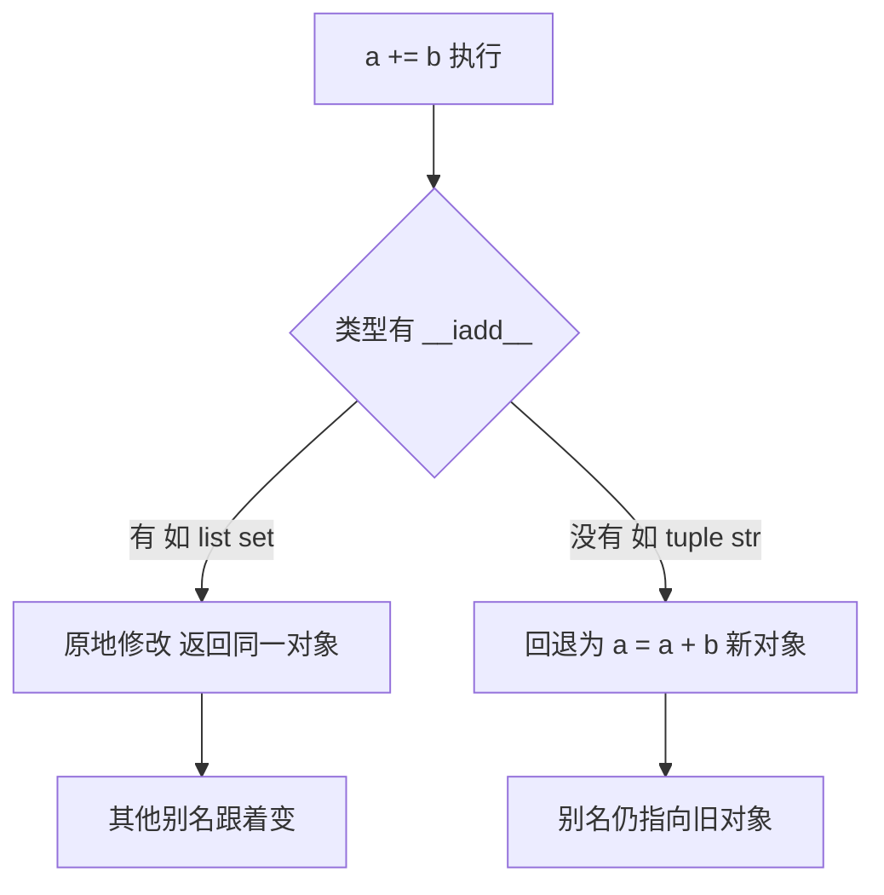

### Q530 · __iadd__ 与 +=:可变与不可变的分歧

> 难度:★★★☆ | 标签:运算符, 可变与不可变

**问**:`a += b` 什么时候原地修改、什么时候新建对象?为什么 list 的 += 会让别名跟着变而 tuple 不会?

**答**:`a += b` 先找 `__iadd__`(就地加):有就原地修改并返回 self,绑定名字不变——list/set/dict(update 语义)属于此类,共享引用全部可见;没有 __iadd__ 就回退 `a = a + b`:不可变类型(tuple/str/int)只有 __add__,产生新对象再重新绑定,别名仍指旧对象。同一运算符在可变/不可变类型上语义分裂,是「函数里 += 参数」类 bug 的根源。自定义类型实现 __iadd__ 必须返回 self(或新对象,但那样要保证返回值被重新绑定,语义混乱)。

```python
# file: code/01_语言核心与底层/q530_iadd.py
a = [1, 2]
b = a
a += [3]                                  # list 有 __iadd__:原地,b 跟着变
print(a, b, "same object:", a is b)

x = (1, 2)
y = x
x += (3,)                                 # tuple 无 __iadd__:回退 x = x + (3,)
print(x, y, "same object:", x is y)

s1, s2 = "ab", "ab"
id_before = id(s1)
s1 += "c"
print(s1, s2, "rebound:", id(s1) != id_before)

class Basket:
    def __init__(self, items):
        self.items = items

    def __iadd__(self, other):
        self.items.extend(other)          # 原地修改
        return self                       # 必须返回 self

    def __repr__(self):
        return f"Basket({self.items})"

if __name__ == "__main__":
    basket = Basket(["pen"])
    alias = basket
    basket += ["book"]
    print(basket, "alias same:", alias is basket)
```

**追问**:1) 为什么 `s1 += "c"` 在 CPython 里 id 有时不变?——1b Q425 讲过:引用计数为 1 的 str 会「原地复用」缓冲,这是实现细节优化,语义上仍是新字符串,绝不能依赖。2) += 与 + 的语义分界?——+= 先找 __iadd__,没有再回退 __add__ 加重新绑定;可变对象就地修改返回 self,不可变对象只能重建,所以 list 就地、str 重绑。3) 字节码与优化器?——INPLACE_ADD 指令走 C 层 do_richinplace 分派;unicode 拼接的「引用计数为 1 才原地」是解释器优化,跨实现(Pypy)与多引用场景都不成立。4) 生产陷阱?——多线程下 += 是 LOAD/ADD/STORE 三步不原子,计数要锁或 itertools.count;对属性做 += 触发 __get__ 与 __set__ 两次描述符调用,自定义描述符要防;可变默认参数 + += 组合出经典状态泄漏。


