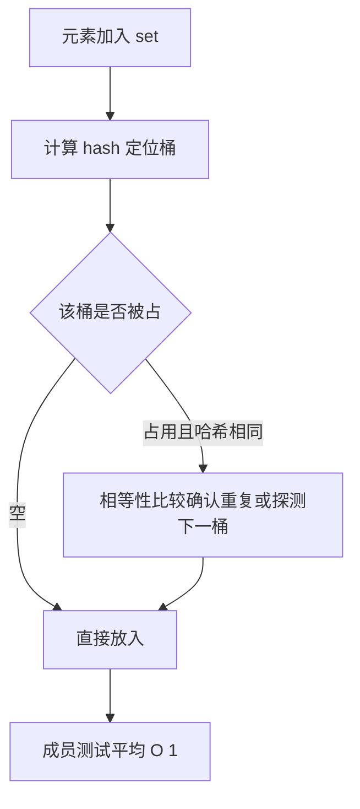

### Q536 · set 与 frozenset:实现与运算

> 难度:★★★☆ | 标签:集合, 哈希

**问**:set 的成员测试为什么平均 O(1)?frozenset 什么时候必须用?

**答**:set 底层是开放寻址哈希表(与 dict 同族但只有键):hash 定位桶、碰撞线性探测,平均 O(1)。运算符语义:并 | 交 & 差 - 对称差 ^,子集 <=;frozenset 是不可变版,可哈希——需要「集合的集合」或「dict 的集合键」时必须用它,普通 set 不可哈希直接 TypeError。陷阱:空集合是 set() 而不是 {}(那是空 dict);set 的元素顺序是实现细节,跨版本不可依赖;add 已存在元素是无操作不报错,去重语义因此幂等。

```python
# file: code/01_语言核心与底层/q536_set_frozenset.py
a = {1, 2, 3}
b = {3, 4}

if __name__ == "__main__":
    print("union:", a | b, "intersection:", a & b)
    print("difference:", a - b, "symmetric:", a ^ b)
    print("subset:", {1, 2} <= a)

    fs = frozenset(b)
    d = {fs: "hashable set"}              # frozenset 可做 dict key
    print(d[fs])

    try:
        {a: "x"}                          # 可变 set 不可哈希
    except TypeError as e:
        print("unhashable:", e)

    empty = set()
    print("empty set is not dict:", type(empty).__name__)
```

**追问**:1) set 和 dict 的哈希表实现差在哪?——set 的条目只有哈希+键,更省内存、缓存更友好;dict 的条目多了值指针与插入序,3.6 后 dict 是紧凑+稀疏两层,set 是单层稀疏表。2) 集合运算的语义细节?——& | - ^ 生成新集合,对应 &= 等原地版;issubset/issuperset 接受任意可迭代;求「有没有交集」用 isdisjoint 可短路,不用构造差集。3) 底层探测机制?——开放寻址 + 扰动线性探测,负载因子超阈值重建表;frozenset 缓存自身哈希,可做另一个 set 的元素。4) 生产陷阱?——自定义元素 __eq__/__hash__ 不一致导致查不到已存对象;遍历 set 时增删抛 RuntimeError;热路径把 list 当 set 用成员测试。


