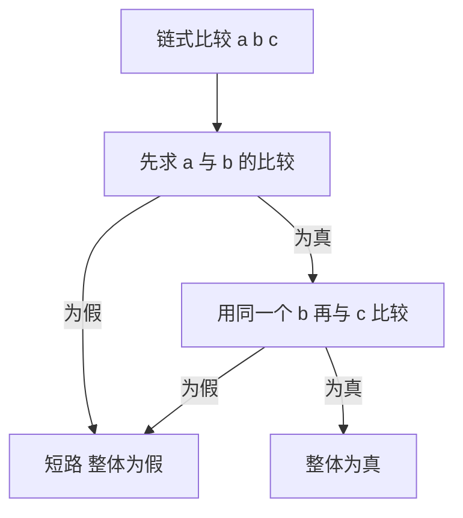

### Q541 · 链式比较的求值:短路与非传递

> 难度:★★☆☆ | 标签:比较, 求值顺序

**问**:`1 < x < 10` 与 `1 < x and x < 10` 的区别?NaN 参与链式比较会发生什么?

**答**:链式比较 a < b < c 等价于 `a < b and b < c`,但 b **只求值一次**(and 写法求值两次)——对带副作用的表达式这是行为差异而非语法糖。每段从左到右短路:第一段为假则后续表达式不再求值。这个语法源于数学记号,适合区间判断;陷阱在非传递关系(如 NaN):nan < 1 与 1 < nan 全为 False,链式 nan < x < y 恒 False 但不报错,静默错误;另一个坑是 `(1 < 2) == True` 与 `1 < 2 == True` 语义完全不同(后者是链式)。

```python
# file: code/01_语言核心与底层/q541_chained_comparison.py
calls = []

def observed(label, value):
    calls.append(label)
    return value

if __name__ == "__main__":
    calls.clear()
    result = observed("a", 1) < observed("b", 5) < observed("c", 10)
    print(result, "evaluated:", calls)    # a b c:中间值只算一次

    calls.clear()
    result2 = observed("a", 1) < observed("b", 0) < observed("c", 10)
    print(result2, "evaluated:", calls)   # c 被短路跳过

    print(1 < 2 < 3)                      # 区间判断的惯用法
    print(3 > 2 == 2)                     # 链式:3>2 and 2==2 → True
    print((3 > 2) == 2)                   # 括号改变语义 → False
```

**追问**:1) 为什么说链式比较对副作用是行为差异?——observed("b") 在链式里只调用一次、and 写法调用两次,日志/计数类副作用直接翻倍;纯函数则结果一致。2) 链式比较的语义?——a < b < c 等价 (a < b) and (b < c),b 只求值一次;运算符可不同(0 <= x < 10);全 True 才 True,与 and 一样短路。3) 字节码实现?——中间值靠 DUP_TOP/COPY 类指令复制栈顶,而不是重新求值——「一次求值」是字节码层保证的,不是优化碰运气。4) 生产陷阱?——中间表达式有副作用(计数、IO)被减半的误判;链式里混入 None 比较 TypeError;超长链可读性差,该拆命名变量;测试里对带副作用表达式做链式断言导致计数偏差。


