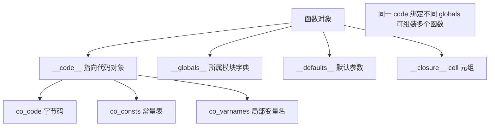

### Q547 · 函数对象与 code 对象:__code__

> 难度:★★★★ | 标签:字节码, 函数

**问**:函数对象和它的 __code__ 各自装着什么?同一个 code 对象能「复活」成多个函数吗?

**答**:函数对象 = code 对象 + 运行环境:__code__ 是编译产物(字节码、常量表 co_consts、局部名 co_varnames、参数个数),而 __globals__、__defaults__、__closure__、__name__、__doc__ 属于函数对象——同一份 code 可以绑定不同 globals 组装出行为不同的函数(types.FunctionType(code, globals)),这就是「代码与执行环境分离」。用途:动态重建函数、序列化纯函数(code + globals 白名单)、深度内省(检查函数用了哪些全局名)。修改 __code__ 属于黑客行为,正常工程只读。

```python
# file: code/01_语言核心与底层/q547_code_object.py
import types

def greet(name):
    return f"hello {name}"

def other(name):
    return f"hi {name}"

if __name__ == "__main__":
    code = greet.__code__
    print(type(code).__name__)
    print("varnames:", code.co_varnames)
    print("consts:", code.co_consts)
    print("argcount:", code.co_argcount)

    rebound = types.FunctionType(code, other.__globals__, "greet2")
    print("rebuilt function:", rebound("CPython"))
    print("same code object:", rebound.__code__ is code)
```

**追问**:1) 闭包的 cell 对象在函数对象哪里?——__closure__ 是 cell 元组,与 __code__.co_freevars 一一对应;cell 是「可变引用盒」,这正是闭包能跨调用共享变量的容器。2) code 对象与函数对象的关系?——code 是编译产物(字节码、常量、名字表、栈大小);函数对象 = code + 默认参数 + closure + globals 引用的运行时壳,同一 code 可生成多个函数。3) 底层可见的调试信息?——co_varnames(局部)、co_freevars(闭包)、co_names(全局/属性)、co_consts(含嵌套函数的 code);dis.dis 直接反汇编。4) 生产陷阱?——直接替换 __code__ 的黑魔法破坏一致性;lambda 的 __name__ 是 <lambda>,监控聚合全是同一名字,要配 functools.wraps 或命名函数。


