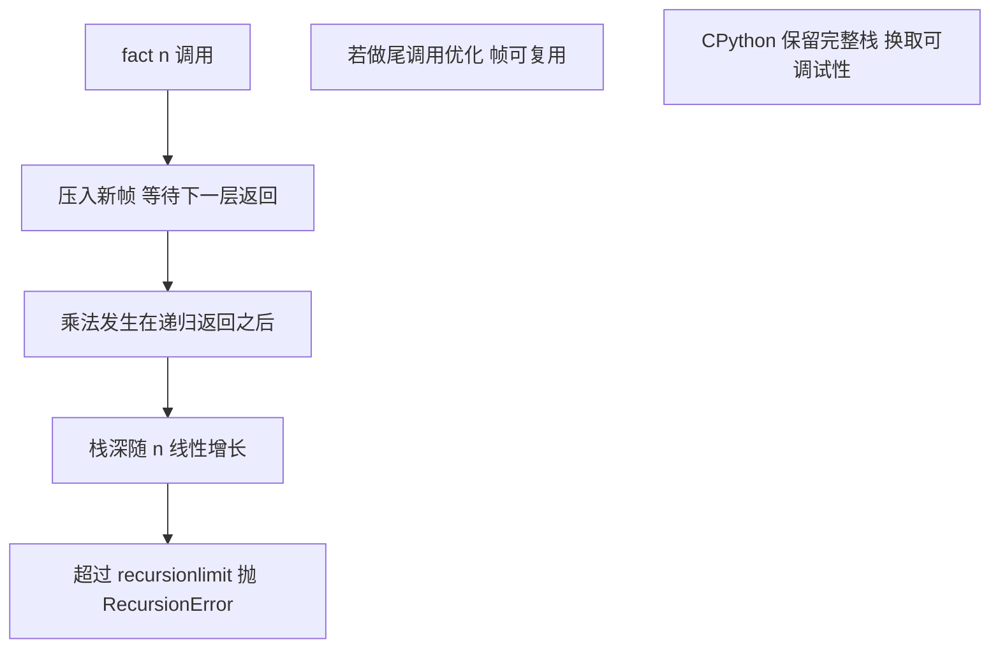

### Q553 · 没有尾调用优化:递归深度与栈

> 难度:★★★☆ | 标签:递归, 栈

**问**:为什么 Python 不做尾调用优化?递归转迭代的工程手法有哪些?

**答**:每次调用压入新帧、保留局部变量与返回地址,递归深度线性吃栈,超过 sys.getrecursionlimit(默认 1000,防 C 栈溢出)抛 RecursionError。Guido 的立场:尾调用优化会破坏 traceback(调用栈不完整,排障变难)且与「清晰的栈语义」冲突。工程替代:1) 循环改写(累加器模式);2) 显式栈模拟递归(深树遍历);3) functools.reduce 归约;4) 真需要深递归的算法换分治/迭代版本。注意递归限制可调(sys.setrecursionlimit)但调大可能直接段错误——Python 帧小,C 栈有限。

```python
# file: code/01_语言核心与底层/q553_no_tail_call.py
import sys

def fact(n):
    if n <= 1:
        return 1
    return n * fact(n - 1)                # 乘法在递归返回后:不是尾调用

def fact_iter(n):
    acc = 1
    while n > 1:                          # 迭代:O(1) 栈
        acc *= n
        n -= 1
    return acc

if __name__ == "__main__":
    print(fact(10), fact_iter(10))
    print("recursion limit:", sys.getrecursionlimit())
    try:
        fact(3000)
    except RecursionError as e:
        print("RecursionError:", str(e)[:40])
    print("iterative deep:", len(str(fact_iter(3000))), "digits, no problem")
```

**追问**:1) 1b Q409 讲过帧,这里递归的栈在 C 层还是 Python 层?——Python 帧在堆上的帧对象链(不受 C 栈限制的部分),但每次 Python 调用同时消耗 C 栈(eval循环嵌套),所以限制本质是保护 C 栈;生成器/协程挂起不占 C 栈,这是它们能做超深遍历的原因。2) 为什么 CPython 不做尾调用优化?——保持完整帧是调试器与 traceback 的根基,尾调用会让栈信息失真;这是刻意的设计取舍,不是没实现。3) 递归限制的构成?——sys.getrecursionlimit 是 Python 帧软限制;3.11+ 加了 C 栈溢出保护,把「调大 limit 直接段错误」变成受控异常;线程的 C 栈大小独立可调。4) 生产陷阱?——深递归改显式栈/迭代;调 setrecursionlimit 掩盖算法问题;子线程递归深度与主线程不同(stack_size 默认值差异)。


