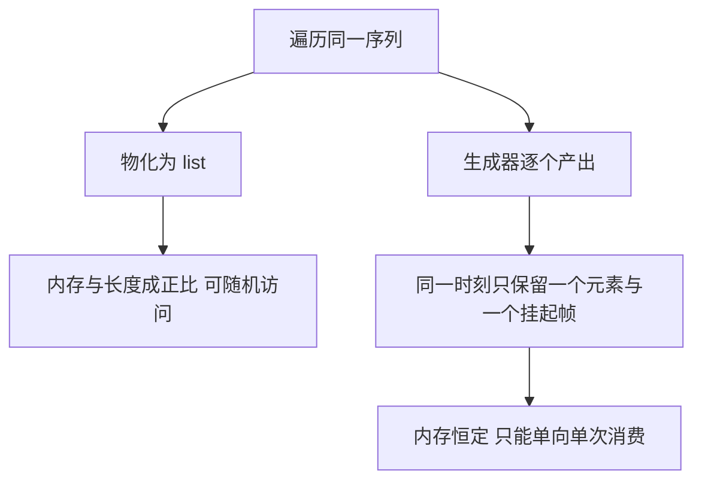

### Q554 · 生成器挂起帧:惰性的内存本质

> 难度:★★★★ | 标签:生成器, 内存

**问**:生成器为什么能遍历十亿个数而不爆内存?挂起的帧放在哪里、占多少?

**答**:普通函数调用栈帧随返回销毁;生成器的帧被「冻结」在堆上的生成器对象里(gi_frame):执行到 yield 时局部变量、求值位置(gi_lasti)全部保存在帧中,控制权返回调用者;next 时恢复现场继续——同一时刻只有一个「当前元素」活在内存,数据流不物化。内存对比:list(range(10**6)) 是约 8MB 的连续指针数组加 10**6 个 int 对象;生成器对象本身约 200 字节(帧 + code 引用),元素按需创建、用完即弃(配合 GC)。代价:不能随机访问、不能 len、只能单向单次。

```python
# file: code/01_语言核心与底层/q554_generator_frame.py
import sys

def read_big(n):
    for i in range(n):
        yield i                           # 挂起:整条流水线只保留一个帧

if __name__ == "__main__":
    n = 1_000_000
    gen = read_big(n)
    print("generator object:", sys.getsizeof(gen), "bytes")
    print("suspended frame exists:", gen.gi_frame is not None)

    lst = list(range(n))
    print("materialized list:", sys.getsizeof(lst) // 1024, "KB (pointers only)")

    print("first item:", next(gen))
    print("after next, still one frame:", sys.getsizeof(gen))
    del lst                               # 释放物化列表
```

**追问**:1) 生成器链(G1 委托 G2 委托 G3)的内存是相加还是相乘?——相加:每级一个挂起帧,固定常数;对比「每级物化一个列表」的相乘级内存,这是流式架构的数学优势。2) 挂起帧存什么?——f_locals、f_lasti(指令指针)、求值栈快照,帧对象在堆上由生成器持有;恢复时按 f_lasti 继续执行,这就是「暂停-恢复」的全部状态。3) 与协程的关系?——协程的 cr_frame 同构,asyncio 的百万协程就是百万个堆上帧;挂起不占 C 栈,内存每协程 KB 级——这是异步高并发的物理基础。4) 生产陷阱?——长期不消费的生成器把上游文件句柄挂在帧里;链上某级引用大对象;忘 aclose 靠 GC 兜底,清理时机不可控。


