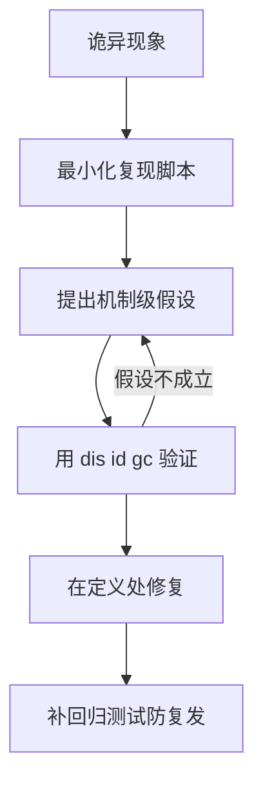

### Q560 · 疑难杂症排查方法论:从现象到机制

> 难度:★★★★★ | 标签:排查, 方法论

**问**:面对「代码输出和我预期不一样」,你的标准排查流程是什么?用闭包 late binding 走一遍。

**答**:五步法:1) 最小复现——删到只剩十几行仍能复现,排除环境噪音;2) 表述假设——用语言机制解释(「闭包捕获的是变量绑定不是值快照」);3) 机制验证——不靠猜:看 __closure__ 的 cell、dis 字节码(LOAD_DEREF 证明运行时才读)、id/getrefcount 验证引用;4) 在定义处修复——lambda n=n 用默认参数固定值,而不是在调用处绕;5) 补回归测试,把机制写进断言注释。通用工具箱:dis 看编译事实、gc/weakref 看引用关系、traceback 与 f_back 看调用链、sys.getsizeof/tracemalloc 看内存。面试中展示「验证动作」比背结论更能证明功底。

```python
# file: code/01_语言核心与底层/q560_debug_methodology.py
import dis

def mystery():
    funcs = []
    for n in [1, 2, 3]:
        funcs.append(lambda: n * 10)
    return funcs

if __name__ == "__main__":
    results = [f() for f in mystery()]
    print("surprising:", results)                 # [30, 30, 30]

    # 第一步后:验证机制——闭包 cell 里存的是什么
    f = mystery()[0]
    cell = f.__closure__[0]
    print("cell content:", cell.cell_contents)

    # 反汇编验证:LOAD_DEREF 说明运行时才读 cell
    for ins in dis.get_instructions(f):
        if ins.opname.startswith("LOAD"):
            print(" ", ins.opname, ins.argrepr)

    # 定义处修复:默认参数在创建时绑定值
    def fixed():
        funcs = []
        for n in [1, 2, 3]:
            funcs.append(lambda n=n: n * 10)
        return funcs

    print("fixed:", [g() for g in fixed()])
    print("methodology: repro -> hypothesis -> verify with dis/id -> fix at definition -> regression")
```

**追问**:1) 如果验证手段本身(如 settrace)改变了行为怎么办?——海森 bug 的标准对策:换更底层的观察点(字节码静态分析、gc 钩子、日志埋点)替代侵入式追踪,并把观察逻辑放到独立的、不影响时序的位置。2) 完整排查链条?——现象(日志/监控)→ 最小复现 → 机制假设(字节码/GC/调度/导入)→ 证据(dis、gc.get_stats、tracemalloc、strace)→ 修复加回归测试;每步只改一个变量,假设必须能被证伪。3) 工具箱分层?——语言层 dis/gc/weakref,运行时 tracemalloc/sys._current_frames,系统层 strace/lldb/perf;生产环境只上非侵入埋点,调试器留在开发。4) 生产陷阱?——在生产挂交互式调试器改时序;修复只对现象打补丁不留回归测试;把偶发问题归为「环境差异」不了了之。


