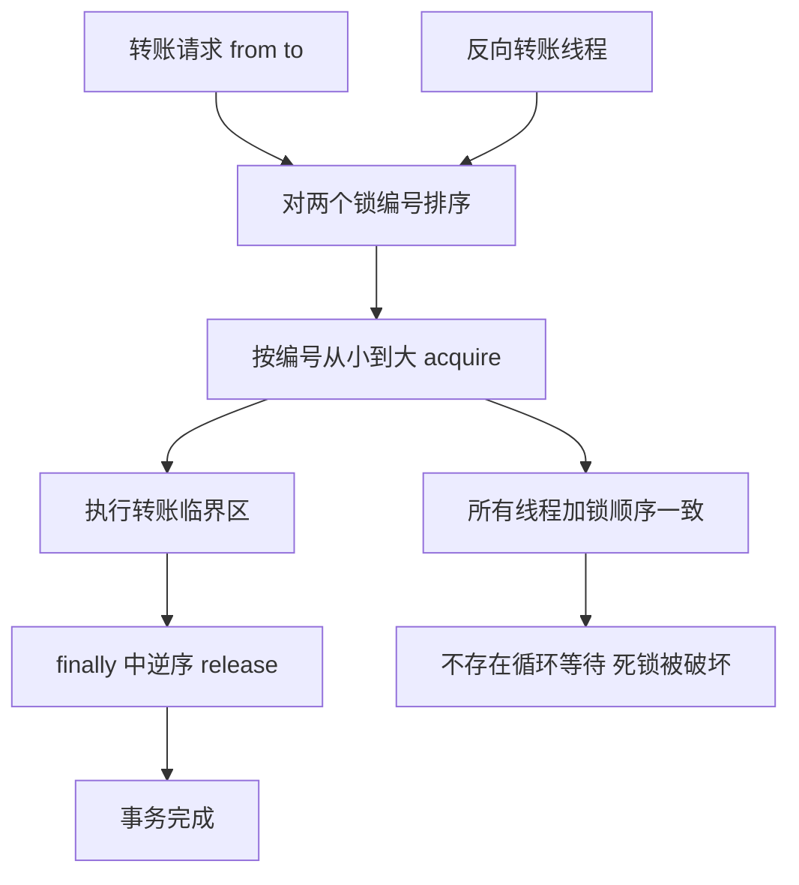

### Q055 · 死锁的避免策略

> 难度:★★★ | 标签:threading, 死锁, 锁排序

**问**:有哪些工程上可行的死锁避免策略?

**答**:常用四招:1) 锁排序——给锁全局编号,所有线程按同一顺序加锁,破坏循环等待;2) 尽量缩小临界区,一次性申请所有需要的锁再执行;3) acquire 带 timeout,失败后释放已持有的锁重试;4) 减少锁的数量,能用一个对象封装的临界区不要拆成多把锁。

```python
# file: code/02_并发与网络工程/q055_deadlock_avoid.py
import threading
import time

lock1 = threading.Lock()
lock2 = threading.Lock()
locks = {1: lock1, 2: lock2}


def acquire_sorted(ids: list[int]):
    # 统一按编号排序加锁, 破坏循环等待
    ordered = sorted(ids)
    for i in ordered:
        locks[i].acquire()
    return ordered


def release_all(ordered: list[int]) -> None:
    for i in reversed(ordered):
        locks[i].release()


def transfer(from_id: int, to_id: int) -> None:
    ordered = acquire_sorted([from_id, to_id])
    try:
        print(f"从账户 {from_id} 转到 {to_id}, 持锁顺序 {ordered}")
        time.sleep(0.05)
    finally:
        release_all(ordered)


if __name__ == "__main__":
    threads = [
        threading.Thread(target=transfer, args=(1, 2)),
        threading.Thread(target=transfer, args=(2, 1)),  # 反向转账也安全
    ]
    for t in threads:
        t.start()
    for t in threads:
        t.join()
    print("无死锁完成")
```

**追问**:
- 统一加锁顺序在工程上怎么落地?——给锁分配全局序号,封装 `acquire_many(*locks)` 按序获取、finally 逆序释放,评审禁止绕过工具函数直接拿锁。
- 活锁和死锁的区别?——活锁是线程不断让出重试、谁也前进不了但没有阻塞;用随机退避打破同步重试。
- 数据库死锁和应用层死锁处理有什么不同?——InnoDB 有死锁检测会回滚一个事务(1213 错误,应用捕获重试);threading 死锁没人替你检测,只能预防加 dump 定位。

---



---
