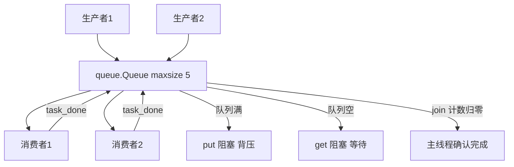

### Q060 · 生产者消费者:queue.Queue 实现

> 难度:★★☆ | 标签:queue, 生产者消费者

**问**:用标准库实现一个多线程生产者消费者,如何控制背压?

**答**:queue.Queue 内部自带锁和条件变量,线程安全且开箱即用;构造时传 maxsize 即可实现有界队列,队列满时 put 阻塞,形成自然背压。用 `q.task_done()` 配合 `q.join()` 判断消费完成,或放 None 哨兵让消费者退出。注:哨兵类型用 `Optional[int]` 标注更兼容——`int | None` 这种 PEP 604 联合类型写法运行时求值要到 Python 3.10 才支持(配合 `from __future__ import annotations` 可提前用于纯注解场景)。

```python
# file: code/02_并发与网络工程/q060_producer_consumer_queue.py
import queue
import threading
import time
from typing import Optional

q: "queue.Queue[Optional[int]]" = queue.Queue(maxsize=5)


def producer(pid: int, count: int) -> None:
    for i in range(count):
        item = pid * 100 + i
        q.put(item)  # 队列满时阻塞, 形成背压
        print(f"生产者 {pid} 生产 {item}")
    q.put(None)  # 哨兵


def consumer(cid: int) -> None:
    while True:
        item = q.get()
        if item is None:
            q.task_done()
            break
        print(f"消费者 {cid} 消费 {item}")
        time.sleep(0.05)
        q.task_done()


if __name__ == "__main__":
    producers = [threading.Thread(target=producer, args=(p, 3)) for p in range(2)]
    consumers = [threading.Thread(target=consumer, args=(c,)) for c in range(2)]
    for t in producers + consumers:
        t.start()
    for t in producers:
        t.join()
    q.join()
    print("所有任务处理完成")
```

**追问**:
- maxsize 满了 put 会怎样?——默认阻塞形成背压;`put_nowait` 抛 queue.Full,要 try 处理或带 timeout,按业务选「等」还是「丢」。
- task_done 和 join 的配对规则?——每个 get 出来的任务处理完必须 task_done 一次,次数不齐 `q.join()` 永久阻塞,这是排查高频点。
- 多消费者怎么优雅退出?——放与消费者等量的哨兵,或 q.join 等清空再退出;只放一个 None 会让其余消费者永久阻塞。

---



---
