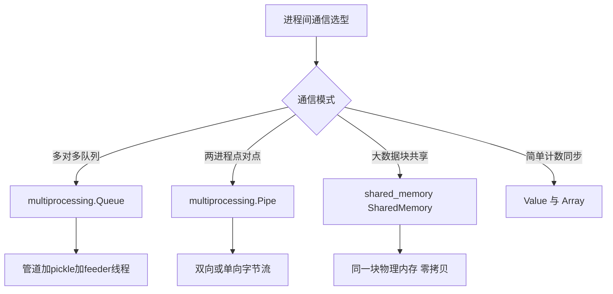

### Q065 · 进程间通信:Pipe

> 难度:★★☆ | 标签:multiprocessing, Pipe, IPC

**问**:Pipe 和 Queue 的区别?各自适合什么场景?

**答**:Pipe 是两个端点间的双向(默认)连接,只适合两个进程点对点通信,速度通常比 Queue 快、开销小;Queue 是多生产者多消费者安全的队列。Pipe 同一端同时被两个进程读写不保证安全;`duplex=False` 时一端只能发另一端只能收。

```python
# file: code/02_并发与网络工程/q065_pipe.py
import multiprocessing


def child(conn) -> None:
    conn.send({"pid_cmd": "hello from child"})
    reply = conn.recv()
    print("child 收到:", reply)
    conn.close()


if __name__ == "__main__":
    parent_conn, child_conn = multiprocessing.Pipe()
    p = multiprocessing.Process(target=child, args=(child_conn,))
    p.start()
    msg = parent_conn.recv()
    print("parent 收到:", msg)
    parent_conn.send("hello from parent")
    p.join()
```

**追问**:
- Pipe 和 Queue 怎么选?——两点之间低延迟双向通信用 Pipe;多生产者多消费者、需要缓冲公平性用 Queue。
- Pipe 同一端并发读写会怎样?——数据流可能交错损坏,每个进程独占一端,或对该端加锁。
- Connection 有什么独门能力?——除了可 pickle 对象,还能经 reduction 直接传文件描述符,这是 Queue 做不到的。

---



---
