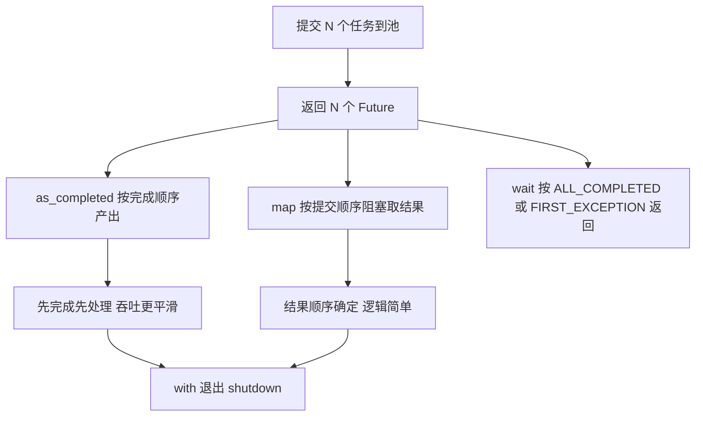

### Q070 · as_completed 与顺序性

> 难度:★★★ | 标签:concurrent.futures, as_completed

**问**:as_completed 解决什么问题?和 wait 的 FIRST_EXCEPTION 参数有什么配合?

**答**:`as_completed(futures)` 按任务"完成顺序"产出 Future,先完成先处理,避免 map 的队头阻塞;配合超时参数可整体限时。`concurrent.futures.wait` 则一次等待多个条件(ALL_COMPLETED/FIRST_COMPLETED/FIRST_EXCEPTION),两种都优于手动轮询。

```python
# file: code/02_并发与网络工程/q070_as_completed.py
import random
import time
from concurrent.futures import ThreadPoolExecutor, as_completed


def task(i: int) -> int:
    delay = random.uniform(0.1, 0.5)
    time.sleep(delay)
    return i


if __name__ == "__main__":
    with ThreadPoolExecutor(max_workers=5) as pool:
        futures = {pool.submit(task, i): i for i in range(5)}
        for fut in as_completed(futures):
            print(f"任务 {futures[fut]} 先完成, 结果 {fut.result()}")
    print("注意完成顺序与提交顺序无关")
```

**追问**:
- as_completed 配整体超时怎么用?——`as_completed(futures, timeout=...)` 超时抛 TimeoutError,已完成结果已产出;未完成任务还在跑,要显式 cancel。
- wait 的 FIRST_EXCEPTION 有什么用?——任一任务抛异常立即返回,适合「快速失败」的批处理:发现失败就取消剩余。
- 结果乱序后怎么对应输入?——给 future 挂 key 属性或用 `{future: key}` 字典映射,完成时按 future 取回业务键。

---



---
