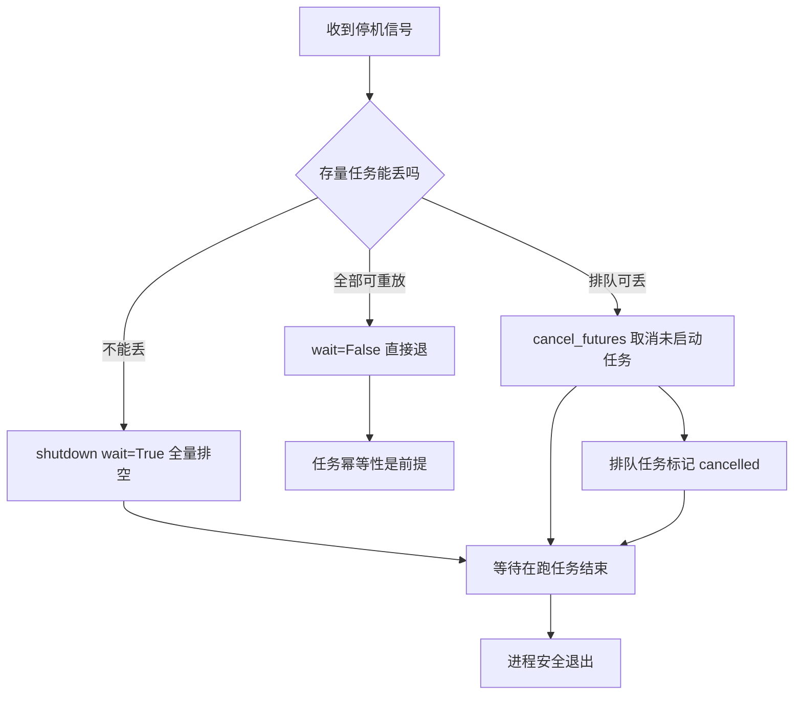

### Q1305 · 线程池排空抉择:等存量还是取消排队

> 难度:★★☆☆ | 标签:线程池, 优雅关闭, cancel_futures

**问**:进程要退出,线程池里还有 500 个排队任务,等还是不等?`cancel_futures=True` 到底取消了什么?

**答**:排空有三档。第一档 `shutdown(wait=True)`:新任务被拒,存量任务全部执行完才返回,适合"任务都不能丢"的场景,代价是退出时间不可控。第二档 `shutdown(wait=True, cancel_futures=True)`:还没开始跑的排队任务直接标记 cancelled,已经在跑的不受影响、跑完为止——这是最常用的中间态,"丢得起排队、丢不起半成品"。第三档 `wait=False` + 强杀:进程直接退,连在跑的也丢,只适合任务天然幂等可重放。注意一个语义细节:cancel_futures 只能取消"从未开始"的任务,Future 已经 running 的 cancel 返回 False。下面的演示对同一批任务跑两种关闭方式,对比完成数与取消数。

```python
# file: code/02_并发与网络工程/q1305_pool_drain_choice.py
import concurrent.futures
import time


def make_task(n: int) -> float:
    return 0.01 if n % 5 else 0.03  # 少量慢任务


def drain_all(jobs: int) -> int:
    with concurrent.futures.ThreadPoolExecutor(max_workers=4) as pool:
        futs = [pool.submit(time.sleep, make_task(i)) for i in range(jobs)]
        concurrent.futures.wait(futs)
        return sum(1 for f in futs if f.done() and not f.cancelled())


def cancel_queued(jobs: int) -> tuple:
    pool = concurrent.futures.ThreadPoolExecutor(max_workers=4)
    futs = [pool.submit(time.sleep, make_task(i)) for i in range(jobs)]
    time.sleep(0.02)                   # 先让 4 个任务跑起来
    pool.shutdown(wait=True, cancel_futures=True)
    done = sum(1 for f in futs if f.done() and not f.cancelled())
    cancelled = sum(1 for f in futs if f.cancelled())
    return done, cancelled


if __name__ == "__main__":
    jobs = 40
    full = drain_all(jobs)
    print(f"排空式关闭: 完成 {full}/{jobs}, 一个不丢")
    done, cancelled = cancel_queued(jobs)
    print(f"取消式关闭: 完成 {done} 个(含在跑的), 排队取消 {cancelled} 个")
    assert done + cancelled == jobs, "每个 Future 必有终态"
    print("排空/取消语义验证通过")
```

**追问**:1) cancel_futures 之后为什么还要 wait=True?——cancel 只清排队区,正在执行的任务会继续跑,不 wait 就等于放任它们和进程退出赛跑,退出时间又不可控了。2) cancel_futures 取消不了什么?——已经 running 的任务 cancel 返回 False,只能等它自然结束;要中断在跑任务必须任务内部自带超时/检查点( cooperative cancellation),线程池没有强制 kill 的手段——这也是 Python 并发取消语义的统一规则。3) 与 asyncio 的排空语义怎么对应?——asyncio 的 TaskGroup/ cancelling 同样是「协作式」:取消只是投递 CancelledError,任务要在 await 点或显式检查中响应;两套 API 共享「取消必须协作」的底层哲学,面试能打通这两层是加分项。4) 生产陷阱?——shutdown(wait=False) 后进程退出,daemon 线程里的任务在解释器清理阶段崩溃报错;排队任务里持有锁/连接,cancel 后资源没释放;把 wait=True 当「事务提交」——任务失败时没有回滚语义。

---



---
