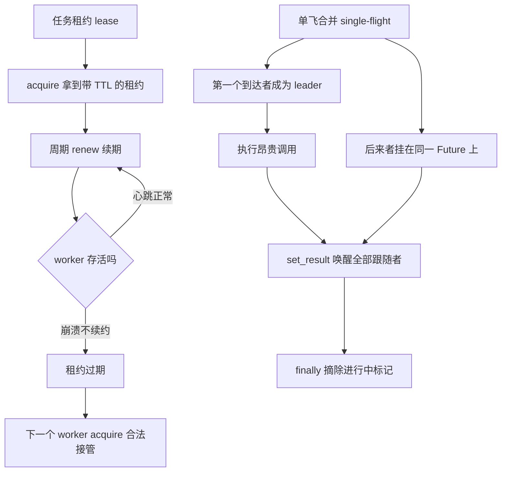

### Q1310 · 任务租约:心跳停了才允许别人接手

> 难度:★★★★ | 标签:租约, takeover, 分布式模式

**问**:一个后台任务只能有一个 worker 在跑,worker 崩溃后怎么让别的进程安全接手?

**答**:用租约(lease)而不是一把永久锁:worker 先 acquire 拿到带 TTL 的租约,持有期间必须周期性 renew 续期;worker 崩溃后没人续期,租约自然过期,下一个 acquire 者合法接管。三个要点:第一,时钟用单调钟,租约过期判断只信"记录的到期时间 vs 现在的单调值",不要两边各自算剩余时间。第二,renew 必须校验持有者身份——只允许当前 owner 续自己的租约,防止过期后被新 owner 接管、旧 worker 恢复又把租约改回去的"僵尸复活"。第三,TTL 要远大于续约周期(工程上 3-10 倍),否则网络抖动一次就误判崩溃。下面的演示完整走一遍"持锁-续约-假死-过期-接管"。

```python
# file: code/02_并发与网络工程/q1310_task_lease.py
import threading
import time


class LeaseManager:
    def __init__(self, ttl: float) -> None:
        self._ttl = ttl
        self._lock = threading.Lock()
        self._leases = {}   # task -> (owner, expire_at)

    def acquire(self, task: str, owner: str) -> bool:
        now = time.monotonic()
        with self._lock:
            cur = self._leases.get(task)
            if cur is not None and cur[1] > now:
                return False            # 仍被有效持有
            self._leases[task] = (owner, now + self._ttl)
            return True

    def renew(self, task: str, owner: str) -> bool:
        now = time.monotonic()
        with self._lock:
            cur = self._leases.get(task)
            if cur is None or cur[0] != owner or cur[1] <= now:
                return False            # 不是你的或已过期, 拒绝续期
            self._leases[task] = (owner, now + self._ttl)
            return True

    def release(self, task: str, owner: str) -> None:
        with self._lock:
            cur = self._leases.get(task)
            if cur and cur[0] == owner:
                del self._leases[task]


def main() -> None:
    mgr = LeaseManager(ttl=0.4)
    timeline = []

    # worker A: 正常续约两轮后假死
    assert mgr.acquire("job", "A")
    timeline.append("A 拿到租约")
    for _ in range(2):
        time.sleep(0.1)
        assert mgr.renew("job", "A")
    timeline.append("A 续约 2 次成功, 随后假死")

    assert not mgr.renew("job", "bogus"), "其他身份不能续 A 的租约"
    assert not mgr.acquire("job", "B"), "租约有效期内 B 不能抢"
    timeline.append("B 尝试接管被拒")

    time.sleep(0.45)                    # A 不再续约, 租约过期
    assert mgr.acquire("job", "B"), "过期后 B 应能接管"
    timeline.append("租约过期, B 合法接管")

    assert mgr.renew("job", "B")
    mgr.release("job", "B")
    assert mgr.acquire("job", "C")
    timeline.append("B 主动释放, C 立即接手")

    for line in timeline:
        print(line)
    print("租约生命周期验证通过")


if __name__ == "__main__":
    main()
```

**追问**:1) 持有者的任务还在跑、但租约已过期被别人接管,怎么办?——持有者每次关键写操作前都必须先 renew 确认自己仍是 owner,失败就立刻自杀停手;这是"租约栅栏"思想,单靠后台续约线程防不住脑裂。2) 为什么 TTL 要远大于续约周期?——网络抖动/负载尖峰让一次续约迟到,若 TTL 与周期接近,租约刚到就被夺走,产生双主;3-10 倍的余量把「一次续约失败」容忍住,代价是故障接管变慢——这是可用性与正确性的经典权衡。3) 栅栏(fencing)怎么做才彻底?——租约带单调递增的 fencing token,持有者每次写操作携带 token,存储端拒绝旧 token——这才是防脑裂的完备方案;只靠「写前 renew 确认」仍有窗口(renew 后、写之前被夺走),面试能说出 fencing token 是 L3 信号。4) 生产陷阱?——时钟用 time.time(NTP 跳变让租约提前/延后过期);续约校验没验 owner 身份,新旧 worker 互相覆盖;崩溃 worker 恢复后不清场,继续写(僵尸复活);TTL 存储用本地内存,多机部署时各自看各自的钟。

---



---
