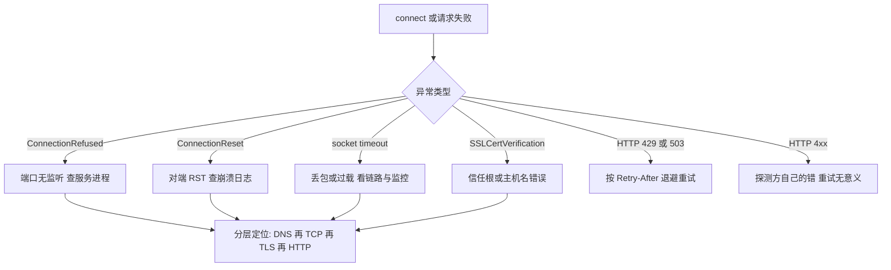

### Q1315 · HTTP 探测与重试预算:状态码分类处理

> 难度:★★★☆ | 标签:HTTP, 健康探测, 重试

**问**:写一个 HTTP 健康探测器,对 4xx、429、5xx、连接失败分别怎么处理?

**答**:核心是"状态码不是错误,是处置指令"。2xx=健康;429 与 503 携带 Retry-After,属于"已知限流/过载",要按服务端指示退避重试;其余 5xx 属"服务端异常",小步重试;4xx(除 429)基本是探测方自己的错(路径错、鉴权错),重试无意义,直接标失败;连接层失败(拒绝、超时)与 5xx 同类。每次探测记录"最终结论 + 尝试次数 + 各次状态",重试次数要有硬上限,防止探测本身变成流量攻击。下面的演示里,目标服务前两次返回 503、第三次 200,探测器按预算重试后转绿。

```python
# file: code/02_并发与网络工程/q1315_http_probe_retry.py
import http.client
import threading
import time
from http.server import BaseHTTPRequestHandler, ThreadingHTTPServer


class FlakyApp(BaseHTTPRequestHandler):
    hits = {"n": 0}
    lock = threading.Lock()

    def do_GET(self):
        with self.lock:
            FlakyApp.hits["n"] += 1
            n = FlakyApp.hits["n"]
        if self.path == "/health" and n <= 2:
            self.send_response(503)
            self.send_header("Retry-After", "1")
            self.end_headers()
            self.wfile.write(b"warming up")
        elif self.path == "/health":
            self.send_response(200)
            self.end_headers()
            self.wfile.write(b"ok")
        else:
            self.send_response(404)
            self.end_headers()
            self.wfile.write(b"no route")

    def log_message(self, *args):
        pass


def classify(status: int) -> tuple:
    if 200 <= status < 300:
        return "healthy", False
    if status in (429, 503):
        return "throttled", True     # 尊重 Retry-After 退避重试
    if 500 <= status < 600:
        return "server_error", True
    return "client_error", False     # 4xx 重试无意义


def probe(host: str, port: int, path: str, max_attempts: int = 3) -> dict:
    attempts = []
    verdict = None
    for i in range(1, max_attempts + 1):
        conn = http.client.HTTPConnection(host, port, timeout=2)
        try:
            conn.request("GET", path)
            resp = conn.getresponse()
            body = resp.read()
            status = resp.status
            retry_after = resp.getheader("Retry-After")
        finally:
            conn.close()
        kind, retryable = classify(status)
        attempts.append(status)
        print(f"  第 {i} 次探测: {status} -> {kind}")
        if not retryable:
            verdict = kind
            break
        if i < max_attempts:
            wait = float(retry_after) if retry_after else 0.1
            time.sleep(min(wait, 0.1))   # 演示加速, 真实应尊重原值
    if verdict is None:
        verdict = "unhealthy_after_retries"
    return {"path": path, "attempts": attempts, "verdict": verdict}


def main() -> None:
    srv = ThreadingHTTPServer(("127.0.0.1", 0), FlakyApp)
    port = srv.server_address[1]
    threading.Thread(target=srv.serve_forever, daemon=True).start()

    print("/health 前 2 次 503:")
    r1 = probe("127.0.0.1", port, "/health")
    print(f"结论: {r1['verdict']}, 共尝试 {len(r1['attempts'])} 次")
    assert r1["verdict"] == "healthy"

    print("/missing 路径 404:")
    r2 = probe("127.0.0.1", port, "/missing")
    print(f"结论: {r2['verdict']}, 只尝试 {len(r2['attempts'])} 次就放弃")
    assert r2["verdict"] == "client_error" and len(r2["attempts"]) == 1
    srv.shutdown()


if __name__ == "__main__":
    main()
```

**追问**:1) 探测器要不要跟业务客户端共用一套重试策略?——不该完全共用:探测重试要更克制(上限更低、退避更保守),否则依赖故障时探测流量本身会放大压力,出现"探测把服务探死"的怪圈。2) 429 与 503 的语义差异?——429=你这个客户端被限流(配额问题,可能与你无关的他人正常);503=服务整体过载/不可用;处置差异:429 看 Retry-After 等,503 看服务健康面(可能要切流量);探测器把两者混为一类,告警归属就错了。3) 重试预算怎么落到探测上?——探测重试上限更低(2-3 次)、退避更保守(见原问);预算独立于业务客户端,避免「探测与业务同时放大压力」;每次尝试的状态与耗时都要记录,最终结论附尝试链。4) 生产陷阱?——把 4xx 一律当健康检查失败(路径/鉴权配置错与依赖故障混在一起);无视 Retry-After 硬重试;探测成功但响应时间没记录,「活着但 10 秒才回」漏检;重试无硬上限,依赖故障时探测自身变成攻击源。

---



---
