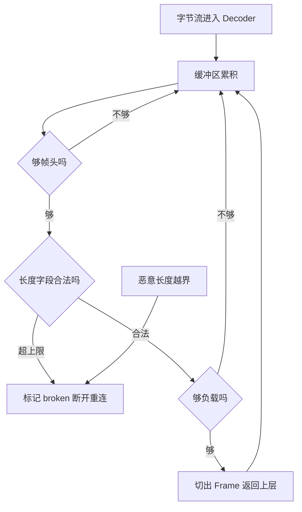

### Q1320 · 帧编解码器对象化:Encoder 与 Decoder 分离

> 难度:★★★☆ | 标签:帧协议, 编解码器, API 设计

**问**:设计一个帧协议的编解码器,API 怎么分层才好维护?

**答**:三个设计决策。第一,Encoder 和 Decoder 分成两个对象:编码是纯函数式的"帧进字节出",无状态;解码天生有状态(要记住半包残留),混在一起接口会脏。第二,Frame 用 dataclass 承载,带上类型与负载字段,禁止让上层直接摸 bytes——类型安全与可读性都来自这层抽象。第三,Decoder 暴露 feed(bytes) -> list[Frame]:喂多少字节无所谓,凑够几帧就吐几帧,凑不齐就攒着;长度字段越界(超过 max_frame)要立刻拒绝并进入"不可用"状态,防止恶意长度把内存打爆。这个 API 形状让它天然适配任何传输层:同步 socket、asyncio、甚至测试里的假字节流。下面的演示把三帧数据切成不规则碎片喂入,验证完整解码。

```python
# file: code/02_并发与网络工程/q1320_frame_codec.py
import random
from dataclasses import dataclass

HEADER_LEN = 4   # 2 字节类型 + 2 字节负载长度(大端)
MAX_FRAME = 0xFF00   # 2 字节长度上限之内再留一条业务红线, 越线即恶意帧


@dataclass(frozen=True)
class Frame:
    msg_type: int
    payload: bytes


class EncodeError(ValueError):
    pass


DecodeError = EncodeError   # 解码失败与编码失败同族, 便于上层统一 except


class DecoderBroken(Exception):
    pass


def encode(frame: Frame) -> bytes:
    if len(frame.payload) >= MAX_FRAME:
        raise EncodeError(f"负载 {len(frame.payload)} 超过上限 {MAX_FRAME}")
    return frame.msg_type.to_bytes(2, "big") + len(frame.payload).to_bytes(2, "big") + frame.payload


class FrameDecoder:
    """有状态的流式解码器: feed 任意碎片, 吐出完整帧。"""

    def __init__(self, max_frame: int = MAX_FRAME) -> None:
        self._buf = bytearray()
        self._max = max_frame
        self._broken = False

    def feed(self, data: bytes) -> list:
        if self._broken:
            raise DecoderBroken("解码器已因非法帧报废, 应重连")
        self._buf.extend(data)
        frames = []
        while True:
            if len(self._buf) < HEADER_LEN:
                break
            msg_type = int.from_bytes(self._buf[0:2], "big")
            length = int.from_bytes(self._buf[2:4], "big")
            if length > self._max:
                self._broken = True     # 恶意长度: 立刻拒绝而不是试图跳过
                raise DecodeError(f"声明的负载长度 {length} 超过上限")
            if len(self._buf) < HEADER_LEN + length:
                break                    # 半包: 继续攒
            payload = bytes(self._buf[HEADER_LEN:HEADER_LEN + length])
            del self._buf[:HEADER_LEN + length]
            frames.append(Frame(msg_type, payload))
        return frames


def main() -> None:
    frames_in = [
        Frame(0x0001, b"hello"),
        Frame(0x0002, bytes(range(64))),
        Frame(0x0003, b"x" * 300),
    ]
    raw = b"".join(encode(f) for f in frames_in)
    print(f"编码得到 {len(raw)} 字节流")

    dec = FrameDecoder()
    rnd = random.Random(42)
    frames_out = []
    pos = 0
    cuts = 0
    while pos < len(raw):
        step = rnd.randint(1, 7)          # 极端碎片化: 1-7 字节一喂
        chunk = raw[pos:pos + step]
        pos += len(chunk)
        frames_out.extend(dec.feed(chunk))
        cuts += 1
    print(f"分 {cuts} 次碎片喂入, 解出 {len(frames_out)} 帧")
    assert frames_out == frames_in, "解码结果必须与原始帧完全一致"

    # 恶意长度必须被拒收: 长度字段写满 0xFFFF, 越过业务红线
    evil = (1).to_bytes(2, "big") + (0xFFFF).to_bytes(2, "big")
    try:
        dec.feed(evil[:2])
        dec.feed(evil[2:])
        print("恶意长度未被拦截!")
    except (DecodeError, DecoderBroken) as exc:
        print(f"恶意长度被拦截: {exc}")
        try:
            dec.feed(b"more")
        except DecoderBroken:
            print("报废状态确认: 后续 feed 直接抛错, 调用方应重连")


if __name__ == "__main__":
    main()
```

**追问**:1) 长度越界为什么直接报废而不是跳过这个"坏头"?——因为流式字节里无法可靠找回帧边界,跳过 4 字节可能正落进下一帧的头里,后续全部错位;唯一安全的动作是断开重连。2) feed 的返回值为什么是 list[Frame] 而不是单个 Frame?——一次 feed 可能带回多帧(粘包),调用方必须批量处理;返回列表让「解析与处理」解耦,处理慢也不阻塞解析(可入队)。3) 不可用状态怎么设计?——长度越界/魔数错后,decoder 进入 poisoned 状态,后续 feed 一律拒绝并断连——「坏状态只出不进」;让上层能区分「这批字节坏了」与「连接完了」,错误恢复策略(Q1331 的断连重同步)才有依据。4) 生产陷阱?——Encoder 与 Decoder 状态混杂(Encoder 偷偷记住上次帧导致跨连接污染);max_frame 校验缺失,恶意长度打爆内存;dataclass Frame 里塞了 bytes 之外的类型忘了类型校验;decoder 复用给新连接忘了 reset(Q1322)。

---



---
