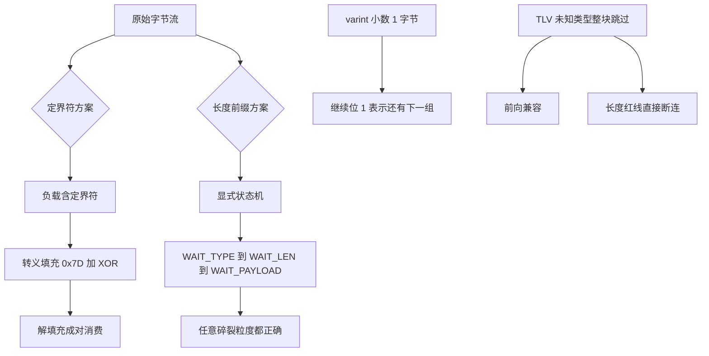

### Q1325 · 文本协议多行应答:SMTP 风格的续行解析

> 难度:★★☆☆ | 标签:文本协议, 多行应答, SMTP

**问**:SMTP 的应答 `250-PIPELINING\r\n250 HELP` 这种格式,解析器怎么判断"应答结束了"?

**答**:规则在每行的第 4 个字符:格式是 `XYZ<分隔符>文本`,XYZ 是三位状态码,第 4 位是 '-' 表示"还有续行",是空格表示"这是最后一行"。解析循环因此非常确定:逐行读,行数凑不齐三位数字是协议错误;末行状态码必须与首行一致。工程细节两个:行分隔必须用 \r\n,手写 split('\n') 会把 \r 留在行尾污染状态码;多行应答期间不能发送任何命令(时序锁定),否则新命令的回显会被误当应答行。这套"数字+分隔符"的行结构还被 FTP、NNTP 沿用,面试时能说出同源性是加分项。下面的演示客户端完整解析服务端的 250 能力列表。

```python
# file: code/02_并发与网络工程/q1325_smtp_multiline_reply.py
import socket
import threading


class ReplyReader:
    """行缓冲必须跨应答存活: 一次 recv 可能带回下一应答的前几行。"""

    def __init__(self, sock: socket.socket) -> None:
        self._sock = sock
        self._buf = b""

    def read_reply(self) -> list:
        lines = []
        while True:
            while b"\r\n" not in self._buf:    # 严格 CRLF, 不吃裸 \n
                chunk = self._sock.recv(256)
                if not chunk:
                    raise ConnectionError("对端在应答中途断开")
                self._buf += chunk
            line, self._buf = self._buf.split(b"\r\n", 1)
            text = line.decode("ascii", errors="replace")
            if len(text) < 3 or not text[:3].isdigit():
                raise ProtocolError(f"应答行格式非法: {text!r}")
            lines.append(text)
            if len(text) == 3 or text[3] == " ":
                return lines                    # 第 4 字符是空格或行止于三位码: 结束
            if text[3] != "-":
                raise ProtocolError(f"第 4 字符既非 '-' 也非空格: {text!r}")


class ProtocolError(ValueError):
    pass


def main() -> None:
    replies = [
        b"220 mail.local ESMTP\r\n",
        b"250-PIPELINING\r\n250-SIZE 10485760\r\n250 HELP\r\n",
    ]
    srv = socket.socket()
    srv.setsockopt(socket.SOL_SOCKET, socket.SO_REUSEADDR, 1)
    srv.bind(("127.0.0.1", 0))
    port = srv.getsockname()[1]
    srv.listen(1)

    def fake_server():
        conn, _ = srv.accept()
        try:
            for r in replies:
                conn.sendall(r)
        finally:
            conn.close()
            srv.close()

    threading.Thread(target=fake_server, daemon=True).start()
    cli = socket.create_connection(("127.0.0.1", port), timeout=2)
    reader = ReplyReader(cli)

    first = reader.read_reply()
    print("单行应答:", first)
    assert first == ["220 mail.local ESMTP"]

    caps = reader.read_reply()
    print("多行应答:", caps)
    assert caps == ["250-PIPELINING", "250-SIZE 10485760", "250 HELP"]
    assert caps[0][:3] == caps[-1][:3], "首末状态码一致"
    print("续行规则验证通过: 第 4 字符 '-' 继续, 空格结束, 状态码首末一致")
    cli.close()


if __name__ == "__main__":
    main()
```

**追问**:1) 为什么多行应答期间禁止发新命令?——服务端按"读到你这行是末行"才认为应答结束,期间塞进来的命令字节会被当成应答文本的一部分,双方状态机直接错位。2) 状态码不一致(首行 250 末行 502)怎么处置?——协议要求末行与首行一致,不一致即协议错误,断连重同步——信任任何一行的语义都可能让状态机错位;这类「跨行一致性」校验是文本协议解析的必修课。3) 与 FTP/NNTP 的同源结构意味着什么?——同一套「XYZ+分隔符」解析器可参数化复用,只是状态码表不同;面试能举一反三说明理解了「应答行协议」这一类,而不是背 SMTP。4) 生产陷阱?——split('\n') 留下 \r 污染状态码解析;把「多行应答中」当「可发命令」(状态机错位,见原问);三位状态码用 int() 解析没校验位数(空行/垃圾行炸出 ValueError);续行的判断用 startswith('-') 而忘了检查前三位是数字。

---



---
