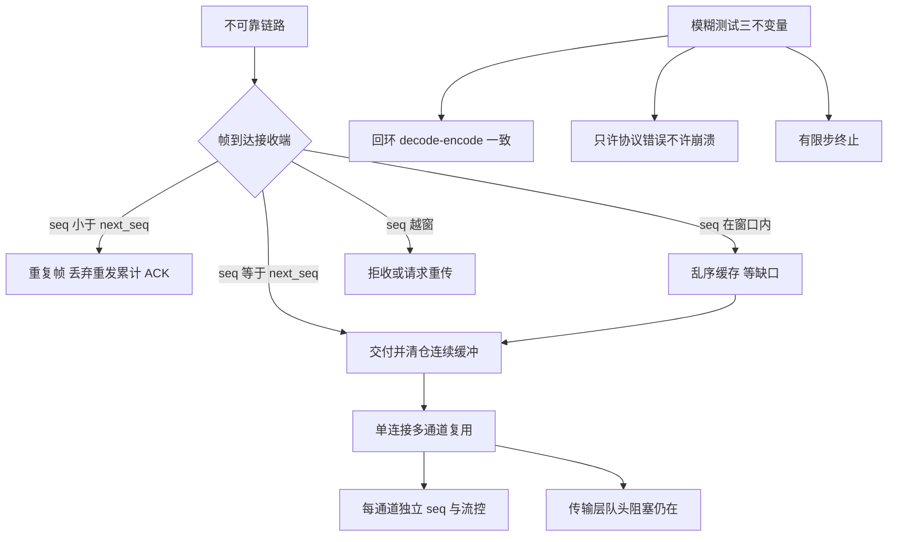

### Q1330 · 协议模糊测试:变异输入与不变量守护

> 难度:★★★★ | 标签:模糊测试, fuzz, 协议健壮性

**问**:没有专门 fuzz 工具,怎么用标准库给协议解析器做一轮模糊测试?要守护哪些不变量?

**答**:模糊测试的骨架是三件套:种子(合法样本)、变异器(翻位、截断、撒谎长度、随机替换)、判据(不变量)。协议解析器要守护的不变量恰好三条:一,回环不变量——decode(encode(x)) == x 对一切合法输入成立;二,崩溃不变量——任何字节序列喂进去,只允许"正常解析"或"抛出协议错误类型",出现其他异常(如 IndexError、struct.error、MemoryError)就是解析器漏洞;三,终止不变量——解析必须有限步结束,恶意长度/循环引用不能让它死循环或吃光内存。判定时把 ProtocolError 算作"健壮",其他异常算 crash。变异要保留原帧的大部分结构(只翻几个位),纯随机字节的发现效率反而低。下面的演示用固定种子跑 5000 个变异样本。

```python
# file: code/02_并发与网络工程/q1330_protocol_fuzzing.py
import random


class ProtocolError(ValueError):
    pass


def encode_frame(msg_type: int, payload: bytes) -> bytes:
    if len(payload) > 0xFFFF:
        raise ProtocolError("payload 超长")
    return bytes([msg_type]) + len(payload).to_bytes(2, "big") + payload


def decode_stream(data: bytes) -> list:
    """合法则返回帧列表, 非法则抛 ProtocolError。绝不允许其他异常逃出。"""
    frames = []
    offset = 0
    while offset < len(data):
        if offset + 3 > len(data):
            raise ProtocolError(f"残余 {len(data) - offset} 字节不足帧头")
        msg_type = data[offset]
        ln = int.from_bytes(data[offset + 1:offset + 3], "big")
        if offset + 3 + ln > len(data):
            raise ProtocolError("负载长度声明越界")
        frames.append((msg_type, data[offset + 3:offset + 3 + ln]))
        offset += 3 + ln
    return frames


def mutate(rnd: random.Random, data: bytes) -> bytes:
    data = bytearray(data)
    op = rnd.randrange(4)
    if op == 0 and data:                          # 翻位
        i = rnd.randrange(len(data))
        data[i] ^= 1 << rnd.randrange(8)
    elif op == 1:                                 # 截断
        data = data[:rnd.randrange(len(data) + 1)]
    elif op == 2 and len(data) > 2:               # 长度字段撒谎
        data[1] = rnd.randrange(256)
        data[2] = rnd.randrange(256)
    else:                                         # 随机替换一段
        i = rnd.randrange(len(data))
        data[i] = rnd.randrange(256)
    return bytes(data)


def main() -> None:
    rnd = random.Random(1330)

    # 不变量一: 合法帧回环
    for _ in range(200):
        t = rnd.randrange(256)
        p = bytes(rnd.randrange(256) for _ in range(rnd.randrange(100)))
        assert decode_stream(encode_frame(t, p)) == [(t, p)]
    print("回环不变量: 200 组合法帧 decode-encode 一致")

    # 不变量二: 变异样本只许 ProtocolError 或正常解析
    valid = b"".join(encode_frame(1, b"abc") + encode_frame(2, b"x" * 40)
                     for _ in range(3))
    handled = crashes = parsed = 0
    for _ in range(5000):
        blob = mutate(rnd, valid)
        try:
            decode_stream(blob)
            parsed += 1
        except ProtocolError:
            handled += 1
        except Exception as exc:                  # 任何其他异常都是解析器漏洞
            crashes += 1
            if crashes <= 3:
                print(f"发现崩溃样本: {exc.__class__.__name__}: {exc}")
    print(f"变异 5000 样本: 正常解析 {parsed}, 协议错误 {handled}, 崩溃 {crashes}")
    assert crashes == 0, "解析器存在未防护异常路径"

    # 恶意超大长度: 必须快速拒绝而不是试图分配
    evil = b"\x01" + (0xFFFF).to_bytes(2, "big")
    try:
        decode_stream(evil)
    except ProtocolError as exc:
        print(f"恶意长度声明被拒: {exc}")
    print("模糊测试通过: 解析器健壮")


if __name__ == "__main__":
    main()
```

**追问**:1) 为什么变异要"保留大部分结构"而不是完全随机?——完全随机字节大概率死在帧头检查,覆盖不到深层逻辑;结构保持的变异才能命中长度校验、状态推进、校验和这些真正的处理路径,这叫结构感知变异。2) 三条不变量分别抓住什么缺陷?——回loop不变量抓编码器 bug(转义/长度计算错);崩溃不变量抓解析器对恶意输入的鲁棒性(IndexError/struct.error 都是漏洞);终止不变量抓 DoS(恶意长度/嵌套让解析不终止)——三条一起守护,解析器才算「可面对公网」。3) 种子与变异策略怎么设计?——种子覆盖「典型合法帧+边界帧(0 长度/最大长度/全部转义字节)」;变异保留结构只翻位(见原问),另加「字段级谎言」(长度改大改小、CRC 不动 payload)——针对性变异的发现效率远高于纯随机。4) 生产陷阱?——只测合法输入(协议实现从不处理非法输入的假设在公网必碎);变异后不重置解析器状态(状态泄漏让结果不可复现);fuzz 发现的崩溃只修不复测(要回归用例固化);把 ProtocolError 算作 crash(分类错误,告警噪音)。

---



---
