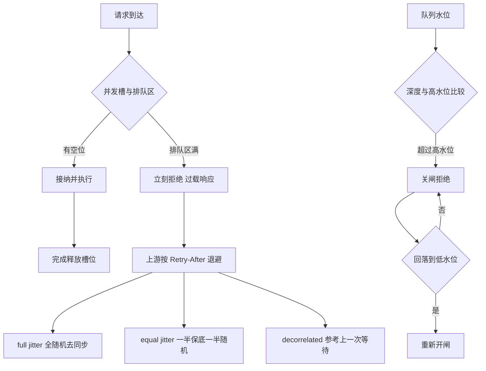

### Q1335 · 指数退避与抖动:三种 jitter 的取舍

> 难度:★★★☆ | 标签:指数退避, jitter, 重试

**问**:指数退避为什么必须加抖动?full jitter、equal jitter、decorrelated jitter 怎么选?

**答**:不加抖动的指数退避会让所有失败客户端在"同一时刻"重试——退避把重试排成了整齐的波浪,比不退避更有害。三种抖动:full jitter = random(0, min(cap, base·2^n)),随机量最大、去同步效果最好,AWS 文档推荐;equal jitter = 指数值一半保底 + 一半随机,兼顾"至少等这么久"的语义;decorrelated jitter = random(base, prev·3),与上次实际等待相关,天然适应"这轮特别难"的情况,避免 full jitter 里"连续抽到极小值"的倒退。选择:通用客户端用 full jitter;要求重试间隔有下限的(如对端明确说 1s 后再试)用 equal;长周期任务用 decorrelated。下面的演示模拟 100 个客户端同步失败后的重试时刻分布,对比有无抖动的重试并发峰。

```python
# file: code/02_并发与网络工程/q1335_backoff_jitter.py
import random


def backoff_exp(base: int, attempt: int, cap: int) -> float:
    return min(cap, base * (2 ** attempt))


def full_jitter(base: int, attempt: int, cap: int, rnd: random.Random) -> float:
    return rnd.uniform(0, backoff_exp(base, attempt, cap))


def equal_jitter(base: int, attempt: int, cap: int, rnd: random.Random) -> float:
    exp = backoff_exp(base, attempt, cap)
    return exp / 2 + rnd.uniform(0, exp / 2)


def decorrelated_jitter(base: int, prev: float, cap: int, rnd: random.Random) -> float:
    return min(cap, rnd.uniform(base, prev * 3))


def main() -> None:
    rnd = random.Random(1335)
    base, cap = 1, 8

    print("attempt | 裸指数 | full | equal | decorrelated")
    prev = base
    for a in range(5):
        d = decorrelated_jitter(base, prev, cap, rnd)
        prev = d
        print(f"  {a}     |  {backoff_exp(base, a, cap):.0f}   | {full_jitter(base, a, cap, rnd):4.2f} "
              f"| {equal_jitter(base, a, cap, rnd):4.2f} | {d:4.2f}")

    # 风暴模拟: 100 个客户端第 0 秒同时失败, 各自重试 3 次
    clients_no_jitter = [backoff_exp(base, 1, cap)] * 100   # 全员同一时刻重试
    ticks_no = {}
    for t in clients_no_jitter:
        ticks_no[round(t, 1)] = ticks_no.get(round(t, 1), 0) + 1
    peak_no = max(ticks_no.values())

    ticks_full = {}
    for _ in range(100):
        t = full_jitter(base, 1, cap, rnd)
        key = round(t / 0.25)               # 0.25s 一档
        ticks_full[key] = ticks_full.get(key, 0) + 1
    peak_full = max(ticks_full.values())

    print(f"无抖动: 重试时刻 {set(round(t, 1) for t in clients_no_jitter)}, "
          f"峰值并发 {peak_no}/tick")
    print(f"full jitter: 重试散布在 {len(ticks_full)} 个时间档, 峰值并发 {peak_full}/tick")
    assert peak_no == 100
    assert peak_full <= 60 and peak_no > peak_full * 1.5, "抖动必须显著削峰"
    print("结论: 退避决定节奏, 抖动决定不同步, 缺一不可")


if __name__ == "__main__":
    main()
```

**追问**:1) cap 设多大合适?——cap 应约等于"服务端从过载恢复的时间尺度":太短则退避没起效就打回去,太长则白白拉长恢复时间;常见取 30s-120s,并与 Retry-After 联动取较大者。2) 三种 jitter 的数学差异?——full jitter 在 [0, cap·2^n] 均匀随机(期望是指数的一半);equal jitter 保底一半+随机一半(期望=指数值);decorrelated 与上次实际值相关(上界 prev·3)避免「连续抽到 0」的倒退——选择本质是「是否需要间隔下限」与「是否怕倒退」。3) cap 与 Retry-After 怎么联动?——cap 取「服务端恢复时间尺度」,且与 Retry-After 取较大者;每次重试后重新评估(服务端给新的 Retry-After 就尊重新的);退避不是一次算死,是逐次更新的策略。4) 生产陷阱?——所有客户端用同一 base/cap(同步性只被部分打散,还要加实例随机种子);重试预算没约束(Q1306),退避再优雅也挡不住总量;把 429 的 Retry-After 和自己的退避叠加成超长等待(取较大者即可);退避状态不随连接重置,重连后立刻满额重试。

---



---
