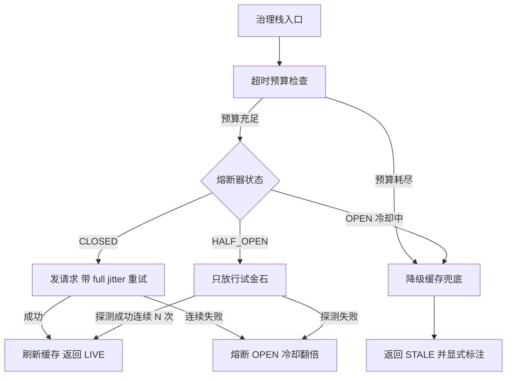

### Q1345 · 综合设计题:一个客户端的完整治理栈

> 难度:★★★★ | 标签:综合设计, 治理栈, 高可用

**问**:把熔断、退避重试、降级缓存、超时预算组装到一个 HTTP 客户端里,故障期间和恢复期间它各是什么行为?

**答**:治理栈的分层顺序就是故障的传导顺序:最外层是超时预算(不让任何一步拖死整体),然后是重试(带抖动、受预算约束),再是熔断(失败率超阈值就停止消耗重试),最后是降级缓存(熔断打开时的兜底答案)。行为时序:依赖故障 → 重试烧掉部分预算 → 连续失败触发熔断 OPEN → 后续请求不再外发、直接回缓存陈旧值(STALE);冷却到点 → HALF_OPEN 试金石 → 成功则回到 CLOSED,缓存刷新为 LIVE。要能回答"每一层什么时候不干活":重试在熔断 OPEN 时不干活,熔断在探测期不放量,缓存在链路健康时只是旁路更新。下面的演示对一台"先坏后好"的依赖服务,输出完整治理时间线。

```python
# file: code/02_并发与网络工程/q1345_governance_stack.py
import http.client
import random
import threading
import time
from http.server import BaseHTTPRequestHandler, ThreadingHTTPServer


class FlakyDep(BaseHTTPRequestHandler):
    state = {"n": 0}
    lock = threading.Lock()

    def do_GET(self):
        with FlakyDep.lock:
            FlakyDep.state["n"] += 1
            n = FlakyDep.state["n"]
        if n <= 4:
            self.send_response(500)
            self.send_header("Content-Length", "5")
            self.end_headers()
            self.wfile.write(b"down")
        else:
            body = f'value-{n}'.encode()
            self.send_response(200)
            self.send_header("Content-Length", str(len(body)))
            self.end_headers()
            self.wfile.write(body)

    def log_message(self, *args):
        pass


class GovernedClient:
    def __init__(self, host: str, port: int) -> None:
        self.host, self.port = host, port
        self.fails = 0
        self.open_until = 0.0
        self.cache = "stale-bootstrap"   # 模拟进程启动时预热的一份陈旧值
        self.rnd = random.Random(1345)
        self.events = []

    def _http_get(self, timeout: float = 0.5) -> str:
        conn = http.client.HTTPConnection(self.host, self.port, timeout=timeout)
        try:
            conn.request("GET", "/")
            resp = conn.getresponse()
            body = resp.read().decode()
            if resp.status != 200:
                raise RuntimeError(f"HTTP {resp.status}")
            return body
        finally:
            conn.close()

    def get(self, key: str) -> tuple:
        now = time.monotonic()
        if now < self.open_until:
            self.events.append(f"{key}: 熔断打开 -> 返回 STALE {self.cache}")
            return "STALE", self.cache
        budget_end = now + 1.0                       # 总预算 1s
        attempt = 0
        while True:
            try:
                value = self._http_get()
                self.fails = 0
                self.cache = value
                src = "LIVE-RETRY" if attempt else "LIVE"
                self.events.append(f"{key}: {src} {value}")
                return src, value
            except Exception as exc:
                self.fails += 1
                attempt += 1
                if self.fails >= 3:
                    self.open_until = time.monotonic() + 0.4
                    self.fails = 0     # 打开后清零: 冷却后的失败从新窗口计数
                    self.events.append(f"{key}: 连续失败 -> 熔断 OPEN 0.4s")
                    return "STALE", self.cache
                if time.monotonic() + 0.1 > budget_end:
                    self.events.append(f"{key}: 预算耗尽({type(exc).__name__}) -> 降级")
                    return "STALE", self.cache
                backoff = self.rnd.uniform(0.02, 0.08) * (2 ** (attempt - 1))
                time.sleep(backoff)                  # full jitter 退避


def main() -> None:
    srv = ThreadingHTTPServer(("127.0.0.1", 0), FlakyDep)
    port = srv.server_address[1]
    threading.Thread(target=srv.serve_forever, daemon=True).start()

    cli = GovernedClient("127.0.0.1", port)
    src1, v1 = cli.get("req-1")
    print(f"req-1: {src1} {v1}(依赖刚坏, 重试 3 次连败 -> 熔断打开)")
    src2, v2 = cli.get("req-2")
    print(f"req-2: {src2} {v2}(冷却期内直接走缓存)")
    src3, v3 = cli.get("req-3")
    print(f"req-3: {src3} {v3}(仍被熔断拦截)")
    time.sleep(0.45)                   # 等熔断冷却
    src4, v4 = cli.get("req-4")
    print(f"req-4: {src4} {v4}(依赖恢复, 重试转绿, 缓存刷新)")

    assert src1 == "STALE" and src2 in ("STALE",)
    assert src3 == "STALE"
    assert src4 in ("LIVE", "LIVE-RETRY") and v4.startswith("value-")
    print("--- 治理时间线 ---")
    for e in cli.events:
        print(" ", e)
    srv.shutdown()


if __name__ == "__main__":
    main()
```

**追问**:1) STALE 值带了多久算多久,会不会误导用户?——所以降级响应要显式标注(响应头或字段说明"数据可能过期"),并在监控里单列 STALE 命中率;如果业务不容忍陈旧,降级动作应该是"明确报错",缓存兜底就不该启用。2) 「每一层什么时候不干活」为什么是面试核心?——治理栈的故障模式大多不是「某层缺失」而是「某层越位」:熔断 OPEN 时重试还在烧预算、链路健康时降级缓存还在回 STALE、探测期还在放量——能说清每层的「休眠条件」才说明理解了分层。3) 恢复期的完整时序?——冷却到点→HALF_OPEN 试金石(Q1336)→连续成功闭合→观察期放量→缓存刷新为 LIVE;每一步都有指标(状态迁移事件、STALE 命中率、探测成功率),恢复质量可量化。4) 生产陷阱?——层间共享状态没加锁(熔断计数被并发读改写);降级缓存永不失效(STALE 变成永久错误答案);重试预算与熔断阈值互相打架(预算没耗尽熔断先开,行为难解释);整套栈没有总开关,故障时无法一键回到「无治理」基线对比。

---


