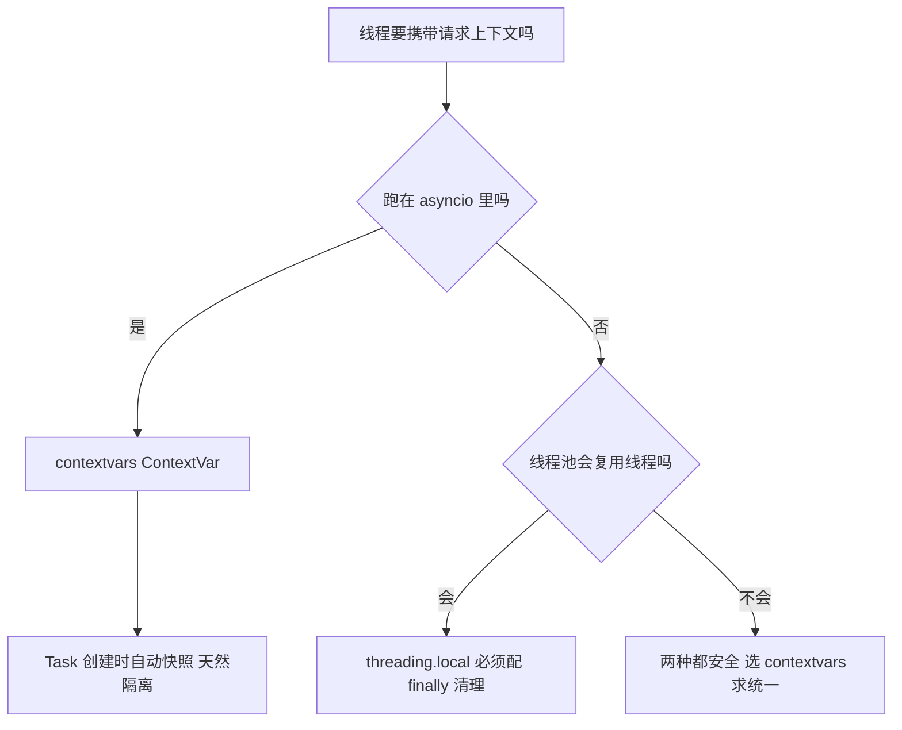

### Q1575 · threading.local vs contextvars:线程池复用下的选型

> 难度:★★☆☆ | 标签:threading.local, contextvars, 选型

**问**:请求上下文(租户、trace id)该用 threading.local 还是 contextvars?两者在异步下表现一样吗?

**答**:不一样,关键差异在"绑定对象"。threading.local 绑定在线程上:线程池复用线程,上一个任务 set 的值会被下一个只读任务看到,这是串号事故的经典来源。contextvars 绑定在 Context 上:asyncio 的 Task 创建时会快照当前上下文,每个协程各改各的,天然隔离;但注意——裸线程池里直接用 ContextVar 同样残留,它隔离的是 Context 不是任务。线程世界的修复是每个任务包一层空 Context().run,或 finally 里显式清理。选型结论:异步项目一律 contextvars(顺带获得 asyncio 传播能力);纯线程项目两者皆可,但必须配套清理纪律。

```python
# file: code/02_并发与网络工程/q1575_ctx_local.py
"""threading.local vs contextvars: 线程池复用下的选型。

- threading.local 绑定在"线程"上: 线程池复用线程, 上一任务 set 的值
  会被下一个"只读"任务看到 -> 串号;
- contextvars 绑定在"Context"上: asyncio 的 Task 创建时快照上下文,
  协程内 set 不会漏给别的 Task; 但裸线程池里同样会残留;
- 线程世界的修复: 每个任务跑在独立 Context 里, 或 finally 里显式清理。
"""
import asyncio
import contextvars
import threading
import time
from concurrent.futures import ThreadPoolExecutor

tenant_local = threading.local()
tenant_var = contextvars.ContextVar("tenant", default=None)


def local_setter(name):
    tenant_local.tenant = name            # 只 set, 不清理
    time.sleep(0.05)
    return tenant_local.tenant


def local_reader():
    time.sleep(0.05)                      # 只读: 看看线程上残留着谁
    return getattr(tenant_local, "tenant", None)


def var_setter(name):
    tenant_var.set(name)                  # 只 set, 不 reset
    time.sleep(0.05)
    return tenant_var.get()


def var_reader():
    time.sleep(0.05)
    return tenant_var.get()


async def aio_setter(name):
    tenant_var.set(name)
    await asyncio.sleep(0.05)
    return tenant_var.get()


async def aio_reader():
    await asyncio.sleep(0.05)
    return tenant_var.get()


async def aio_main():
    return await asyncio.gather(aio_setter("A"), aio_reader())


def main():
    # 1) threading.local: 单 worker 必然复用线程, 只读任务看到脏值
    with ThreadPoolExecutor(max_workers=1) as ex:
        a = ex.submit(local_setter, "A").result()
        leak = ex.submit(local_reader).result()
    print("threading.local: setter 写入", a, "| 后续只读任务读到", leak)
    assert a == "A" and leak == "A", "复用线程上只读任务必然读到上一任务的脏值"

    # 2) 裸线程池里的 contextvars: 同样残留, 别迷信
    with ThreadPoolExecutor(max_workers=1) as ex:
        a = ex.submit(var_setter, "A").result()
        leak2 = ex.submit(var_reader).result()
    print("线程池裸用 contextvars: setter 写入", a, "| 只读任务读到", leak2)
    assert a == "A" and leak2 == "A", "contextvars 在裸线程池里同样串号"

    # 3) 修复: 每个任务包一层空 Context, 值活在该任务的上下文里
    with ThreadPoolExecutor(max_workers=1) as ex:
        a = ex.submit(var_setter, "A").result()
        fixed = ex.submit(lambda: contextvars.Context().run(var_reader)).result()
    print("Context().run 隔离后: 只读任务读到", fixed)
    assert a == "A" and fixed is None, "空 Context 隔离后不应看到残留"

    # 4) asyncio: 每个 Task 创建时快照上下文, 天然隔离
    r = asyncio.run(aio_main())
    print("asyncio 双 Task:", r)
    assert r == ["A", None], "Task 上下文快照应互相隔离"

    print("结论: async 世界选 contextvars; 线程世界两者都需配'任务结束清理'纪律")


if __name__ == "__main__":
    main()
```

**追问**:1) ContextVar.set 在协程里会漏到别的协程吗?——不会,Task 创建时复制了上下文,各改各的;但同一个协程内先 set 再 await 再读,读到的仍是自己 set 的值。2) asyncio Task 的上下文快照语义是什么?——Task 创建时 copy 当前 Context,协程内 set 只影响自己的副本;但这意味着「协程里 set 的值,创建它的协程看不到」——传播方向是「创建时继承」,不是「运行时共享」,理解错方向就会写出失效的 trace id 逻辑。3) 线程池场景怎么修串号?——每个任务用 contextvars.copy_context().run(fn) 包一层(独立 Context 天然隔离),或 finally 显式清理;threading.local 在「每请求一线程」模型下没问题,在「池化复用」模型下必须清理——选型先看线程模型。4) 生产陷阱?——租户 ID 串号(线程池复用残留,事故级);trace id 在异步链路中途丢失(没人 set 或 set 错层级);用 threading.local 存连接/事务对象,复用线程带着上一个请求的事务跑新请求;ContextVar 在同步回调里被误 set 导致值「凭空出现」。



---
