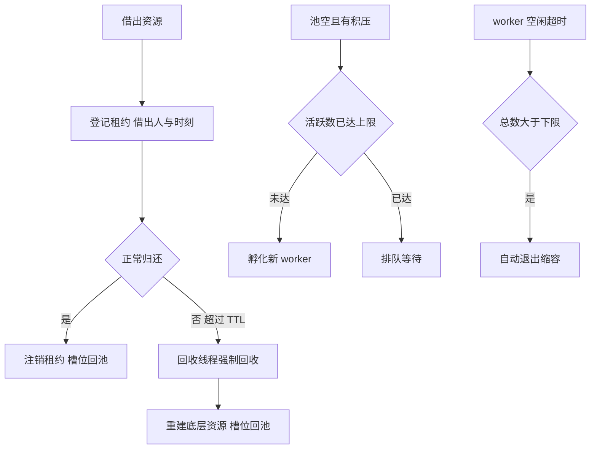

### Q1580 · 线程池动态扩缩:自研可伸缩的工作池

> 难度:★★★☆ | 标签:线程池, 扩缩容, 工作队列

**问**:ThreadPoolExecutor 的 max_workers 一旦定了就不能变,业务高峰想临时加手怎么办?

**答**:自研一个能伸缩的池,核心是两条扩缩规则。扩容看"有积压且全员在忙":队列非空且 busy 等于总数时孵化新 worker,直到上限;缩容看"空闲超时且超出下限":worker 在 get(timeout) 里等不到任务,且总数超过下限就自动退出。突发流量自动加手,低谷自动收摊,吞吐与资源两头兼顾。实现要点:busy/total 计数的增减必须与任务领取、完成在同一把锁下,否则扩缩判断会基于脏数据;关闭用哨兵值排空队列,保证存量任务做完再收摊。

```python
# file: code/02_并发与网络工程/q1580_pool_resize.py
"""线程池动态扩缩: 标准库池是定死的, 自己写一个能伸缩的。

ThreadPoolExecutor 的 max_workers 固定; 高峰需要更多手, 低谷想省内存。
自研要点:
- 扩容: 有积压且没有闲手 -> 孵化新 worker, 直到上限;
- 缩容: worker 空闲超时, 且总数超过下限 -> 自动退出;
- 关闭: 哨兵值排空队列, 存量任务做完再收摊。
"""
import queue
import threading
import time


class ResizablePool:
    def __init__(self, min_workers=2, max_workers=4, idle_timeout=0.25):
        self.q = queue.Queue()
        self.min_workers = min_workers
        self.max_workers = max_workers
        self.idle_timeout = idle_timeout
        self.mu = threading.Lock()
        self.busy = 0
        self.total = 0
        self.peak_busy = 0
        self.results = []
        for _ in range(min_workers):
            self._spawn()

    def _spawn(self):
        self.total += 1
        threading.Thread(target=self._worker, daemon=True,
                         name="w%d" % self.total).start()

    def _worker(self):
        while True:
            try:
                item = self.q.get(timeout=self.idle_timeout)
            except queue.Empty:
                with self.mu:
                    if self.total > self.min_workers:
                        self.total -= 1     # 缩容: 多余的手自动退出
                        return
                continue
            with self.mu:
                self.busy += 1
                self.peak_busy = max(self.peak_busy, self.busy)
            time.sleep(0.1)                 # 模拟任务耗时
            self.results.append(item)
            with self.mu:
                self.busy -= 1

    def drain(self, items):
        for it in items:
            self.q.put(it)
        deadline = time.monotonic() + 5
        while time.monotonic() < deadline:
            with self.mu:
                # 扩容: 有积压且全员在忙
                if self.total < self.max_workers and self.busy == self.total \
                        and not self.q.empty():
                    self._spawn()
            if self.q.empty() and self.busy == 0:
                break
            time.sleep(0.02)
        # 等待多余 worker 空闲退出
        end = time.monotonic() + 2
        while time.monotonic() < end:
            with self.mu:
                if self.total == self.min_workers:
                    break
            time.sleep(0.05)
        return self.peak_busy


def main():
    pool = ResizablePool(min_workers=2, max_workers=4)
    print("初始 worker 数:", pool.total)
    peak = pool.drain(["task-%d" % i for i in range(8)])
    print("完成 %d 个任务, 忙碌峰值: %d" % (len(pool.results), peak))
    print("收缩后 worker 数:", pool.total)
    assert len(pool.results) == 8, "所有任务都应完成"
    assert peak >= 3, "突发时应扩容到 3 个以上忙碌 worker"
    assert pool.total == 2, "低谷后应收缩回下限"
    print("结论: 扩容看'积压 + 无闲手', 缩容看'空闲超时 + 超出下限'")


if __name__ == "__main__":
    main()
```

**追问**:1) 为什么不直接建一个 max_workers 很大的池?——线程内存栈与调度都有真实成本;扩缩让容量跟着负载走,低谷省下的就是账面上的钱。2) 扩容条件「队列非空且全员忙」为什么不能只看队列非空?——短暂排队是正常波动,全员忙且仍有积压才说明容量真不够;只看队列会因瞬时尖峰疯狂孵化 worker,尖峰过后又要缩,抖动剧烈;滞后(连续 N 次满足才扩)能进一步防抖(Q1604 的滞回思想)。3) 计数脏数据怎么防?——busy/total 的增减与任务领取、完成必须在同一把锁内;锁外更新会出现「明明有闲手却扩容」的误判;哨兵值关闭时,缩容逻辑与哨兵消费的交互(收到哨兵的 worker 必须退出而不触发缩容统计)也要想清。4) 生产陷阱?——扩容线程数超上限(无上限的孵化让内存爆);缩容把正在处理任务的 worker 当空闲退出(worker 退出条件要检查「手头无任务」);shutdown 时扩缩逻辑还在孵化新 worker(关闭状态要停止扩缩);worker 退出没 join,资源清理悬空。



---
