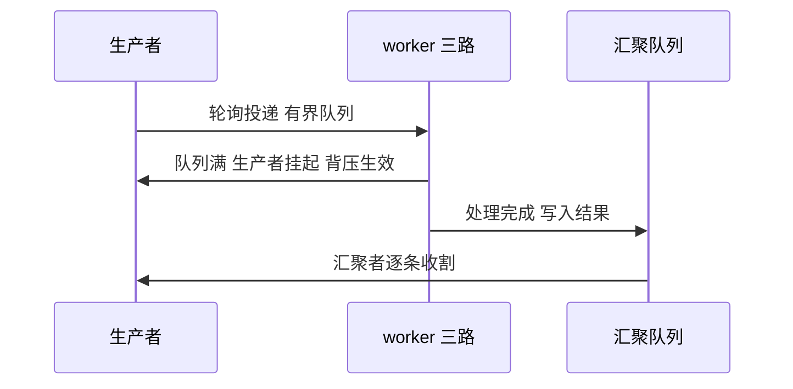

### Q1585 · 异步管道:fan-out 分工与 fan-in 汇聚

> 难度:★★★☆ | 标签:asyncio, 管道, 背压

**问**:一条流水线:生产者、多个 worker、结果汇聚,asyncio 里怎么组织?队列要不要有界?

**答**:fan-out:生产者把任务分发到每个 worker 的独立 asyncio.Queue(轮询或按 key 分发),worker 各自循环 get、处理、输出;fan-in:所有 worker 把结果写进同一个汇聚队列,收集者统一收割。队列必须有界(maxsize):无界队列默默吞下所有积压,把背压推迟到内存爆炸;有界队列满时 put 挂起,生产者自动降速——这就是背压。收尾靠哨兵:每个 worker 队列塞一个 None,收到即退出;收集者按预期结果数收割,防止提前退出丢数据。

```python
# file: code/02_并发与网络工程/q1585_fan_fan.py
"""异步管道: fan-out 分工与 fan-in 汇聚。

- fan-out: 生产者把任务轮流分发到每个 worker 的有界队列(maxsize=3),
  队列满则生产者挂起 -> 背压自动限速上游;
- fan-in: 所有 worker 把结果写进同一个有界汇聚队列, 汇聚者统一收集。
有界是关键: 无界队列会把背压推迟到内存爆炸。
"""
import asyncio

N_ITEMS = 20
N_WORKERS = 3


async def producer(worker_queues):
    for i in range(N_ITEMS):
        q = worker_queues[i % N_WORKERS]         # 轮询分发
        await q.put(i)                           # 队列满 -> 挂起, 背压生效
    for q in worker_queues:
        await q.put(None)                        # 逐个通知收工


async def worker(in_q, agg_q, wid, stats):
    while True:
        item = await in_q.get()
        if item is None:
            return
        await asyncio.sleep(0.01)                # 模拟处理耗时
        await agg_q.put((wid, item))
        stats[wid] += 1


async def collector(agg_q, n):
    results = []
    while len(results) < n:
        results.append(await agg_q.get())
    return results


async def main():
    worker_queues = [asyncio.Queue(maxsize=3) for _ in range(N_WORKERS)]
    agg_q = asyncio.Queue(maxsize=8)             # 汇聚队列同样有界
    stats = [0] * N_WORKERS

    prod = asyncio.create_task(producer(worker_queues))
    workers = [asyncio.create_task(worker(worker_queues[i], agg_q, i, stats))
               for i in range(N_WORKERS)]
    results = await collector(agg_q, N_ITEMS)
    await prod
    await asyncio.gather(*workers)

    items = sorted(x for _, x in results)
    print("各 worker 处理量:", stats)
    assert items == list(range(N_ITEMS)), "20 个任务一个都不能丢"
    assert len(set((w, x) for w, x in results)) == N_ITEMS, "结果不应重复"
    print("结论: fan-out 分担算力, fan-in 收拢结果, 有界队列兜住背压")


if __name__ == "__main__":
    asyncio.run(main())
```

**追问**:1) 轮询分发和按负载分发怎么选?——任务耗时均匀时轮询最简单;耗时长尾明显时按最短队列分发,代价是多一次探测。2) 有界队列的 maxsize 怎么定?——按「worker 单次处理耗时×容忍积压」估:太小则生产者频繁挂起(吞吐损失),太大则背压迟钝(内存峰值高);两级队列(生产→分发→worker)各级都要有界,任何一级无界都会把背压掐断。3) 哨兵收尾的完整性怎么保证?——每个 worker 队列一个哨兵;收集者按「预期结果数」收割而不是「队列空了就收」(空可能是生产者还没写完);生产者先 close 再发哨兵的顺序错了会让 worker 收到 None 之前先拿到 stop——收尾顺序本身就是协议。4) 生产陷阱?——无界队列(Q1585 原问)内存爆炸;worker 异常退出后哨兵没被消费,收集者永久等待(gather 要包 try,finally 补哨兵);fan-out 分发与 fan-in 收集共享一个无界结果队列,慢 worker 积压拖整体;任务里再起任务,收尾树没被 wait 全覆盖。



---
