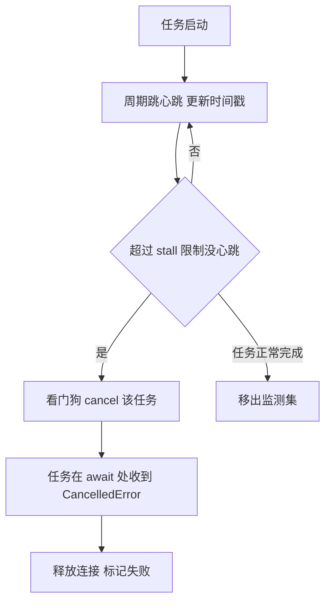

### Q1590 · 异步看门狗:任务心跳监测与卡死处置

> 难度:★★★☆ | 标签:asyncio, 看门狗, 心跳

**问**:一个协程活着但不干活——没异常、不完成、占着连接,怎么发现并处置?

**答**:活性需要证据,证据就是心跳。模式:被监测任务周期性 beat(name) 更新时间戳;看门狗协程定期巡逻,超过 stall_limit 没心跳的任务直接 cancel——用取消把卡死任务从 await 处拽出来,再走统一的失败收尾。要点:stall_limit 要显著大于正常心跳间隔,避免误伤慢任务;看门狗只负责发现与取消,处置(重试、告警、转移)交给任务的异常收尾;心跳应打在推进点上(每处理完一个单元),而不是循环开头,否则卡在循环体中间照样发现不了。

```python
# file: code/02_并发与网络工程/q1590_async_watchdog.py
"""异步看门狗: 任务心跳监测与卡死处置。

长任务"活着但卡死"是 asyncio 最危险的故障: 不抛异常、不完成、占着连接。
模式: 被监测任务周期性 beat() 更新心跳时间戳; 看门狗协程定期巡逻,
超过 stall_limit 没心跳的任务直接 cancel——用取消把它从卡死中拽出来。
"""
import asyncio


class Watchdog:
    def __init__(self, stall_limit=0.25):
        self.beats = {}
        self.stall_limit = stall_limit
        self.killed = []

    def beat(self, name):
        self.beats[name] = asyncio.get_running_loop().time()

    async def patrol(self, tasks):
        loop = asyncio.get_running_loop()
        while any(not t.done() for t in tasks.values()):
            await asyncio.sleep(0.05)
            now = loop.time()
            for name, t in tasks.items():
                if t.done():
                    continue
                if now - self.beats.get(name, 0.0) > self.stall_limit:
                    self.killed.append(name)
                    t.cancel()               # 用取消把卡死任务拽出来


async def healthy(wd, name, rounds):
    for _ in range(rounds):
        await asyncio.sleep(0.04)
        wd.beat(name)                        # 每 40ms 跳一次心跳
    return name + "-done"


async def staller(wd, name):
    wd.beat(name)
    await asyncio.sleep(1.0)                 # 卡死: 之后再也不跳心跳
    return name + "-done"


async def main():
    wd = Watchdog(stall_limit=0.25)
    tasks = {
        "healthy-1": asyncio.create_task(healthy(wd, "healthy-1", 6)),
        "healthy-2": asyncio.create_task(healthy(wd, "healthy-2", 8)),
        "staller": asyncio.create_task(staller(wd, "staller")),
    }
    patrol = asyncio.create_task(wd.patrol(tasks))
    results = await asyncio.gather(*tasks.values(), return_exceptions=True)
    try:
        await patrol
    except asyncio.CancelledError:
        pass

    print("看门狗踢掉的卡死任务:", wd.killed)
    print("healthy-1 结果:", results[0])
    print("staller 已取消:", tasks["staller"].cancelled())
    assert results[0] == "healthy-1-done", "健康任务不应被误伤"
    assert tasks["staller"].cancelled(), "卡死任务应被看门狗取消"
    assert wd.killed == ["staller"], "只踢卡死的, 不踢健康的"
    print("结论: 心跳是活性的唯一证据; 看门狗的处置手段就是 cancel")


if __name__ == "__main__":
    asyncio.run(main())
```

**追问**:1) 看门狗自己卡死怎么办?——看门狗也要被监督:给它配一层看门狗的心跳,或用 loop.call_later 链这类更底层的机制兜底。2) 卡死协程 cancel 后为什么能恢复?——cancel 把 CancelledError 投到协程当前 await 处,卡在 await 的任务被拽出来;但「卡在同步死循环/C 扩展阻塞」的任务收不到取消(没到 await 点),看门狗 cancel 后要配超时验证,仍不退就升级处置(进程级)。3) 心跳打在哪才是有效证据?——打在「推进点」(处理完一个单元后),循环开头打心跳,卡在循环体中间的任务心跳照样更新——活性证据要对应「业务推进」而不是「线程/协程还活着」。4) 生产陷阱?——stall_limit 太小误杀慢任务(要大于正常心跳间隔数倍);看门狗自己卡死(要被监督,Q1590 原问);cancel 后任务在 finally 里又卡住(清理超时也要兜底);把心跳时间戳用 time.time(NTP 跳变误判)。



---
