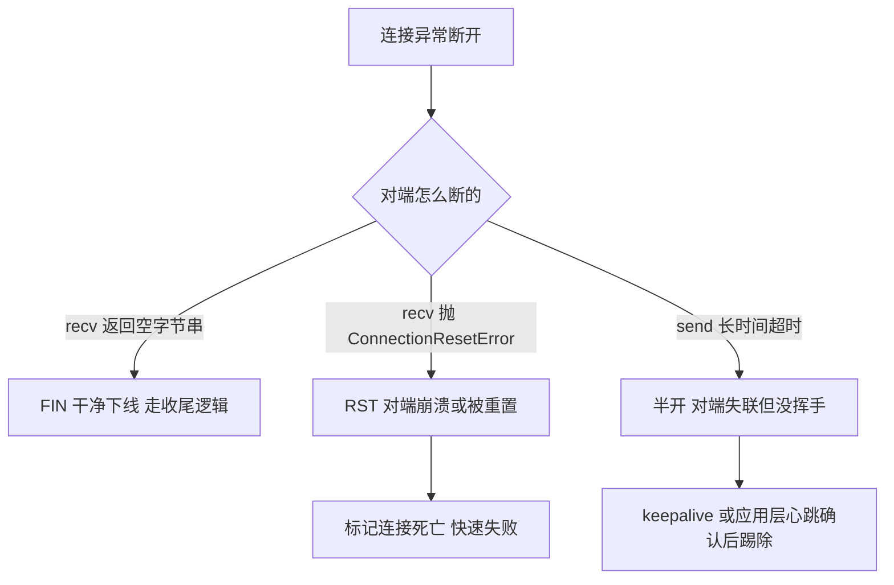

### Q1600 · socket 选项实验台:缓冲区与 keepalive 参数

> 难度:★★★☆ | 标签:socket, SO_SNDBUF, keepalive

**问**:SO_SNDBUF 设了 4096,为什么 getsockopt 读回来是翻倍的值?缓冲区影响什么、不影响什么?

**答**:setsockopt 的值会被内核翻倍——内核用双倍空间做簿记,这是历史行为不是 bug。缓冲区影响吞吐与背压起点:发送方在缓冲满时阻塞或非阻塞失败,接收方在缓冲空时等待;它不影响正确性——4KB 的接收缓冲照样收完 512KB,只是节奏慢,实验里用 md5 验证完整性。keepalive 的平台差异也是实验台常客:Linux 有 KEEPIDLE、KEEPINTVL、KEEPCNT 三件套,macOS 的 TCP_KEEPALIVE 只管空闲间隔。结论:选项决定内核行为的手感,完整性永远靠应用层校验兜底。

```python
# file: code/02_并发与网络工程/q1600_sockopt_bench.py
"""socket 选项实验台: 缓冲区、keepalive 与完整性验证。

- SO_SNDBUF / SO_RCVBUF: 内核为每个方向的缓冲, setsockopt 的值通常被
  内核翻倍(簿记开销); 缓冲区影响的是吞吐与背压起点, 不是正确性;
- SO_KEEPALIVE: 空闲后内核代发探测帧, 平台参数名不同(mac 的 TCP_KEEPALIVE
  相当于 Linux 的 TCP_KEEPIDLE);
- 功能验证: 把接收缓冲调到 4KB 照样传完 512KB —— 缓冲只影响节奏。
"""
import hashlib
import socket
import threading


def serve_tiny(srv, result):
    srv.listen(5)
    conn, _ = srv.accept()
    md5 = hashlib.md5()
    while True:
        chunk = conn.recv(4096)
        if not chunk:
            break
        md5.update(chunk)
    conn.close()
    srv.close()
    result.append(md5.hexdigest())


def main():
    # 1) 缓冲区观测: setsockopt 的值通常被内核翻倍
    s = socket.socket(socket.AF_INET, socket.SOCK_STREAM)
    print("默认 SO_SNDBUF=%d SO_RCVBUF=%d"
          % (s.getsockopt(socket.SOL_SOCKET, socket.SO_SNDBUF),
             s.getsockopt(socket.SOL_SOCKET, socket.SO_RCVBUF)))
    s.setsockopt(socket.SOL_SOCKET, socket.SO_RCVBUF, 4096)
    print("setsockopt SO_RCVBUF=4096 后读回: %d (内核翻倍预留)"
          % s.getsockopt(socket.SOL_SOCKET, socket.SO_RCVBUF))
    s.close()

    # 2) keepalive: 开关 + 平台各自的空闲间隔参数
    k = socket.socket()
    k.setsockopt(socket.SOL_SOCKET, socket.SO_KEEPALIVE, 1)
    knobs = [name for name in ("TCP_KEEPALIVE", "TCP_KEEPIDLE",
                               "TCP_KEEPINTVL", "TCP_KEEPCNT")
             if hasattr(socket, name)]
    if "TCP_KEEPALIVE" in knobs:            # macOS
        k.setsockopt(socket.IPPROTO_TCP, socket.TCP_KEEPALIVE, 5)
    if "TCP_KEEPIDLE" in knobs:             # Linux
        k.setsockopt(socket.IPPROTO_TCP, socket.TCP_KEEPIDLE, 5)
    print("SO_KEEPALIVE=%d, 本机可调参数: %s"
          % (k.getsockopt(socket.SOL_SOCKET, socket.SO_KEEPALIVE), knobs))
    assert k.getsockopt(socket.SOL_SOCKET, socket.SO_KEEPALIVE) != 0
    k.close()

    # 3) 小缓冲不损完整性: 4KB 接收缓冲照样收完 512KB
    srv = socket.socket()
    srv.setsockopt(socket.SOL_SOCKET, socket.SO_REUSEADDR, 1)
    srv.setsockopt(socket.SOL_SOCKET, socket.SO_RCVBUF, 4096)   # 监听套接字上的值被子连接继承
    srv.bind(("127.0.0.1", 0))
    port = srv.getsockname()[1]
    result = []
    threading.Thread(target=serve_tiny, args=(srv, result), daemon=True).start()

    payload = bytes(range(256)) * 2048      # 512KB 确定性数据
    expect = hashlib.md5(payload).hexdigest()
    c = socket.create_connection(("127.0.0.1", port), timeout=2)
    c.sendall(payload)
    c.shutdown(socket.SHUT_WR)              # 半关闭: 告诉服务端流结束
    c.close()
    deadline = threading.Event()
    deadline.wait(0.5)
    while not result:
        deadline.wait(0.05)
    print("512KB 经 4KB 缓冲传输, md5 一致:", result[0] == expect)
    assert result[0] == expect, "缓冲区大小只影响节奏, 不影响完整性"

    print("结论: 选项决定内核行为的手感, 完整性永远靠应用层校验兜底")


if __name__ == "__main__":
    main()
```

**追问**:1) SO_SNDBUF 设为 0 会怎样?——多数平台按最小值处理;真正的同步零缓冲没有可移植开关,应用层用小包发送加等待 ACK 模拟。2) 缓冲区「影响节奏不影响正确性」的边界在哪?——吞吐、延迟、背压起点都受缓冲影响;但应用层校验(长度、checksum、md5)永远是完整性的最终裁决——内核缓冲丢不了已确认写入的数据,「丢包」发生在网络层,两层别混。3) keepalive 参数的平台差异怎么写可移植代码?——优先尝试 Linux 三件套(KEEPIDLE/KEEPINTVL/KEEPCNT),AttributeError/errno 降级到 macOS TCP_KEEPALIVE,再降级只开 SO_KEEPALIVE;封装成 try 链并记录生效配置——跨平台 socket 选项的通用套路。4) 生产陷阱?——以为 setsockopt 的值就是生效值(内核翻倍,容量规划按实际 getsockopt 算);缓冲调大掩盖慢接收问题(背压延迟,故障发现变晚);把内核缓冲当可靠性保证(进程崩溃缓冲数据仍丢);macOS 上用 Linux 常数名直接 AttributeError。



---
