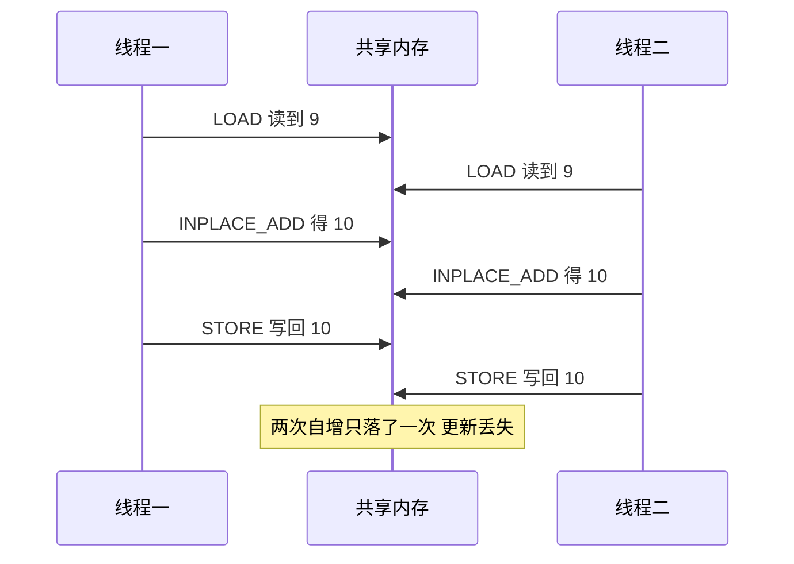

### Q1605 · 竞态的微观镜头:dis 看自增的字节码窗口

> 难度:★★★★ | 标签:GIL, 字节码, 竞态

**问**:都说 CPython 里 dict 操作是原子的,那 counter 加一为什么还会丢更新?

**答**:因为自增根本不是一条指令。dis 反汇编:LOAD_FAST 取容器、LOAD_CONST 取下标、BINARY_SUBSCR 读值、LOAD_CONST 1、INPLACE_ADD 相加、STORE_SUBSCR 写回——六步。GIL 保证的是单条字节码原子,而这六步之间任何一次 GIL 让渡,另一个线程就插进来读旧值,最终丢失更新。实验:双线程各 5 万次无锁自增,几乎必然少于 10 万;加锁后分毫不差。工程含义:限流计数器差一次就是放过一个超限请求——读改写必须加锁,或换成 itertools.count、单写者队列等天然原子的结构。

```python
# file: code/02_并发与网络工程/q1605_dis_race.py
"""竞态的微观镜头: dis 看自增的字节码窗口。

counter[0] += 1 不是一条指令, 而是一串字节码:
LOAD_FAST -> LOAD_CONST(0) -> BINARY_SUBSCR -> LOAD_CONST(1)
-> INPLACE_ADD -> STORE_SUBSCR。
GIL 保证"单条字节码"原子, 但这六步之间任何一次切换都会丢更新。
限流计数器差一次就是放过一个超限请求, 所以计数必须加锁或换原子结构。
"""
import dis
import threading


def incr_plain(cell):
    cell[0] += 1


def show_bytecode():
    print("incr_plain 的字节码:")
    for ins in dis.get_instructions(incr_plain):
        print("  %-16s %s" % (ins.opname, ins.argrepr))


OPS = 50000
TRIALS = 5


def race_once(with_lock):
    cell = [0]
    lock = threading.Lock() if with_lock else None

    def worker():
        for _ in range(OPS):
            if lock:
                with lock:
                    cell[0] += 1
            else:
                cell[0] += 1            # 六步字节码之间存在切换窗口

    ts = [threading.Thread(target=worker) for _ in range(2)]
    for t in ts:
        t.start()
    for t in ts:
        t.join()
    return cell[0]


def main():
    show_bytecode()
    expected = 2 * OPS
    lost_rounds = []
    for i in range(TRIALS):
        got = race_once(False)
        if got != expected:
            lost_rounds.append((got, expected - got))
            print("无锁第 %d 轮: 期望 %d 实得 %d, 丢失 %d 次更新"
                  % (i + 1, expected, got, expected - got))
    locked = race_once(True)
    print("加锁一轮: 期望 %d 实得 %d" % (expected, locked))
    assert locked == expected, "加锁后的计数必须分毫不差"
    if lost_rounds:
        print("结论: %d/5 轮出现丢失——字节码间隙就是竞态窗口" % len(lost_rounds))
    else:
        print("本轮未复现丢失(切换未落在窗口内), 但窗口客观存在, 加锁是唯一保证")


if __name__ == "__main__":
    main()
```

**追问**:1) 为什么两个线程不是每轮都丢?——只有 GIL 切换恰好落在六步之间才丢;切换间隔默认 5ms,窗口很窄,所以竞态偶发难复现——这正是它危险的原因。2) 「GIL 保证单字节码原子」的边界与演进?——3.10 时代字节码级原子成立,但复合语句(六步自增)不原子;3.11+ 自适应解释器与特化字节码改变了指令形态,「某些操作原子」的结论更要实测验证,不能背结论;free-threading(3.13 实验性,PEP 703)下连这个保证都要重新审视——并发口径要跟着解释器版本走。3) 读改写竞态的标准修法排序?——锁(通用正确)、单写者架构(把状态变更收敛到一个线程/队列)、天然原子结构(itertools.count、deque 单端操作)、最后才是「原子性踩点」(依赖实现细节,脆弱)——优先级与团队可维护性挂钩。4) 生产陷阱?——限流计数器无锁(超限放过,见原问);把「list.append 原子」推广到「list[i] += 1 原子」;3.11+ 行为变化后旧基准结论直接沿用;竞态偶发被当成「环境问题」不修(测试环境复现难,生产必炸)。



---
