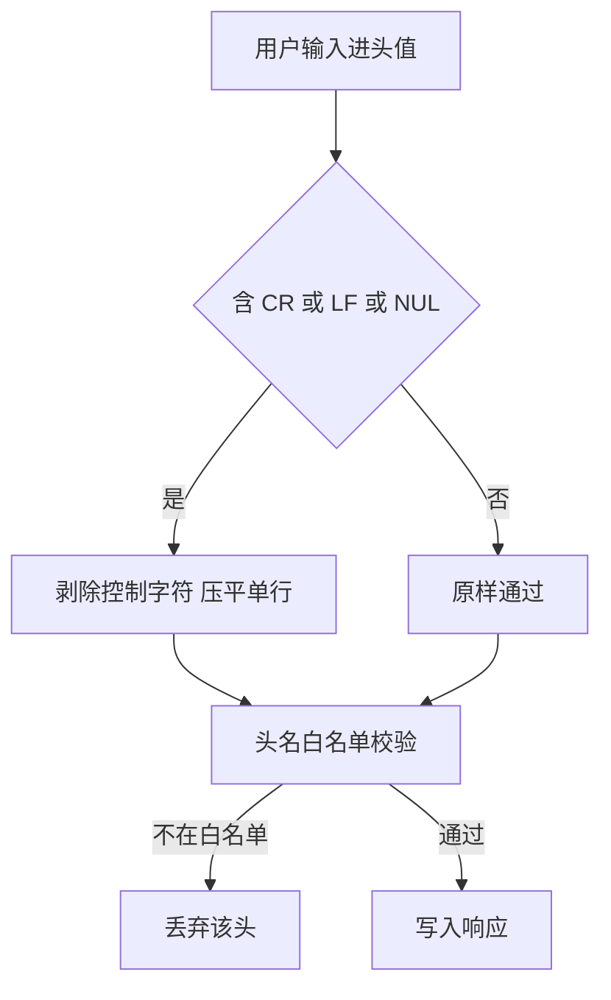

### Q1610 · CRLF 头注入:响应头的消毒

> 难度:★★★☆ | 标签:安全, HTTP 头, 注入

**问**:把用户输入直接写进响应头(比如昵称放进 X-User),攻击者输入里带回车换行会发生什么?

**答**:头与体的分界符就是 CRLF:攻击者在输入里塞进换行加 Set-Cookie,响应头被拆成两条,凭空多出一个 Cookie;更进一步用连续两个 CRLF 直接闭合头区、注入整个响应体(响应拆分),能毒害中间缓存、污染其他用户。防线两层:消毒——头值里的 CR、LF、NUL 一律剥除,天然压平成单行,注入语法失效;白名单——允许写入的响应头名单化管理,不认识的头名直接丢弃,顺手挡掉未来的注入面。输出编码的通用原则同样成立:进入结构化位置(头、URL、HTML)之前,先做该位置的转义。

```python
# file: code/02_并发与网络工程/q1610_crlf_guard.py
"""CRLF 头注入: 响应头的消毒。

攻击者把 \\r\\n 塞进会回显进响应头的输入(如昵称、搜索词):
  X-User: attacker\\r\\nSet-Cookie: session=pwned
响应头被拆成两条, 攻击者凭空注入了 Set-Cookie 甚至整个响应体。
防线: 头值消毒(剥 CR/LF/NUL)+ 头名白名单, 双保险。
"""
def build_response(status, headers):
    lines = ["HTTP/1.1 %s" % status]
    for k, v in headers:
        lines.append("%s: %s" % (k, v))
    return ("\r\n".join(lines) + "\r\n\r\n").encode() + b"ok"


def sanitize(value):
    """剥掉 CR/LF/NUL: 头值只能是单行文本。"""
    for ch in ("\r", "\n", "\x00"):
        value = value.replace(ch, "")
    return value


ALLOWED = {"X-User", "Content-Type", "Cache-Control"}


def build_response_safe(status, headers):
    lines = ["HTTP/1.1 %s" % status]
    for k, v in headers:
        if k not in ALLOWED:            # 头名白名单
            continue
        lines.append("%s: %s" % (sanitize(k), sanitize(v)))
    return ("\r\n".join(lines) + "\r\n\r\n").encode() + b"ok"


def head_lines(resp):
    return resp.split(b"\r\n\r\n")[0].split(b"\r\n")


def main():
    attacker = "alice\r\nSet-Cookie: session=pwned\r\n\r\nHTTP/1.1 200 OK"

    vulnerable = build_response("200 OK", [("X-User", attacker)])
    lines = head_lines(vulnerable)
    print("易感实现的响应头:")
    for ln in lines:
        print("   %s" % ln.decode(errors="replace"))
    injected = any(b"Set-Cookie" in ln for ln in lines)
    print("注入成功:", injected)
    assert injected, "不做消毒时, 攻击者应能注入 Set-Cookie 头"

    safe = build_response_safe("200 OK",
                               [("X-User", attacker),
                                ("X-Evil", "should-be-dropped"),
                                ("Content-Type", "text/plain")])
    lines = head_lines(safe)
    print("消毒后的响应头:")
    for ln in lines:
        print("   %s" % ln.decode(errors="replace"))
    assert not any(ln.startswith(b"Set-Cookie") for ln in lines), \
        "CR/LF 已剥除, 不再拆出独立头行"
    assert not any(b"X-Evil" in ln for ln in lines), "白名单外的头应被丢弃"
    assert any(b"alice" in ln for ln in lines), "合法内容保留(压平成单行)"
    print("注意: 残留的 Set-Cookie 字样只是被压平的头值文本, 已无头语义")

    print("结论: CRLF 是头与体的分界符, 进头之前必须消毒——白名单是第二道锁")


if __name__ == "__main__":
    main()
```

**追问**:1) 为什么 NUL 也要剥?——某些解析器把 NUL 当字符串终结符,残留 NUL 会造成两套解析器看到不同内容——与走私是同一类病。2) 响应拆分为什么能毒害缓存?——注入的完整响应(含自己的头)被中间缓存按「同 URL」缓存,后续其他用户请求同一 URL 拿到攻击者的响应——受害者不是发起攻击的人;这是缓存投毒的标准链路,CDN 场景危害放大。3) 消毒与白名单怎么落地?——头值 set 时统一过 sanitize(CR/LF/NUL 剥除)+断言(测试期发现源头);框架层(FastAPI/Django 的 response API)已挡一层,但绕过框架直接写 socket/原始头的路径要自查;白名单管头名,消毒管头值,两层都要。4) 生产陷阱?——用户输入直接进头(昵称/文件名/X-Forwarded 链);日志头注入(把用户输入写进响应日志头,同样可注入);多字节编码绕过(\u000a 在某些序列化后变真换行,消毒要在最终形态做);只消毒不白名单(新头名仍可被注入试探)。



---
