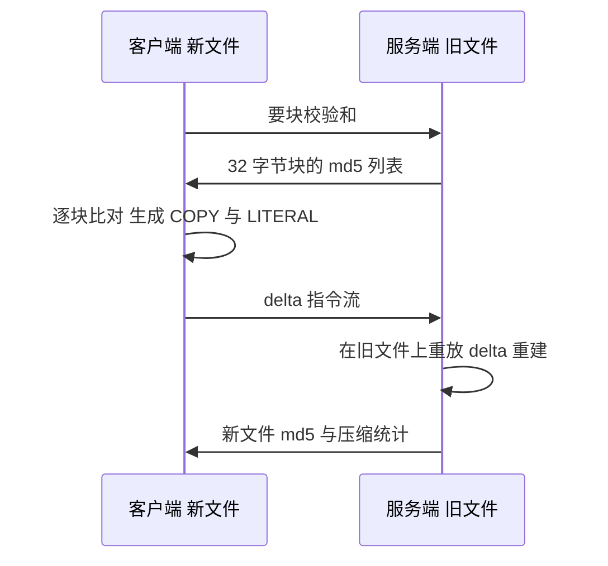

### Q1615 · 综合设计:迷你 rsync 增量同步协议

> 难度:★★★★ | 标签:协议设计, 增量同步, rsync

**问**:设计一个增量文件同步协议:服务端有旧文件,客户端有新文件,怎么只传差异?

**答**:协议四步,帧等于 4 字节大端长度加 JSON:第一步客户端请求块校验和;第二步服务端把旧文件按 32 字节切块,回每块的 md5,块索引隐含在顺序里;第三步客户端把新文件同样切块、逐块比对——md5 命中生成 COPY 指令,没命中就攒 LITERAL 字节;第四步客户端把 delta 指令流发回,服务端在旧文件上重放——COPY 段从旧文件对应块取,LITERAL 段直接拼接——最后回新文件的 md5 验证与压缩统计。演示里 810 字节的文件只传 362 字节新数据,复用占大头。工程升级路径:块内滚动校验让插入字节后的块也能对齐;块大小是精度与元数据的折中;md5 有极小碰撞概率,严格场景加全文校验。

```python
# file: code/02_并发与网络工程/q1615_mini_rsync.py
"""综合设计: 迷你 rsync 增量同步协议。

服务端持有旧文件, 客户端持有新文件, 目标: 只传差异。
协议四步(帧 = 4 字节大端长度 + JSON):
1) 客户端要校验和 -> 服务端按 32 字节块回 md5 列表;
2) 客户端逐块比对, 生成 delta: COPY 命中块 / LITERAL 新数据;
3) 客户端发 delta -> 服务端在旧文件上重放, 重建出新文件;
4) 服务端回 md5 验证与压缩统计。
"""
import base64
import hashlib
import json
import socket
import struct
import threading

BLOCK = 32
OLD = (b"The quick brown fox jumps over the lazy dog. " * 16
       + b"NEW-TAIL-SECTION added in this revision.\n")


def md5(data):
    return hashlib.md5(data).hexdigest()


def recv_frame(sock):
    head = bytearray()
    while len(head) < 4:
        chunk = sock.recv(4 - len(head))
        if not chunk:
            raise ConnectionError("closed")
        head.extend(chunk)
    (n,) = struct.unpack(">I", bytes(head))
    buf = bytearray()
    while len(buf) < n:
        chunk = sock.recv(n - len(buf))
        if not chunk:
            raise ConnectionError("closed")
        buf.extend(chunk)
    return json.loads(bytes(buf))


def send_frame(sock, obj):
    data = json.dumps(obj).encode()
    sock.sendall(struct.pack(">I", len(data)) + data)


def build_delta(new, old_blocks):
    """逐块贪心: 命中校验和就 COPY, 否则攒 LITERAL。"""
    ops = []
    lit = bytearray()
    for i in range(0, len(new), BLOCK):
        block = new[i:i + BLOCK]
        h = md5(block)
        if len(block) == BLOCK and h in old_blocks:
            if lit:
                ops.append(["lit", base64.b64encode(bytes(lit)).decode()])
                lit = bytearray()
            ops.append(["copy", old_blocks[h]])
        else:
            lit.extend(block)
    if lit:
        ops.append(["lit", base64.b64encode(bytes(lit)).decode()])
    return ops


def apply_delta(old, ops):
    out = bytearray()
    for op in ops:
        if op[0] == "copy":
            out.extend(old[op[1] * BLOCK:(op[1] + 1) * BLOCK])
        else:
            out.extend(base64.b64decode(op[1]))
    return bytes(out)


def server_thread(port_slot, result):
    srv = socket.socket()
    srv.setsockopt(socket.SOL_SOCKET, socket.SO_REUSEADDR, 1)
    srv.bind(("127.0.0.1", 0))
    srv.listen(5)
    port_slot.append(srv.getsockname()[1])
    conn, _ = srv.accept()
    try:
        req = recv_frame(conn)
        assert req["op"] == "checksums"
        blocks = [OLD[i:i + BLOCK] for i in range(0, len(OLD), BLOCK)]
        old_blocks = {md5(b): idx for idx, b in enumerate(blocks)}
        send_frame(conn, {"blocks": list(old_blocks.keys())})

        req = recv_frame(conn)
        assert req["op"] == "delta"
        rebuilt = apply_delta(OLD, req["ops"])
        copy_bytes = sum(BLOCK for op in req["ops"] if op[0] == "copy")
        lit_bytes = sum(len(base64.b64decode(op[1]))
                        for op in req["ops"] if op[0] == "lit")
        send_frame(conn, {"ok": md5(rebuilt) == md5(NEW_HOLDER[0]),
                          "md5": md5(rebuilt),
                          "copy_bytes": copy_bytes,
                          "lit_bytes": lit_bytes})
        result.append(rebuilt)
    finally:
        conn.close()
        srv.close()


NEW_HOLDER = [None]


def main():
    # 新版本: 中间等长改一词(不挪块边界), 结尾加一段
    mid = OLD.index(b"lazy dog")
    new = OLD[:mid] + b"calm pugs" + OLD[mid + len(b"lazy dog"):] \
        + b"EXTRA-NOTES\n" * 4
    NEW_HOLDER[0] = new
    print("旧文件 %d 字节, 新文件 %d 字节" % (len(OLD), len(new)))

    port_slot, result = [], []
    threading.Thread(target=server_thread, args=(port_slot, result),
                     daemon=True).start()
    while not port_slot:
        threading.Event().wait(0.01)

    cli = socket.create_connection(("127.0.0.1", port_slot[0]), timeout=3)
    cli.settimeout(3)
    send_frame(cli, {"op": "checksums"})
    reply = recv_frame(cli)
    old_blocks = {h: i for i, h in enumerate(reply["blocks"])}
    print("服务端回 %d 个块校验和" % len(old_blocks))

    ops = build_delta(new, old_blocks)
    n_copy = sum(1 for op in ops if op[0] == "copy")
    n_lit = sum(1 for op in ops if op[0] == "lit")
    send_frame(cli, {"op": "delta", "ops": ops})
    ack = recv_frame(cli)
    cli.close()

    print("delta 指令: COPY %d 块 + LITERAL %d 段" % (n_copy, n_lit))
    print("传输账: 复用 %d 字节 + 新传 %d 字节(全量为 %d 字节)"
          % (ack["copy_bytes"], ack["lit_bytes"], len(new)))
    print("服务端重建校验:", ack["md5"], "一致:", ack["ok"])
    assert ack["ok"], "重建结果必须与新文件逐字节一致"
    assert ack["md5"] == md5(new)
    assert ack["copy_bytes"] > 0, "大部分块应复用旧数据"
    assert ack["copy_bytes"] > ack["lit_bytes"], "复用应占大头"
    print("结论: 校验和比对 + COPY/LITERAL delta, 省下的就是那份'没变的字节'")


if __name__ == "__main__":
    main()
```

**追问**:1) 为什么 rsync 还需要 rolling checksum?——固定块 md5 要求块边界不动,插入一个字节后所有后续块错位;滚动校验能在字节流里滑窗找候选块,这是 rsync 的核心思想。2) 固定块 md5 的失效场景与滚动校验的补法?——插入一个字节后,后续所有块边界错位,md5 全不命中退化为全量传输;rolling checksum(如 adler32 滑窗)在字节流里滑窗找候选块,命中再用 md5 强校验——rsync 的两层校验(弱滚动+强摘要)就是为此。3) 协议帧层的工程要点?——长度前缀+JSON 指令流的定界(Q621);delta 指令的 COPY 必须校验「块索引合法且源区间正确」防恶意指令越界读;重放后全文 md5 校验兜底(md5 碰撞概率小但校验成本低)。4) 生产陷阱?——块大小失衡(太大精度差,太小元数据爆炸,32B-4KB 按文件大小分层);delta 重放没有边界校验(恶意 COPY 索引 OOB);只传 md5 列表没带文件整体指纹(两文件 md5 块列表相同但内容不同的边缘情况);大文件全量切块在内存做(要流式分块)。


