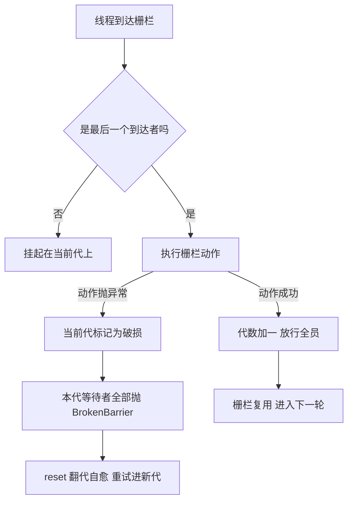

### Q1845 · 栅栏动作失败与中止恢复:broken 只毒化当前代

> 难度:★★★★ | 标签:Barrier, 故障处理, 自愈

**问**:栅栏动作里抛了异常,等待的一组线程怎么办?怎么设计才能不把整组永久卡死?

**答**:正确路径是代内破损:动作抛异常时把当前代标记为 broken,notify_all 把所有等待者叫醒,它们与本代后续到达者统一收到 BrokenBarrierError,立刻解脱而不是傻等。

- 破损只属于当前代,不会毒化下一代,这是 '可复用 + 可自愈' 的关键设计;

- reset() 显式翻代复位:清掉破损与计数、代数加一,全员可以重试;

- 演示第一轮动作故意失败,三个线程全部感知破损后重试,故障解除加 reset 之后第二轮全员成功。

threading.Barrier 内建这套语义(wait 返回 BrokenBarrierError,abort/reset 配套),手写的意义在于把 '代内故障隔离' 这个设计决策讲清楚。

```python
# file: code/02_并发与网络工程/q1845_barrier_abort_reset.py
# -*- coding: utf-8 -*-
"""栅栏动作失败与中止恢复: broken 代隔离故障, reset 后进入下一代。

- 栅栏动作在最后到达者的上下文里执行, 它抛异常时本代标记为 broken;
- broken 只属于当前代: 本代所有等待者抛 BrokenBarrierError, 不会毒化下一代;
- reset() 显式翻代复位, 让全员重试, 这是可复用栅栏的自愈路径。
"""
import threading
import time


class BrokenBarrierError(Exception):
    pass


class AbortableBarrier:
    def __init__(self, parties, action=None):
        self._parties = parties
        self._action = action
        self._cond = threading.Condition()
        self._arrived = 0
        self._generation = 0
        self._broken = False

    def wait(self, timeout=5.0):
        with self._cond:
            g = self._generation
            if self._broken:
                raise BrokenBarrierError("代 %d 已破损" % g)
            self._arrived += 1
            if self._arrived == self._parties:
                self._arrived = 0
                try:
                    if self._action is not None:
                        self._action(g)
                except Exception as e:
                    self._broken = True
                    self._cond.notify_all()
                    raise BrokenBarrierError("栅栏动作失败: %r" % e) from e
                self._generation = g + 1
                self._cond.notify_all()
                return 0
            deadline = time.monotonic() + timeout
            while self._generation == g and not self._broken:
                remain = deadline - time.monotonic()
                if remain <= 0:
                    raise TimeoutError("barrier 等待超时")
                self._cond.wait(remain)
            if self._broken:
                raise BrokenBarrierError("代 %d 已破损" % g)
            return 1

    def reset(self):
        with self._cond:
            self._broken = False
            self._arrived = 0
            self._generation += 1             # 换新代, 旧代全部作废
            self._cond.notify_all()


def main():
    fail_first = {"v": True}
    broken_events = []
    success_events = []
    ev_lock = threading.Lock()

    def action(g):
        if fail_first["v"]:
            raise OSError("外部依赖暂不可用, 模拟第一轮动作失败")

    barrier = AbortableBarrier(3, action=action)

    def worker(name):
        for attempt in range(10):
            try:
                barrier.wait()
            except BrokenBarrierError as e:
                with ev_lock:
                    broken_events.append((name, attempt, str(e)))
                time.sleep(0.03)            # 稍等自愈, 再进栅栏
                continue
            with ev_lock:
                success_events.append((name, attempt))
            return

    ts = [threading.Thread(target=worker, args=("w%d" % i,)) for i in range(3)]
    for t in ts:
        t.start()

    # 等第一轮破损被全员感知, 再解除故障并复位栅栏
    deadline = time.monotonic() + 3.0
    while time.monotonic() < deadline and len(broken_events) < 3:
        time.sleep(0.01)
    fail_first["v"] = False
    barrier.reset()

    for t in ts:
        t.join(timeout=5.0)
        assert not t.is_alive(), "复位后重试轮应当成功, 不应卡死"

    print("破损事件数:", len(broken_events))
    print("重试成功:", success_events)
    assert len(broken_events) >= 3, "第一轮 3 个线程都应感知破损"
    assert len(success_events) == 3, "复位后重试轮全员成功"
    assert all("动作失败" in msg or "已破损" in msg
               for _, _, msg in broken_events), "事件都应是栅栏破损语义"
    print("结论: broken 只毒化当前代, reset 翻代自愈, 重试进新代")


if __name__ == "__main__":
    main()
```

**追问**:1) 等待者收到 BrokenBarrierError 后该重试还是放弃?——取决于动作失败的原因:瞬时故障(依赖抖动)可以退避后重试进新代,确定性故障(参数非法)应放弃并让整组任务失败,别把重试做成死循环。2) broken 为什么只毒化当前代?——破损的原因(动作异常)只属于这一批参与者;下一代是新的一批,状态应干净——这延续了「代」的语义;threading.Barrier 行为一致(broken 状态在本代等待/到达者上抛)。3) reset() 的使用时机与风险?——reset 是管理员的显式动作:清计数、翻代、唤醒全员报破损;调用时若有人正处于「刚到达未登记」的窗口,会拿到 BrokenBarrierError——reset 本身也要在锁内原子完成,且语义是「重新开始」不是「悄悄修复」。4) 生产陷阱?——把 BrokenBarrierError 当普通异常吞掉继续等待(下次照样挂);重试无退避(整组高频撞栅栏);动作失败原因没有分类(瞬时 vs 确定性,重试策略无从定,Q1845 原问);栅栏状态无监控(broken 次数该告警)。



---
