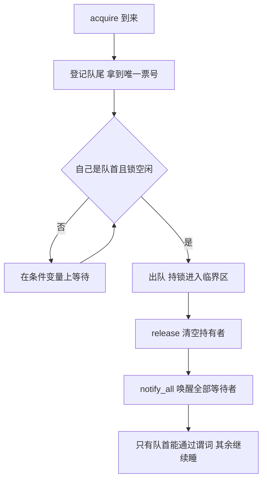

### Q1851 · FIFO 公平锁:队列票号保证先到先得

> 难度:★★★ | 标签:公平锁, FIFO, 饥饿

**问**:threading.Lock 说是非公平的,'不公平' 具体指什么?怎么写一把保证先到先得的锁?

**答**:非公平指的是:锁释放的瞬间,刚释放的线程立刻重入往往能赢过正在等待的线程,等待者拿锁的顺序与排队顺序无关,极端情况下有人长期饿死。

- 公平锁的实现是队列票号:acquire 时原子登记到队尾拿唯一票号,谓词是 '自己是队首且锁空闲',release 后 notify_all,但只有队首能通过谓词;

- 演示六个线程同一瞬间起跑,登记顺序是随机的,但服务顺序严格等于票号顺序,无人插队;

- 代价是吞吐:release 必须 notify_all,被唤醒的大多数是无效唤醒,立刻重新入睡。

选型原则:默认用内建 Lock(吞吐优先);只有确认存在长等待者且饥饿会造成业务伤害时才换公平锁。

```python
# file: code/02_并发与网络工程/q1851_fifo_fairlock.py
# -*- coding: utf-8 -*-
"""FIFO 公平锁: 队列票号保证先到先得, 消除线程饥饿。

- acquire 时原子登记到队列尾部拿票, 谓词是 "自己是队首且锁空闲";
- release 必须 notify_all: 只有队首能通过谓词, 其余唤醒后继续睡, 这是公平的代价;
- 六个线程同一瞬间起跑, 票号随机但服务顺序必须严格等于票号顺序。
"""
import collections
import threading
import time


class FairLock:
    def __init__(self):
        self._cond = threading.Condition()
        self._queue = collections.deque()
        self._owner = None
        self._next_ticket = 0

    def acquire(self, timeout=5.0):
        me = threading.get_ident()
        with self._cond:
            self._next_ticket += 1            # 全局唯一票号, 登记顺序即票号顺序
            ticket = self._next_ticket
            self._queue.append(me)
            deadline = time.monotonic() + timeout
            while self._owner is not None or self._queue[0] != me:
                remain = deadline - time.monotonic()
                if remain <= 0:
                    raise TimeoutError("公平锁等待超时")
                self._cond.wait(remain)
            self._queue.popleft()
            self._owner = me
            return ticket

    def release(self):
        with self._cond:
            if self._owner != threading.get_ident():
                raise RuntimeError("不能释放不属于当前线程的锁")
            self._owner = None
            self._cond.notify_all()           # 只让队首通过, 其余是无效唤醒

    def __enter__(self):
        return self.acquire()

    def __exit__(self, *exc):
        self.release()


def main():
    lock = FairLock()
    served = []
    tickets = {}
    served_lock = threading.Lock()
    start = threading.Event()

    def worker(name):
        start.wait()
        ticket = lock.acquire()
        with served_lock:
            tickets[name] = ticket
            served.append(name)
        time.sleep(0.01)                      # 持有一下, 观察交接
        lock.release()

    names = ["t%d" % i for i in range(6)]
    ts = [threading.Thread(target=worker, args=(n,)) for n in names]
    for t in ts:
        t.start()
    time.sleep(0.05)                          # 确保全员都堵在起跑线上
    start.set()
    for t in ts:
        t.join(timeout=5.0)
        assert not t.is_alive(), "公平锁不应饿死任何线程"

    print("服务顺序:", served)
    print("票号:", tickets)
    order_by_ticket = [n for n, _ in sorted(tickets.items(), key=lambda kv: kv[1])]
    assert sorted(tickets.values()) == [1, 2, 3, 4, 5, 6], "并发起跑票号连续唯一"
    assert served == order_by_ticket, "服务顺序必须等于票号顺序, 无人插队"
    print("结论: 票号即顺序, 公平锁用 notify_all 的浪费换无人饥饿")


if __name__ == "__main__":
    main()
```

**追问**:1) 公平锁要不要支持可重入?——基本版不支持,同线程重复 acquire 会在自己后面排队直接死锁;支持重入需要记录属主与深度,但 '重入插队' 本身就是对公平性的豁免,要明确接受这个权衡。2) notify_all 的无效唤醒怎么优化?——每个等待者专属 Event(Q1573 同思路):release 只 notify 队首一个,精确唤醒,惊群消失;代价是每个等待者一个 Event 的内存;条件变量方案胜在简单,票号+专属 Event 方案胜在规模。3) 公平性与可重入的交互怎么设计?——重入插队是对公平性的豁免(属主直接进入,不排队);要接受「重入线程可能延后队列里的等待者」,或者对重入计数封顶(防止递归深度的饥饿放大);公平锁+可重入的组合语义要写进文档。4) 生产陷阱?——谓词「自己是队首」判断不在锁内(竞态);release 忘 notify(队首永久等待);票号生成竞态(登记要原子);把公平锁用在所有场景(吞吐损失),只在「稀缺资源+长等待」场景启用。



---
