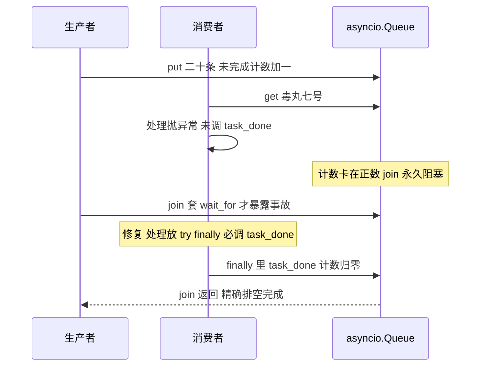

### Q1856 · join 永久阻塞事故:worker 死前忘了 task_done

> 难度:★★★ | 标签:asyncio.Queue, 事故复盘, finally

**问**:生产上 queue.join() 偶尔永远不返回,task 明明都在跑,最可能的原因是什么?

**答**:最典型账目事故:某条数据触发 worker 抛异常,死在 task_done 之前,该次 get 的计数永远没减,未完成计数卡在正数,join 无限等。

- 演示一条毒丸数据让 worker 当场死亡,join 被 wait_for 兜底查出永久阻塞;修复版把处理逻辑放进 try/finally,task_done 放 finally,成败都记账;

- 排查手段二:join 永远套 wait_for 把永久阻塞变成可观测超时;线上再加 '未完成计数' 的指标暴露;

- 次生问题:worker 异常没人收割时是 'Task exception was never retrieved',gather(return_exceptions=True) 收尸是纪律。

记住口诀:join 卡死,先查 task_done 的账,再查 worker 的尸。

```python
# file: code/02_并发与网络工程/q1856_join_hang_bug.py
# -*- coding: utf-8 -*-
"""join 永久阻塞的经典事故: worker 死前忘了 task_done, 计数永远回不到零。

- 事故链: 某条数据触发 worker 抛异常 -> 该次 get 没有 task_done -> 未完成计数卡住;
- join 无限等, 表面像 "任务丢了", 实质是队列计数器的账没平;
- 修复: 处理逻辑放进 try/finally, task_done 放 finally, 成败都记账;
- 排查手段: join 永远套 wait_for, 把永久阻塞变成可观测的超时。
"""
import asyncio


async def buggy_worker(q, results):
    while True:
        item = await q.get()
        if item == 7:
            raise ValueError("毒丸数据 7, worker 当场死亡")   # 没有 task_done!
        await asyncio.sleep(0.003)
        results.append(item)
        q.task_done()


async def fixed_worker(q, results):
    while True:
        item = await q.get()
        try:
            if item == 7:
                raise ValueError("毒丸数据 7")
            await asyncio.sleep(0.003)
            results.append(item)
        finally:
            q.task_done()                              # 成败都记账


async def run(worker_fn):
    q = asyncio.Queue()
    results = []
    workers = [asyncio.create_task(worker_fn(q, results)) for _ in range(2)]
    for i in range(20):
        await q.put(i)
    try:
        await asyncio.wait_for(q.join(), timeout=1.0)
        ok = True
    except (asyncio.TimeoutError, TimeoutError):
        ok = False                                     # join 永久阻塞的实锤
    for w in workers:
        w.cancel()
    await asyncio.gather(*workers, return_exceptions=True)
    return ok, results


async def main():
    ok1, r1 = await run(buggy_worker)
    print("有 bug 版: join 在 1s 内返回吗 -> %s, 已处理 %d 条"
          % (ok1, len(r1)))
    assert ok1 is False, "毒丸吃掉一次 task_done, join 必然超时"

    ok2, r2 = await run(fixed_worker)
    print("修复版  : join 返回 -> %s, 已处理 %d 条(毒丸被记账但跳过)"
          % (ok2, len(r2)))
    assert ok2 is True and len(r2) == 19, "除毒丸外全部处理完成"

    print("结论: join 卡死先查 task_done 账目, finally 是唯一的保险")


if __name__ == "__main__":
    asyncio.run(main())
```

**追问**:1) 毒丸数据该重试还是丢弃?——进入死账说明是确定性失败,重试只会再死一次;正确做法是记账后跳过、进死信队列,task_done 照常调用,让计数回到正轨。2) 「未完成计数指标」怎么设计才能定位事故?——暴露 qsize 与 unfinished_tasks 两个数:qsize 归零而 unfinished>0 =「有数据被取走但没记账」,直接指向 worker 异常路径;配合 worker 异常计数与死信队列计数,事故链一分钟还原。3) 死账数据的处置链?——确定性失败记账后跳过(Q1856 原问);进入死信队列(带原始数据+异常摘要);task_done 在 finally 必调;死信率是「数据质量/代码 bug」的指标,要告警而不是默默吞。4) 生产陷阱?——task_done 放在处理逻辑尾部(异常跳过);重试在 worker 内无限做(毒丸反复死);join 无 wait_for 兜底(永久阻塞);gather 不带 return_exceptions(异常静默);重启后队列计数丢失(内存队列无持久化,要外部 MQ 承接)。



---
