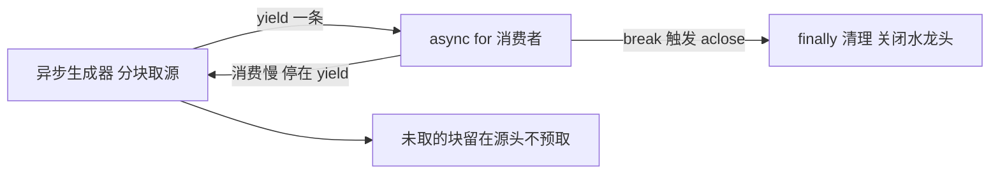

### Q1862 · 异步生成器流式接口:拉模型天然背压,break 后 aclose 收尾

> 难度:★★★ | 标签:异步生成器, 流式, 资源清理

**问**:async for 消费一个异步生成器,为什么天然就有背压?中途 break 之后清理代码会执行吗?

**答**:异步生成器是拉模型:async for 每次只向源头要一条,消费慢时源头停在 yield 处,不会预取后面未消费的块——背压不用写,结构自带。

- 分块取数的生成器里,break 提前退出意味着后续块永远不会被取回,演示里只取回前两块共八条;

- 清理必须显式:await agen.aclose() 让 finally 立即执行;自然耗尽时 finally 也会跑,但 break 之后的 aclose 不等 GC,资源释放时机确定;

- finally 里放连接归还、计数上报等收尾逻辑,这是流式接口的 '关门' 契约。

Python 3.10 才有 contextlib.aclosing,3.9 直接调 agen.aclose() 即可。

```python
# file: code/02_并发与网络工程/q1862_async_stream_gen.py
# -*- coding: utf-8 -*-
"""异步生成器流式接口: 取多少算多少, break 后 aclose 触发 finally 清理。

- async for 每次只向源头要一条, 消费慢时源头自然停在 yield 处, 天然背压;
- 分块预取的生成器: break 提前退出时, 未取的块永远不会被取回;
- 显式 await agen.aclose() 让 finally 立刻执行, 不依赖 GC 心情。
"""
import asyncio

CLEANED = {"flag": False, "produced": 0}


async def source(total=12, batch=4):
    produced = 0
    try:
        for start in range(0, total, batch):
            await asyncio.sleep(0.03)          # 模拟取块的网络延迟
            chunk = list(range(start, min(start + batch, total)))
            produced += len(chunk)
            for x in chunk:
                yield x
    finally:
        CLEANED["flag"] = True
        CLEANED["produced"] = produced
        print("  生成器 finally 清理: 实际产出 %d 条" % produced)


async def main():
    # 全量消费: 自然耗尽同样触发 finally
    got = []
    async for x in source():
        got.append(x)
    print("全量消费 %d 条" % len(got))
    assert got == list(range(12))
    assert CLEANED["flag"], "耗尽时 finally 也应执行"
    assert CLEANED["produced"] == 12

    # 中途 break: 只预取到第二块, 第三块永远不会被取回
    CLEANED["flag"] = False
    got2 = []
    agen = source()
    async for x in agen:
        got2.append(x)
        if x == 5:
            break
    await agen.aclose()
    print("中途 break 拿到:", got2)
    assert got2 == [0, 1, 2, 3, 4, 5]
    assert CLEANED["flag"], "break 后必须 aclose 触发清理"
    assert CLEANED["produced"] == 8, "只取了两块共 8 条, 后面 4 条从未取回"
    print("结论: 异步生成器是拉模型, break 就是把水龙头关在源头")


if __name__ == "__main__":
    asyncio.run(main())
```

**追问**:1) 生成器里 await 的任务被取消怎么办?——取消会注入到当前挂起的 await 点,finally 照常执行,aclose 本身也是可等待的;要小心 finally 里再做 await 可能再次被取消,清理逻辑尽量写成不可取消的短操作。2) 拉模型背压与推模型(队列)背压怎么选?——生成器拉模型:消费速率直接约束生产速率,零缓冲,适合「逐条处理」;队列推模型:缓冲吸收波动,适合「生产消费速率不匹配」;混合形态(生成器+内部小缓冲)按延迟容忍选——背压的本质都是「消费速率向上游传导」。3) aclose 的时机与 GC 的差异?——自然耗尽时 finally 自动跑;break 后生成器被 GC 时才跑 athrow/aclose(时机不定,连接归还延迟);显式 await aclose() 让清理确定化——长连接场景必须显式,「等 GC」在 async 世界是反模式。4) 生产陷阱?——break 后不 aclose(资源滞留到 GC,连接池耗尽);finally 里做慢 IO(清理本身慢,且可能再被取消,Q1862 原问);把「生成器里 await」当成普通函数调用(异常与取消的传播路径不同);异步生成器被跨任务共享(两个消费者同时拉,状态错乱)。



---
