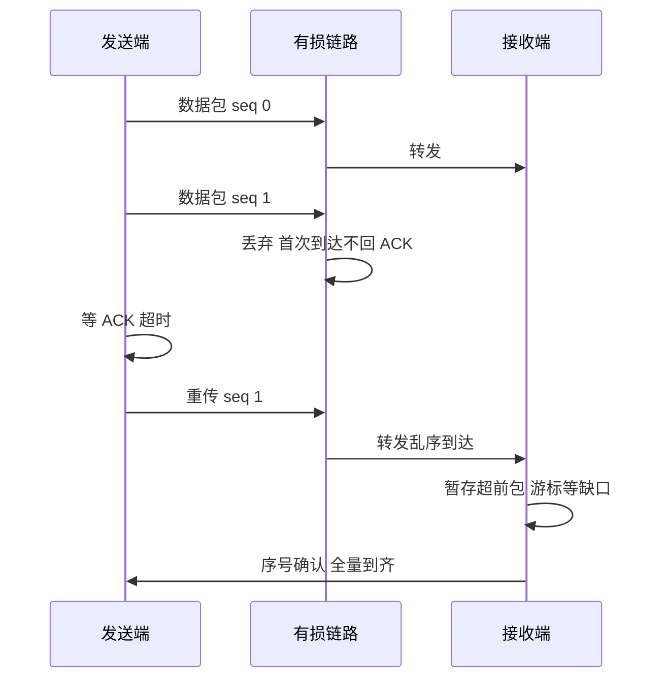

### Q1868 · UDP 乱序到达重组:按序号缓存,连续前缀才交付

> 难度:★★★ | 标签:UDP, 乱序, 重组

**问**:UDP 包到了但顺序乱了,接收方怎么处理?缺中间的包怎么办?

**答**:接收方维护 expected 游标:到达序号等于游标立即交付并推进;序号超前则暂存进缓存,并明确知道 '缺口在哪';缺口补上后一次性按序冲洗缓存。

- 演示用乱序中间人把六个分块倒序转发,接收方把 5 到 1 全部暂存,0 号一到立即交付并连冲洗五条暂存;

- 缓存要设上限与淘汰策略:缺口长期补不上时,按窗口大小丢弃过旧或过新的包,防止攻击者用乱序包撑爆内存;

- 交付顺序与到达顺序解耦后,上层应用看到的是稳定的有序字节流,这是所有序列号协议的共性。

把本题与重传题组合,就是 '可靠 + 有序' 的完整 UDP 可靠层,QUIC 做的正是这件事的工业版。

```python
# file: code/02_并发与网络工程/q1868_udp_reorder.py
# -*- coding: utf-8 -*-
"""UDP 乱序到达重组: 按序号缓存, 只交付连续前缀, 缺口暂存等补齐。

- 乱序中间人把 6 个分块按倒序转发, 模拟真实网络的乱序投递;
- 接收方维护 expected 游标: 到达序号等于游标立即交付并冲洗缓存;
- 序号超前则暂存缺口之后的数据, 缺口补上后一次性按序放行。
"""
import socket
import threading

CHUNKS = 6
MESSAGE = b"HELLO-UDP-REORDER-DEMO"


def split_message():
    base = len(MESSAGE) // CHUNKS
    rem = len(MESSAGE) % CHUNKS
    out = []
    pos = 0
    for i in range(CHUNKS):
        n = base + (1 if i < rem else 0)
        out.append(MESSAGE[pos:pos + n])
        pos += n
    return out


def port_of(s):
    return s.getsockname()[1]


def start_receiver(done_event, result_box):
    sock = socket.socket(socket.AF_INET, socket.SOCK_DGRAM)
    sock.bind(("127.0.0.1", 0))

    def loop():
        expected = 0
        buffer = {}
        delivered = b""
        sock.settimeout(3.0)
        while expected < CHUNKS:
            data, _ = sock.recvfrom(2048)
            seq = data[0]
            payload = data[1:]
            if seq == expected:
                delivered += payload
                print("  交付 seq=%d(连续)" % seq)
                expected += 1
                while expected in buffer:              # 冲洗暂存区
                    delivered += buffer.pop(expected)
                    print("  冲洗暂存 seq=%d" % expected)
                    expected += 1
            else:
                buffer[seq] = payload
                print("  暂存 seq=%d, 缺口在 seq=%d" % (seq, expected))
        result_box.append(delivered)
        done_event.set()

    threading.Thread(target=loop, daemon=True).start()
    return sock


def start_reorderer(recv_port):
    """乱序中间人: 收齐全部分块后按倒序转发给真正的接收端。"""
    sock = socket.socket(socket.AF_INET, socket.SOCK_DGRAM)
    sock.bind(("127.0.0.1", 0))
    collected = {}

    def loop():
        sock.settimeout(3.0)
        while len(collected) < CHUNKS:
            data, _ = sock.recvfrom(2048)
            collected[data[0]] = data[1:]
        for seq in sorted(collected, reverse=True):    # 倒序转发, 制造乱序
            sock.sendto(bytes([seq]) + collected[seq], ("127.0.0.1", recv_port))

    threading.Thread(target=loop, daemon=True).start()
    return sock


def main():
    done = threading.Event()
    result_box = []
    recv_sock = start_receiver(done, result_box)
    reorder_sock = start_reorderer(port_of(recv_sock))

    cli = socket.socket(socket.AF_INET, socket.SOCK_DGRAM)
    chunks = split_message()
    for i, chunk in enumerate(chunks):
        cli.sendto(bytes([i]) + chunk, ("127.0.0.1", port_of(reorder_sock)))
    cli.close()

    assert done.wait(timeout=3.0), "3 秒内应完成重组"
    recv_sock.close()
    reorder_sock.close()

    got = result_box[0]
    print("乱序交付后重组结果:", got.decode())
    assert got == MESSAGE, "按序号重组必须还原原文"
    print("结论: 乱序不可怕, 缺序号先暂存, 游标推进时连续放行")


if __name__ == "__main__":
    main()
```

**追问**:1) 乱序是常态还是异常?——多路径路由与负载均衡下是常态,跨洋链路轻微乱序很常见;窗口设计要容忍常态乱序度,重传逻辑要避免把乱序误判为丢包而重传风暴。2) 乱序度的「常态容忍」怎么定窗口?——窗口≥实测乱序深度 P99(跨洋链路可能 3-5 包);窗口太小,常态乱序被当丢包重传(风暴);太大,内存与交付延迟涨——乱序度是链路特性,窗口是它的工程映射。3) 缺口长期不补的淘汰策略?——按窗口大小丢弃过旧(缺口之前的)或过新(缺口之后太远的)包;或整体 reset 请求重传(重同步);「缓存上限+淘汰」防攻击者用乱序包撑爆内存(Q1324 的长度上限同思想)。4) 生产陷阱?——缓存无上限(内存攻击);把乱序当丢包立刻重传(风暴,先等重传超时);交付前缀时漏冲缓存(数据滞留);expected 游标回绕处理错误(序号空间耗尽);中间人转发改了字节(校验缺失,坏包被重组)。



---
