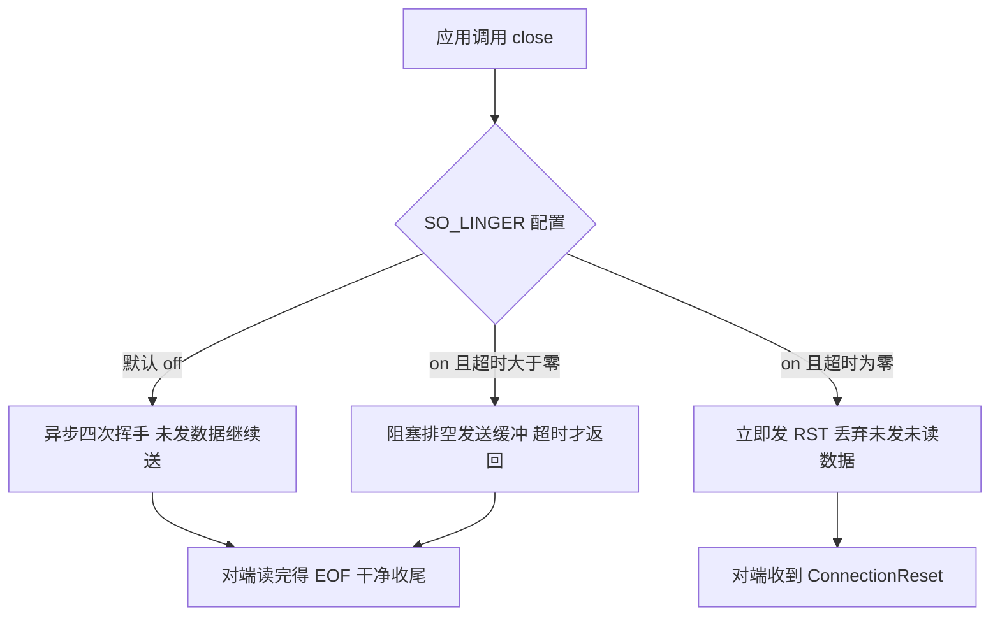

### Q1873 · socket.sendfile 零拷贝传输:与手工 sendall 循环对照

> 难度:★★★ | 标签:sendfile, 零拷贝, 性能

**问**:发大文件为什么推荐 socket.sendfile 而不是 read 后 sendall?

**答**:手工循环要把文件数据从内核页缓存拷到用户缓冲,再从用户缓冲拷进 socket 缓冲,两次拷贝加两次上下文切换;sendfile 把数据从页缓存直接推进 socket 缓冲,绕过用户态,这就是零拷贝。

- Python 的 socket.sendfile(f) 内部走 os.sendfile,返回已发送字节数,失败时记住偏移量支持续传;

- 不变式实验:两种方式各发 256KB,服务端收到的字节必须与源文件完全一致,零拷贝优化不许改变结果;

- 回环加小文件测不出吞吐差,差距在大文件、高并发、跨机网络下才显性化——但 syscall 次数与用户态内存占用的节约是结构性的。

静态文件服务、日志转发、流媒体推流,只要 '文件到 socket' 一条路,都值得换 sendfile。

```python
# file: code/02_并发与网络工程/q1873_sendfile_zero.py
# -*- coding: utf-8 -*-
"""socket.sendfile 零拷贝传输实测: 与手工 read/sendall 循环对照。

- sendfile 把文件页直接推入 socket 缓冲, 绕过用户态缓冲区, 少一次拷贝;
- 与手工循环传输的字节必须完全一致, 这是不变式;
- 回环 + 小文件看不出吞吐差, 但 syscall 次数与内存占用的差距是结构性的。
"""
import os
import socket
import tempfile
import threading
import time

SIZE = 256 * 1024


def wait_port(port, timeout=3.0):
    deadline = time.monotonic() + timeout
    while time.monotonic() < deadline:
        try:
            with socket.create_connection(("127.0.0.1", port), timeout=0.2):
                return
        except OSError:
            time.sleep(0.05)
    raise RuntimeError("端口未就绪")


def start_recv_server(n_conns, box):
    srv = socket.socket()
    srv.setsockopt(socket.SOL_SOCKET, socket.SO_REUSEADDR, 1)
    srv.bind(("127.0.0.1", 0))
    srv.listen(2)

    def serve():
        srv.settimeout(0.5)
        deadline = time.monotonic() + 5.0
        while len(box) < n_conns and time.monotonic() < deadline:
            try:
                conn, _ = srv.accept()
            except socket.timeout:
                continue
            conn.settimeout(3.0)
            first = conn.recv(65536)
            if not first:
                conn.close()            # 端口探针连接, 不消耗实验名额
                continue
            chunks = [first]
            total = len(first)
            while True:
                data = conn.recv(65536)
                if not data:
                    break
                chunks.append(data)
                total += len(data)
            conn.close()
            box.append((total, b"".join(chunks)))
        srv.close()

    threading.Thread(target=serve, daemon=True).start()
    port = srv.getsockname()[1]
    wait_port(port)
    return port


def main():
    with tempfile.TemporaryFile() as f:
        content = bytes(range(256)) * (SIZE // 256)
        f.write(content)
        f.flush()
        f.seek(0)

        box = []
        port = start_recv_server(2, box)

        # 方式一: sendfile
        c1 = socket.create_connection(("127.0.0.1", port))
        t0 = time.monotonic()
        sent1 = c1.sendfile(f)                 # 返回已发送字节数
        c1.close()
        cost1 = time.monotonic() - t0

        # 方式二: 手工 read/sendall 循环
        f.seek(0)
        c2 = socket.create_connection(("127.0.0.1", port))
        t0 = time.monotonic()
        sent2 = 0
        while True:
            chunk = f.read(65536)
            if not chunk:
                break
            c2.sendall(chunk)
            sent2 += len(chunk)
        c2.close()
        cost2 = time.monotonic() - t0

        deadline = time.monotonic() + 3.0      # 等服务端把两份都记完账
        while time.monotonic() < deadline and len(box) < 2:
            time.sleep(0.02)

        (got1, data1), (got2, data2) = box
        print("sendfile : 发送 %d 字节 耗时 %.3fs, 服务端收到 %d 字节"
              % (sent1, cost1, got1))
        print("sendall  : 发送 %d 字节 耗时 %.3fs, 服务端收到 %d 字节"
              % (sent2, cost2, got2))
        assert sent1 == SIZE and sent2 == SIZE
        assert got1 == SIZE and got2 == SIZE, "两种方式都不许丢字节"
        assert data1 == content and data2 == content, "字节必须完全一致"
        print("结论: 结果一致, sendfile 少一次用户态拷贝, 大文件下差距才显性化")


if __name__ == "__main__":
    main()
```

**追问**:1) sendfile 能配合 TLS 吗?——不能直发,TLS 要在用户态加密,数据必须过用户态,openSSL 路径上 sendfile 失效;加密传输用 sendall 或让内核 TLS(kTLS)接管。2) sendfile 的「结构性收益」具体在哪几个账上?——syscall 次数(read+send 循环→单次 sendfile,可 offset 推进)、用户态内存(数据不过用户缓冲,GC 零参与)、上下文切换(减少);吞吐差在「大文件+高并发+跨机」显性化——回环小文件测不出是常态(Q1873 原问)。3) 续传与部分发送怎么处理?——sendfile 返回已发字节数(可能小于请求,socket 缓冲满),循环推进 offset;socket.sendfile 记录 offset 失败可续传;非阻塞 socket 上 BlockingIOError 要重试(Q660 的边界清单)。4) 生产陷阱?——TLS 场景仍想 sendfile(失效,见原问);管道/非 regular file 输入(报错);对端断开未处理(ConnectionResetError);把 sendfile 当「零拷贝=零成本」(页缓存未命中仍有磁盘 IO);手工循环版被当作「等价实现」做基准(漏了 syscall 账)。



---
