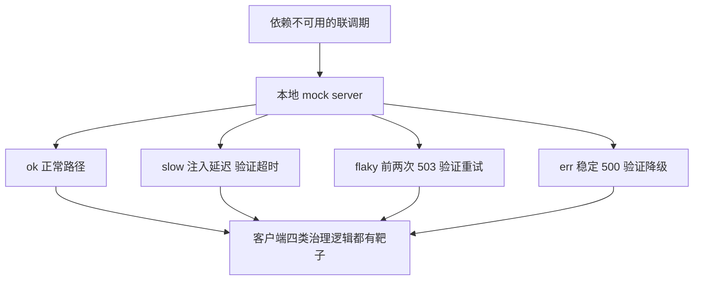

### Q1878 · 链路级 mock server:延迟与错误注入模拟真实依赖

> 难度:★★★ | 标签:mock, 测试, 错误注入

**问**:联调时第三方依赖不给力,自己起一个 mock server 要模拟哪些行为才够用?

**答**:mock 的价值不在返回正常数据,而在注入 '行为谱':正常、慢调用、间歇故障、稳定故障,四类都要有,客户端的重试、超时、降级逻辑才有靶子。

- 一个 ThreadingHTTPServer 承载四个路径:/ok 直接 200、/slow 睡 0.3 秒、/flaky 前两次 503 之后恢复、/err 稳定 500;

- flaky 的状态性是关键:客户端的重试逻辑必须真的经历两次 503 后在第三次成功,而不是 mock 永远成功让重试代码永远没跑过;

- 客户端用 urllib 加空代理 opener 绕开环境代理,慢场景用计时断言验证延迟注入生效。

进阶:把场景做成可切换的(/mock/场景名),测试用例里按需编排,就是简易的混沌工程工具。

```python
# file: code/02_并发与网络工程/q1878_mock_server.py
# -*- coding: utf-8 -*-
"""链路级 mock server: 用延迟与错误注入模拟真实依赖的行为谱。

- 一个 ThreadingHTTPServer 承载四类场景: 正常 / 慢调用 / 间歇故障 / 稳定故障;
- flaky 场景带状态: 前两次 503 之后恢复, 用于驱动客户端的重试逻辑;
- 客户端用 urllib + 空代理 opener, 绕开环境里的 http_proxy。
"""
import json
import socket
import threading
import time
import urllib.error
import urllib.request
from http.server import BaseHTTPRequestHandler, ThreadingHTTPServer


class MockHandler(BaseHTTPRequestHandler):
    hits = {"flaky": 0}

    def _reply(self, code, body):
        data = json.dumps(body).encode()
        self.send_response(code)
        self.send_header("Content-Type", "application/json")
        self.send_header("Content-Length", str(len(data)))
        self.end_headers()
        self.wfile.write(data)

    def do_GET(self):
        if self.path == "/ok":
            self._reply(200, {"status": "ok"})
        elif self.path == "/slow":
            time.sleep(0.3)                    # 注入慢调用
            self._reply(200, {"status": "slow-ok"})
        elif self.path == "/flaky":
            MockHandler.hits["flaky"] += 1
            if MockHandler.hits["flaky"] <= 2:
                self._reply(503, {"status": "unavailable"})
            else:
                self._reply(200, {"status": "recovered"})
        elif self.path == "/err":
            self._reply(500, {"status": "boom"})
        else:
            self._reply(404, {"status": "not-found"})

    def log_message(self, *args):
        pass


def wait_port(port, timeout=3.0):
    deadline = time.monotonic() + timeout
    while time.monotonic() < deadline:
        try:
            with socket_probe(port):
                return
        except OSError:
            time.sleep(0.05)
    raise RuntimeError("端口未就绪")


def socket_probe(port):
    import socket
    return socket.create_connection(("127.0.0.1", port), timeout=0.2)


def main():
    srv = ThreadingHTTPServer(("127.0.0.1", 0), MockHandler)
    port = srv.server_address[1]
    threading.Thread(target=srv.serve_forever, daemon=True).start()
    wait_port(port)

    opener = urllib.request.build_opener(urllib.request.ProxyHandler({}))
    base = "http://127.0.0.1:%d" % port

    # 正常场景
    with opener.open(base + "/ok", timeout=2) as r:
        body = json.loads(r.read())
    print("/ok    -> %d %s" % (r.status, body))
    assert body["status"] == "ok"

    # 慢调用场景: 计时验证延迟注入
    t0 = time.monotonic()
    with opener.open(base + "/slow", timeout=2) as r:
        json.loads(r.read())
    cost = time.monotonic() - t0
    print("/slow  -> 耗时 %.2fs" % cost)
    assert cost >= 0.25

    # 间歇故障场景: 客户端重试, 第三次成功
    attempts = 0
    for _ in range(3):
        attempts += 1
        try:
            with opener.open(base + "/flaky", timeout=2) as r:
                body = json.loads(r.read())
            print("/flaky 第 %d 次 -> %d %s" % (attempts, r.status, body))
            break
        except urllib.error.HTTPError as e:
            print("/flaky 第 %d 次 -> %d, 退避后重试" % (attempts, e.code))
            time.sleep(0.05)
    assert body["status"] == "recovered" and attempts == 3

    # 稳定故障场景: 500 必须如实抛出
    try:
        opener.open(base + "/err", timeout=2)
        raise AssertionError("500 不应成功")
    except urllib.error.HTTPError as e:
        print("/err   -> %d (如实抛出)" % e.code)
        assert e.code == 500

    srv.shutdown()
    print("结论: mock 注入的是行为谱, 正常 慢 间歇 常错, 四类都要覆盖")


if __name__ == "__main__":
    main()
```

**追问**:1) mock 会不会和真实行为脱节?——会,这是 mock 的固有风险;用录制的真实流量做回放、用契约测试(Pact 类)锁住接口行为,mock 才不会变成自嗨。2) flaky 场景的状态性为什么关键?——无状态的 mock 永远成功,客户端的重试逻辑永远没被执行过(测试假绿);「前两次 503 第三次成功」的状态计数让重试路径真实跑通——mock 的价值=行为谱覆盖,不是返回值正确。3) mock 与契约测试怎么分工?——mock 验证「我们的客户端逻辑」,契约测试(Pact 类)验证「对端接口行为没变」;两者互补:mock 脱节风险(见原问)由契约测试兜住;录制回放(流量镜像 Q1611)是第三种补充。4) 生产陷阱?——mock 全成功(重试/降级代码没被测过);mock 的延迟与真实不符(超时参数按假延迟调优,上线翻车);mock 不模拟分页/限流头(Retry-After);联调环境永远开着 mock(真实依赖故障被掩盖);mock 端口对外暴露(测试服务变攻击面)。



---
