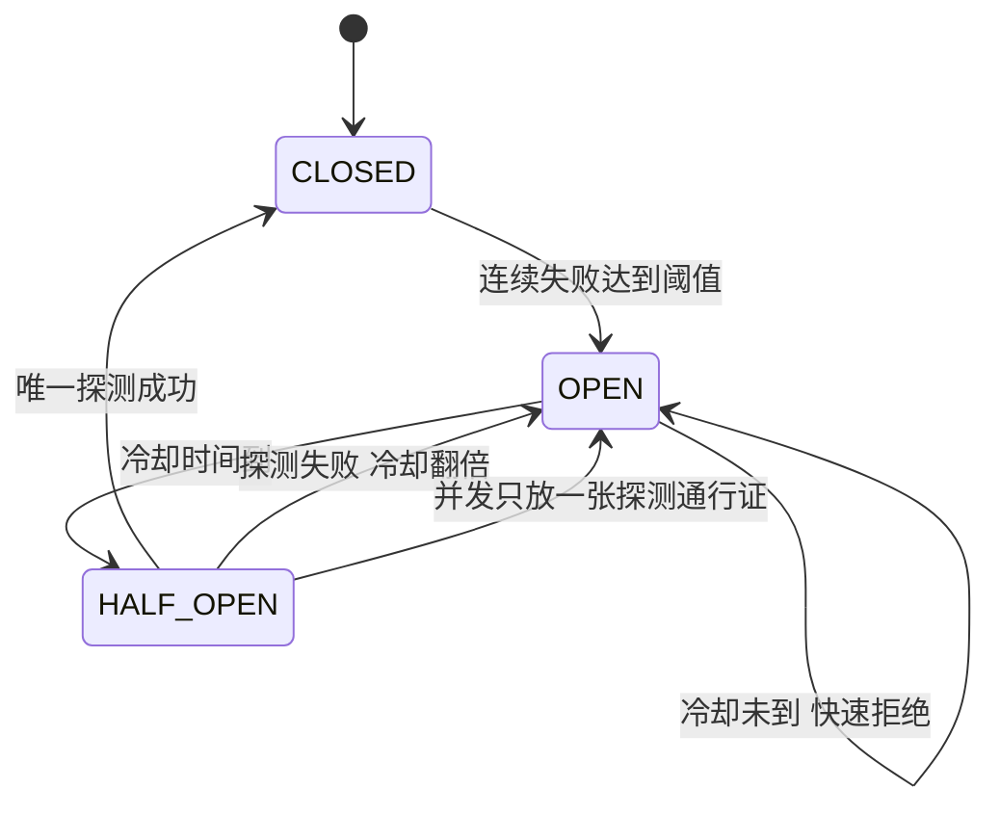

### Q1882 · 熔断半开探测的并发实现:单飞通行证只发一张

> 难度:★★★★ | 标签:熔断, half-open, 并发

**问**:熔断器冷却到点后放行,如果一秒内涌进一千个请求,半开探测不就被打爆了?

**答**:半开状态的核心是单飞:在同一把锁里只发一张 '探测通行证',抢到的执行真实请求,抢不到的立刻被拒——一千个并发里只有一个探测、九百九十九个快速失败。

- 通行证在探测开始时置位、结束时(成败都要)复位,状态翻转全部在锁内完成,没有竞态窗口;

- 探测成功回 CLOSED 并清零失败计数;探测失败回 OPEN 且冷却时间翻倍,防止对 '时好时坏' 的依赖反复试探,演示里冷却从 0.4s 翻到 0.8s;

- 实验把探测窗口拉长到 0.15s,十个并发同时涌入:恰好一个探测执行、九个被拒,闭合后全部正常放行。

半开期被拒的请求走降级路径,它们是 '熔断器还在试探' 的受害者,监控上要有独立指标。

```python
# file: code/02_并发与网络工程/q1882_half_open_probe.py
# -*- coding: utf-8 -*-
"""熔断器半开探测的并发实现: HALF_OPEN 只放一个探测, 其余快速失败。

- OPEN 冷却到点不直接 CLOSED, 先进 HALF_OPEN, 只发一张探测通行证;
- 并发请求在同一把锁里抢单飞的 probe 通行证, 抢不到的立刻被拒;
- 探测成功回 CLOSED 清零, 失败回 OPEN 且冷却时间翻倍, 防止反复试探。
"""
import threading
import time


class CircuitOpenError(Exception):
    pass


class CircuitBreaker:
    def __init__(self, failure_threshold=3, cooldown=0.4):
        self.failure_threshold = failure_threshold
        self.cooldown = cooldown
        self._lock = threading.Lock()
        self.state = "CLOSED"
        self.failures = 0
        self.opened_at = 0.0
        self.probe_in_flight = False
        self.probe_runs = 0
        self.rejected = 0

    def call(self, fn):
        with self._lock:
            now = time.monotonic()
            if self.state == "OPEN":
                if now - self.opened_at >= self.cooldown:
                    self.state = "HALF_OPEN"
                    self.probe_in_flight = False
                else:
                    self.rejected += 1
                    raise CircuitOpenError("熔断冷却中, 快速失败")
            if self.state == "HALF_OPEN":
                if self.probe_in_flight:
                    self.rejected += 1
                    raise CircuitOpenError("半开探测进行中, 只放一个")
                self.probe_in_flight = True       # 发出唯一一张探测通行证
                probe = True
            else:
                probe = False
        try:
            result = fn()
        except Exception:
            with self._lock:
                if probe:
                    self.state = "OPEN"
                    self.opened_at = time.monotonic()
                    self.cooldown *= 2            # 探测失败, 冷却翻倍
                    self.probe_in_flight = False
                else:
                    self.failures += 1
                    if self.failures >= self.failure_threshold:
                        self.state = "OPEN"
                        self.opened_at = time.monotonic()
            raise
        else:
            with self._lock:
                if probe:
                    self.state = "CLOSED"         # 探测成功, 闭合清零
                    self.failures = 0
                    self.probe_in_flight = False
                    self.probe_runs += 1
                else:
                    self.failures = 0
            return result


def main():
    cb = CircuitBreaker(failure_threshold=3, cooldown=0.4)

    def fail():
        raise RuntimeError("依赖挂了")

    def ok():
        time.sleep(0.15)                          # 拉长探测窗口, 让并发涌进来
        return "ok"

    # 第一阶段: 连续 3 次失败 -> OPEN
    for _ in range(3):
        try:
            cb.call(fail)
        except RuntimeError:
            pass
    print("三次失败后状态:", cb.state)
    assert cb.state == "OPEN"

    # 第二阶段: 冷却未到, 直接拒绝
    r0 = cb.rejected
    try:
        cb.call(ok)
        raise AssertionError("冷却期内不应放行")
    except CircuitOpenError as e:
        print("冷却期内拒绝:", e)

    # 第三阶段: 冷却到点进 HALF_OPEN, 10 并发只放一个探测
    time.sleep(0.45)
    outcomes = []
    out_lock = threading.Lock()
    r1 = cb.rejected
    start = threading.Event()

    def caller():
        start.wait()
        try:
            result = cb.call(ok)
            with out_lock:
                outcomes.append(("ok", result))
        except CircuitOpenError as e:
            with out_lock:
                outcomes.append(("rejected", str(e)))

    ts = [threading.Thread(target=caller) for _ in range(10)]
    for t in ts:
        t.start()
    time.sleep(0.02)
    start.set()
    for t in ts:
        t.join(timeout=3.0)

    rejected_in_halfopen = cb.rejected - r1
    oks = sum(1 for kind, _ in outcomes if kind == "ok")
    print("半开阶段: 探测执行 %d 次, 放行成功 %d, 并发拒绝 %d, 状态 %s"
          % (cb.probe_runs, oks, rejected_in_halfopen, cb.state))
    assert cb.probe_runs == 1, "半开只放一个探测"
    assert rejected_in_halfopen >= 6, "其余并发应被快速拒绝"
    assert cb.state == "CLOSED", "探测成功应闭合"

    # 第四阶段: 再次打开, 半开探测失败 -> 冷却翻倍
    cooldown_before = cb.cooldown
    for _ in range(3):
        try:
            cb.call(fail)
        except RuntimeError:
            pass
    time.sleep(0.45)
    try:
        cb.call(fail)
    except RuntimeError:
        pass
    print("探测失败后冷却翻倍: %.2fs -> %.2fs, 状态 %s"
          % (cooldown_before, cb.cooldown, cb.state))
    assert cb.cooldown == cooldown_before * 2, "探测失败冷却必须翻倍"
    assert cb.state == "OPEN"

    print("结论: 半开的灵魂是单飞探测, 通行证一张, 其余人立刻请回")


if __name__ == "__main__":
    main()
```

**追问**:1) 探测请求怎么选?——用流量里的真实请求当探测(简单)还是用专用健康检查(可控)是两条路线;真实探测的优点是测的就是业务链路,缺点是失败会伤及真实用户,所以要求探测请求也带降级保护。2) 「通行证在锁内置位/复位」防的是什么竞态?——探测开始/结束并发到点:无锁时多个请求都认为自己该探测(打爆半开的依赖)或通行证永久占位(熔断卡死在 HALF_OPEN);锁内原子翻转让「同窗口恰好一个探测」成为不变量。3) 冷却翻倍的参数怎么定?——翻倍+封顶(30-60s):反复探测「时好时坏」的依赖,每次失败冷却加长,给依赖真喘息;封顶防止探测周期小时级(恢复检测失效,Q1336 同构)。4) 生产陷阱?——HALF_OPEN 放行全部(半开变全开);探测成功回 CLOSED 但计数没清零(旧的失败样本拖累新窗口);冷却翻倍无封顶;探测请求无降级保护(真实用户受伤,Q1882 原问);状态迁移无指标(熔断行为不可观测)。



---
