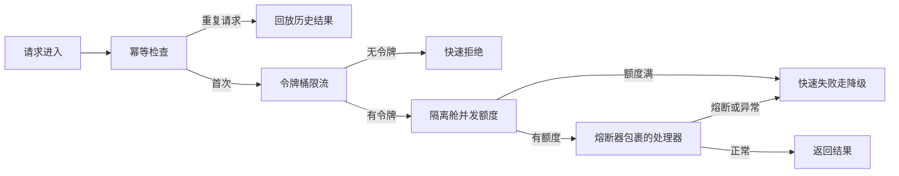

### Q1885 · 综合设计题:服务端入站治理链,五道门各司其职

> 难度:★★★★★ | 标签:治理链, 综合设计, 服务端

**问**:把幂等、限流、隔离舱、熔断、降级串成一条入站治理链,门的顺序怎么排?为什么?

**答**:按 '成本从便宜到贵' 排序:幂等回放(查内存表)→ 令牌桶限流(一次加减)→ 隔离舱额度(一次信号量)→ 熔断器包裹的处理器(真实执行)→ 降级兜底。重复请求与超量请求根本不该碰到业务处理器。

- 演示五个阶段:六正常全 ok、三 boom 让熔断打开、熔断期请求走降级、重放旧 id 命中幂等回放、十二线程突发让限流与隔离舱接管;

- 每个请求必有唯一终局:ok / dedup / rate-limited / bulkhead-full / fallback,统计上恰好一枚硬币落地,不存在 '处理了一半' 的请求;

- 五道门各有指标:回放率、拒绝率、舱满率、熔断时长、降级率,治理链的健康度就是这五个数的组合。

反例要记牢:把熔断放最外面——超量请求先打满业务再熔断,隔离舱永远白配;顺序错了,每一道门都在为上一道门的失误买单。

```python
# file: code/02_并发与网络工程/q1885_gateway_chain.py
# -*- coding: utf-8 -*-
"""综合设计题: 服务端入站治理链, 幂等 限流 隔离舱 熔断 降级 各司其职。

- 链路顺序: 幂等回放 -> 令牌桶限流 -> 隔离舱并发额度 -> 熔断器包裹处理器 -> 降级;
- 越靠前的治理越便宜, 重复请求与超量请求根本不该碰到业务处理器;
- 每个请求必有终局: ok / dedup / rate-limited / bulkhead-full / fallback 五种。
"""
import threading
import time


class TokenBucket:
    def __init__(self, capacity=10, refill_per_sec=50):
        self.cap = capacity
        self.rate = refill_per_sec
        self.tokens = float(capacity)
        self.last = time.monotonic()
        self.lock = threading.Lock()

    def take(self):
        with self.lock:
            now = time.monotonic()
            self.tokens = min(self.cap,
                              self.tokens + (now - self.last) * self.rate)
            self.last = now
            if self.tokens >= 1.0:
                self.tokens -= 1.0
                return True
            return False


class BulkheadFull(Exception):
    pass


class CircuitOpenError(Exception):
    pass


class Gateway:
    def __init__(self, capacity=10, refill=20, permits=3):
        self.bucket = TokenBucket(capacity, refill)
        self.sem = threading.BoundedSemaphore(permits)
        self.store = {}                        # id -> response
        self.store_lock = threading.Lock()
        self.breaker = {"state": "CLOSED", "failures": 0,
                        "opened_at": 0.0, "cooldown": 1.0}
        self.stats = {"ok": 0, "dedup": 0, "rate-limited": 0,
                      "bulkhead-full": 0, "fallback": 0}
        self.lock = threading.Lock()

    def _handler(self, req):
        if req["payload"] == "boom":
            raise RuntimeError("依赖炸了")
        if req["payload"] == "slow":
            time.sleep(0.4)
        return "ok:" + req["payload"]

    def _breaker_call(self, fn):
        b = self.breaker
        with self.lock:
            if b["state"] == "OPEN":
                if time.monotonic() - b["opened_at"] >= b["cooldown"]:
                    b["state"] = "HALF_OPEN"
                else:
                    raise CircuitOpenError("熔断打开")
            probe = b["state"] == "HALF_OPEN"
        try:
            result = fn()
        except Exception:
            with self.lock:
                if probe:
                    b["state"] = "OPEN"
                    b["opened_at"] = time.monotonic()
                    b["cooldown"] *= 2
                else:
                    b["failures"] += 1
                    if b["failures"] >= 3:
                        b["state"] = "OPEN"
                        b["opened_at"] = time.monotonic()
            raise
        else:
            with self.lock:
                b["state"] = "CLOSED"
                b["failures"] = 0
            return result

    def serve(self, req):
        with self.store_lock:
            if req["id"] in self.store:        # 幂等回放: 最便宜的治理
                with self.lock:
                    self.stats["dedup"] += 1
                return dict(self.store[req["id"]], outcome="ok")

        resp = {"id": req["id"]}
        if not self.bucket.take():             # 限流: 第二便宜
            resp["outcome"] = "rate-limited"
        elif not self.sem.acquire(timeout=0.1):    # 隔离舱: 第三便宜
            resp["outcome"] = "bulkhead-full"
        else:
            try:
                resp["value"] = self._breaker_call(
                    lambda: self._handler(req))
                resp["outcome"] = "ok"
            except CircuitOpenError:
                resp["outcome"] = "fallback"
            except RuntimeError:
                resp["outcome"] = "fallback"
            finally:
                self.sem.release()
        with self.store_lock:
            self.store[req["id"]] = dict(resp)
        with self.lock:
            self.stats[resp["outcome"]] += 1
        return resp


def main():
    gw = Gateway()
    seq = {"n": 0}

    def rid():
        seq["n"] += 1
        return "req-%d" % seq["n"]

    print("-- 阶段一: 6 个正常请求 --")
    for _ in range(6):
        assert gw.serve({"id": rid(), "payload": "x"})["outcome"] == "ok"

    print("-- 阶段二: 3 个 boom, 熔断打开 --")
    for _ in range(3):
        assert gw.serve({"id": rid(), "payload": "boom"})["outcome"] == "fallback"
    assert gw.breaker["state"] == "OPEN"

    print("-- 阶段三: 熔断期请求 -> 降级 --")
    assert gw.serve({"id": rid(), "payload": "x"})["outcome"] == "fallback"

    print("-- 阶段四: 重放旧 id -> 幂等回放 --")
    for _ in range(2):
        assert gw.serve({"id": "req-1", "payload": "x"})["outcome"] == "ok"

    print("-- 阶段五: 熔断冷却复位后, 4 个慢调用挤 3 个舱位 --")
    time.sleep(1.05)                           # 冷却复位熔断, 令牌桶回满
    burst_results = []
    burst_lock = threading.Lock()
    start = threading.Event()

    def burst(payload):
        start.wait()
        r = gw.serve({"id": rid(), "payload": payload})
        with burst_lock:
            burst_results.append(r["outcome"])

    ts = [threading.Thread(target=burst, args=("slow",)) for _ in range(4)]
    for t in ts:
        t.start()
    time.sleep(0.05)                           # 全员在起跑线上就位
    start.set()
    for t in ts:
        t.join(timeout=5.0)

    print("-- 阶段六: 14 线程突发, 令牌桶只放 10 个 --")
    time.sleep(1.05)                           # 慢调用结束, 令牌桶再次回满
    ts2 = [threading.Thread(target=burst, args=("x",)) for _ in range(14)]
    for t in ts2:
        t.start()
    time.sleep(0.05)
    start.set()
    for t in ts2:
        t.join(timeout=5.0)

    print("治理统计:", gw.stats)
    print("突发终局分布:", burst_results)
    assert gw.stats["dedup"] == 2, "重放请求必须命中幂等回放"
    assert gw.stats["fallback"] == 4, "3 个 boom 加 1 个熔断期请求走降级"
    assert gw.stats["bulkhead-full"] == 1, "4 个慢调用挤 3 个舱位恰好拒一个"
    assert gw.stats["rate-limited"] >= 2, "14 个突发至少 2 个被令牌桶拒绝"
    assert gw.stats["ok"] >= 19, "阶段一 6 个加慢调用 3 个加突发放行 10 个以上"
    total = sum(gw.stats.values())
    assert total == 6 + 3 + 1 + 2 + 4 + 14, "每个请求恰好一个终局"
    print("结论: 治理链按成本排序, 便宜的门挡住不值得花贵的钱")


if __name__ == "__main__":
    main()
```

**追问**:1) 客户端治理栈和服务端治理链为什么不一样?——客户端治理围绕 '重试与等待'(退避、预算、幂等键),服务端治理围绕 '接纳与隔离'(限流、舱、熔断);同一种模式在两侧的镜像形态不同,组件可以复用思想但参数与语义各定。2) 「越靠前越便宜」的排序反例有什么?——把熔断放最前(健康请求也被熔断拒,回放/限流没机会跑);把幂等放最后(重复请求已消耗业务资源);顺序错了「每一道门都在白做」——治理链的性能本质是「最便宜的检查过滤最多的流量」。3) 五个终局的指标体系怎么搭?——回放率(幂等命中)、拒绝率(限流)、舱满率、熔断时长、降级率,加上「每请求唯一终局」的不变量测试(不存在半处理请求);终局分布的突变(如降级率跳升)就是链路告警的输入。4) 生产陷阱?——治理链没有总开关(Q1345 同坑,故障时无法回基线);门的顺序按「想到了就加」(无成本排序);幂等表与限流计数器无共享基础设施(各自实现各自漏);治理层抛裸异常(终局不唯一,调用方崩);测试只测 happy path(五终局只有 ok 被覆盖)。


