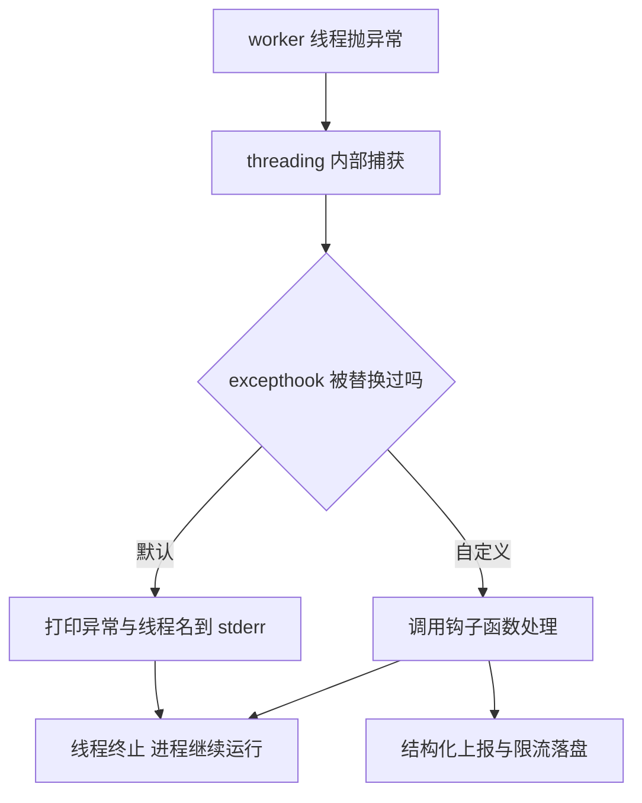

### Q2115 · excepthook 工程化:崩溃上报落盘与限流

> 难度:★★★ | 标签:excepthook, 崩溃上报, JSONL

**问**:给你一个长期运行的多线程服务,怎么把"线程崩了没人知道"变成"崩了就留档告警"?

**答**:安装一个工程化的 excepthook:每次崩溃记录时间、线程名、异常类型、消息与完整栈,追加成 JSONL 报告文件,并做总量限流防止雪崩刷盘。

- 报告结构化落盘后,可直接接日志采集或告警管道;

- 限流上限内每条都留档,超限静默丢弃,保护磁盘优先;

- 钩子内部全 try/except 包裹,上报路径本身绝不二次引爆;

- uninstall 恢复原钩子,避免测试代码污染其他库。

```python
# file: code/02_并发与网络工程/q2115_excepthook_report.py
# -*- coding: utf-8 -*-
"""excepthook 工程化: 崩溃上报与落盘。

- 钩子里做三件事: 记现场、落盘成 JSONL、限流防止雪崩刷盘;
- traceback.format_exception 拿完整栈, 线程名是定位的首要线索;
- 钩子内部绝不能再抛异常, 否则解释器只能再次打印并继续。
"""
import json
import os
import tempfile
import threading
import time
import traceback


class CrashReporter:
    def __init__(self, path, max_reports=5):
        self.path = path
        self.max_reports = max_reports
        self.count = 0
        self._lock = threading.Lock()
        self._previous = threading.excepthook

    def __call__(self, args):
        try:
            with self._lock:
                if self.count >= self.max_reports:
                    return
                self.count += 1
            entry = {
                "time": round(time.time(), 3),
                "thread": args.thread.name if args.thread else None,
                "type": args.exc_type.__name__,
                "msg": str(args.exc_value),
                "stack": "".join(traceback.format_exception(
                    args.exc_type, args.exc_value, args.exc_traceback)),
            }
            with open(self.path, "a") as f:
                f.write(json.dumps(entry, ensure_ascii=False) + "\n")
            print("[reporter] 已记录崩溃:", entry["type"], "来自", entry["thread"])
        except Exception:
            pass   # 钩子里吞掉一切, 绝不二次引爆

    def install(self):
        threading.excepthook = self

    def uninstall(self):
        threading.excepthook = self._previous


def crashy(tag):
    if tag == "big":
        raise RuntimeError("数据库连接耗尽")
    raise KeyError("missing-config")


def main():
    path = tempfile.mktemp(prefix="q2115_crash_", suffix=".jsonl")
    reporter = CrashReporter(path)
    reporter.install()
    try:
        for tag in ("net", "big", "cfg"):
            t = threading.Thread(target=crashy, args=(tag,),
                                 name="worker-" + tag)
            t.start()
            t.join()
    finally:
        reporter.uninstall()
    with open(path) as f:
        rows = [json.loads(ln) for ln in f if ln.strip()]
    print("报告条数:", len(rows))
    for r in rows:
        print("-", r["thread"], r["type"], r["msg"], "| 栈行数:",
              len(r["stack"].splitlines()))
    os.remove(path)


if __name__ == "__main__":
    main()
```

**追问**:1) 钩子里能直接调上报接口发 HTTP 吗?——能但不该:钩子运行在崩溃线程上下文,阻塞或再失败都会放大事故,先落盘、异步上报。2) 怎么区分"同一处的重复崩溃"?——报告里带线程名与栈签名,采集侧按签名聚合去重,钩子本身保持无状态。3) 「先落盘、异步上报」的分层为什么是必须的?——钩子运行在崩溃线程上下文,HTTP 上报可能再失败/阻塞,把崩溃处理变成二次事故;JSONL 落盘是本地最低保障,采集管道异步消费——崩溃路径的每一层都要「假设下一层不可靠」。4) 限流与去重的设计要点?——总量限流(超限静默丢+计数)保护磁盘;去重(栈签名聚合)在采集侧做,钩子保持无状态——限流的上限按「最坏崩溃风暴」估算(如每秒百条),磁盘预留按限流上限算。5) 生产陷阱?——钩子里再抛异常(解释器只能再打印);uninstall 不恢复原钩子(测试污染);上报接口在钩子里同步调用(放大事故);限流阈值无限流计数(雪崩刷盘);报告缺线程名/栈(无法定位)。



---
