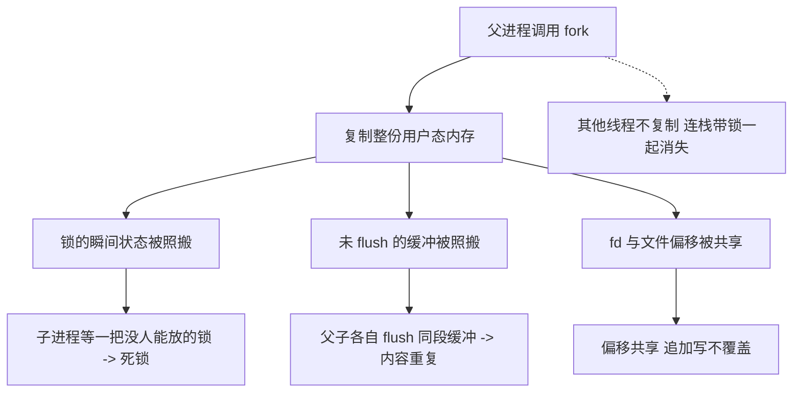

### Q2121 · threading.stack_size 与线程内存账

> 难度:★★☆ | 标签:stack_size, 线程栈, 容量估算

**问**:一台 8GB 的机器能跑多少个 Python 线程?瓶颈是 CPU 核数吗?

**答**:瓶颈是每线程的独立栈:macOS/Linux 默认栈是 MB 级,10 万线程 x 8MB 就是 800GB 虚拟内存,先爆的永远是内存账而不是 CPU。

- threading.stack_size() 可读可设,非法值抛 ValueError,实测 1 字节被拒;

- 设 256KB 后线程正常工作,但深度递归会先撞 RecursionError 甚至段错误;

- 调小栈前必须知道业务最坏递归深度,并给足余量;

- 真要海量并发任务,线程池 + 任务队列或协程才是对的形态。

```python
# file: code/02_并发与网络工程/q2121_stack_size.py
# -*- coding: utf-8 -*-
"""threading.stack_size 与线程内存账。

- 每线程独立栈, macOS 默认走系统 pthread 栈, 可用 stack_size 调低;
- 栈太小会撞 RecursionError 甚至直接段错误, 调前必须留足最坏深度;
- 换算: 10 万线程 x 8MB 默认栈 = 800GB 虚拟内存, 上限从来不是 CPU。
"""
import threading


def work(depth, out, idx):
    def climb(n):
        if n <= 0:
            return 0
        return 1 + climb(n - 1)
    try:
        climb(depth)             # 温和深度: 各档栈都能安全承载
        out[idx] = "ok"
    except RecursionError:
        out[idx] = "recursion-error"


def main():
    old = threading.stack_size()
    print("默认 stack_size:", old, "(0 表示交给系统 pthread 默认)")

    for size in (256 * 1024, 128 * 1024, 64 * 1024, 1):
        try:
            threading.stack_size(size)
            print("set(%7d) 成功, 当前 %6d KB" %
                  (size, threading.stack_size() // 1024))
        except (ValueError, RuntimeError) as e:
            print("set(%7d) 失败: %s: %s" % (size, type(e).__name__, e))

    threading.stack_size(256 * 1024)     # 降到可用的较小值
    out = [None] * 4
    ts = [threading.Thread(target=work, args=(100, out, i))
          for i in range(4)]
    for t in ts:
        t.start()
    for t in ts:
        t.join()
    threading.stack_size(old)
    print("256KB 栈跑 4 线程递归深度 100:", out)
    print("深度越大越危险: 栈不足时报 RecursionError, 更深处直接段错误")
    print("内存账: 100000 线程 x 8MB 默认 = %.0f GB (不可行)" %
          (100000 * 8 / 1024))
    print("内存账: 100000 线程 x 256KB = %.0f GB (依然巨大)" %
          (100000 * 0.25 / 1024))
    print("结论: 线程上限由栈内存与调度决定, 不是 CPU 核数")


if __name__ == "__main__":
    main()
```

**追问**:1) 虚拟内存 800GB 真的全是物理内存吗?——栈页按需分配,实际物理占用小得多,但地址空间预算与内核开销仍构成硬约束,保守估算按全量算才安全。2) 为什么调大栈也常见?——深递归业务(如树遍历)需要,和调小是同一把旋钮的两端。3) 栈内存账的完整算法?——线程数×stack_size(虚拟内存)+内核调度实体+每线程 TLS;虚拟内存按需分配物理页,但地址空间预算(64 位平台宽裕,32 位或受限容器内存上限紧张)与 vm.max_map_count(每线程至少 2 个映射)是隐性硬顶。4) 调小栈的安全边界怎么定?——业务最坏递归深度×每层帧大小+余量;RecursionError 是软保护(还能报错),段错误是硬崩溃(直接死);sys.setrecursionlimit 与 stack_size 要配套(递归限制超过栈容量就是段错误)。5) 生产陷阱?——stack_size 调小后深递归段错误(不是 RecursionError);海量线程方案(协程才是对的形态,Q654);容器内存上限没算线程栈(8GB 限制下 10 万线程全爆);虚拟内存当物理内存估算(方向反过来也会低估风险)。



---
