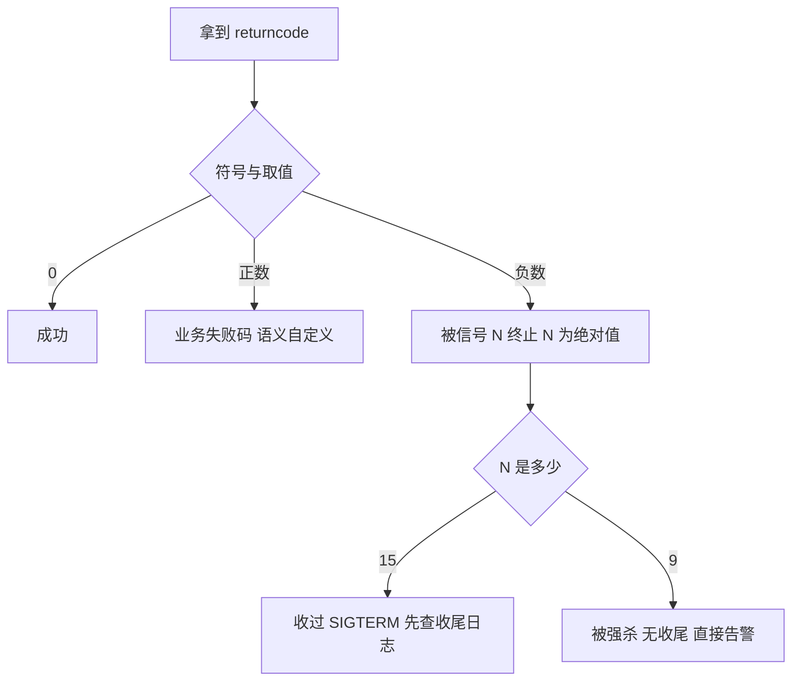

### Q2127 · 进程退出码约定:0 成功、非 0 失败

> 难度:★★☆ | 标签:退出码, returncode, 编排

**问**:巡检脚本和 CI 靠什么判断子任务成败?打印了"成功"为什么不算数?

**答**:靠退出码:0 成功、非 0 失败,这是 shell 与进程编排世界的通用契约,打印是给人看的,退出码才是给机器看的。

- sys.exit(n) 显式指定;未捕获异常默认退 1;跑完 main 退 0;

- 1-127 由业务自定义,建议在文档里固化"3 = 配置错误"这类约定;

- 调用方只需 if rc != 0 即可编排,无需解析输出文本;

- 输出仍要写,但用途是人看的诊断,不是机器判据。

```python
# file: code/02_并发与网络工程/q2127_exit_code.py
# -*- coding: utf-8 -*-
"""进程退出码约定: 0 成功、非 0 失败、1 默认异常。

- 约定 0 表示成功, 1-127 是失败码, 128+N 常用于被信号 N 杀死;
- sys.exit(n) 显式指定, 抛未捕获异常默认退 1, main 跑完退 0;
- 巡检/CI 靠退出码编排, 打印只是给人看的, 退出码才是给机器看的。
"""
import subprocess
import sys

CASES = {
    "ok": "import sys; sys.exit(0)",
    "fail3": "import sys; sys.exit(3)",
    "raise": "raise ValueError('boom')",
    "implicit": "print('done')",
}


def main():
    for tag, code in CASES.items():
        p = subprocess.run([sys.executable, "-c", code],
                           capture_output=True, text=True)
        print("%-9s returncode=%-2d stderr首行=%s" %
              (tag, p.returncode,
               (p.stderr.strip().splitlines() or [""])[0][:40]))
    print("约定映射: 0 成功 | 1 默认异常 | 3 业务自定义失败码")
    print("调用方只需 if rc != 0 就能编排, 无需解析输出")


if __name__ == "__main__":
    main()
```

**追问**:1) 128 以后的退出码是什么?——惯例上表示被信号 N 杀死(128+N),与负数 returncode 是同一事实的两种表达。2) 退出码和 stdout 的原子性问题?——退出码由内核记账,不存在缓冲与丢失,这是它比"检查输出"可靠的根本原因。3) 退出码约定的完整表怎么设计?——0 成功;1 通用失败;2 用法/环境错误;3+ 业务语义(文档固化);128+N 信号;容器/编排器(K8s)只看 0 与非 0,细分码用于自家人工排障——「机器只分两类,人看细分」的分层约定。4) 「打印不算数」的深层原因?——stdout 可能被重定向/截断/缓冲,输出不是契约;退出码由内核记账(waitpid),不经过缓冲——机器判据必须是内核可见的事实;日志(输出)与状态(退出码)分离,两套消费者两套通道。5) 生产陷阱?——sys.exit('错误信息')(传字符串=退 1 但信息进 stderr,约定破坏);未捕获异常退 1 与业务失败 1 混淆(细分码设计);CI 判断「输出含成功」(脆弱);被信号杀死(负数/128+N)没与业务失败区分(Q2128 的分诊)。



---
