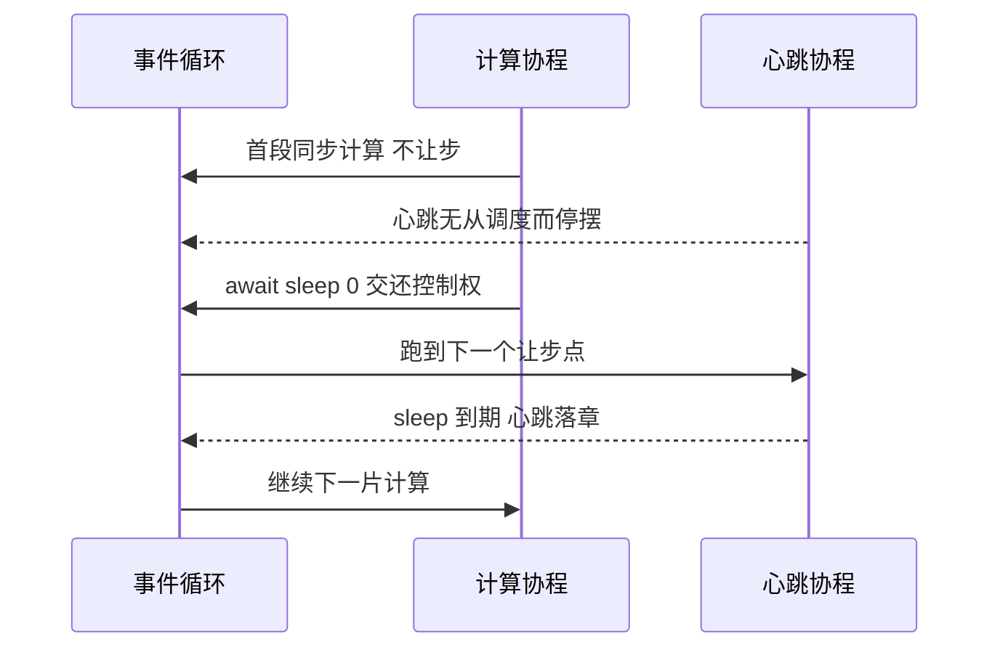

### Q2133 · await 竞态与让步点:醒来顺序的确定性

> 难度:★★★ | 标签:asyncio, 让步点, FIFO

**问**:两个协程 await 同一个延迟,谁先醒来?顺序有保证吗?

**答**:有。同一截止时刻到期的回调按注册顺序执行,先挂起者先醒;更根本的规则是:协程跑到第一个让步点之前不会被切走。

- 实测三个同延迟 racer 按 A、B、C 顺序醒来,确定性而非概率;

- 手动 send(None) 驱动演示:首个让步点前的同步段一次跑完;

- gather 的首段执行顺序等于创建顺序;

- "await 让出"的不是线程,是从当前位置到下一个让步点的执行权。

```python
# file: code/02_并发与网络工程/q2133_await_yield_point.py
# -*- coding: utf-8 -*-
"""await 竞态与让步点: 醒来顺序的确定性。

- async def 调用只创建协程, 首个 send/await 才执行到第一个让步点;
- 同一截止时刻到期的回调按注册顺序执行, 先挂起者先醒;
- 让步点是顺序的钥匙: 没有 await 的同步段不会被打断。
"""
import asyncio


async def racer(tag, out, delay):
    await asyncio.sleep(delay)     # 让步点: 控制权回到事件循环
    out.append(tag)


async def sync_head(tag, out):
    x = sum(i * i for i in range(1000))   # 首个 await 之前的同步段
    out.append((tag, x))
    await asyncio.sleep(0)                # 第一个让步点在这里


async def main():
    out = []
    await asyncio.gather(
        racer("A", out, 0.05),
        racer("B", out, 0.05),
        racer("C", out, 0.05),
    )
    print("相同延迟的醒来顺序:", out, "-> 先挂起者先醒, FIFO")

    out2 = []
    c = sync_head("X", out2)
    c.send(None)                  # 手动驱动: 跑到第一个让步点
    print("首个让步点前:", out2, "-> 同步段一次跑完, 不可被打断")
    try:
        c.send(None)              # 从 sleep(0) 之后续跑
    except StopIteration:
        pass
    print("续跑完成:", out2)

    out3 = []
    await asyncio.gather(
        sync_head("P", out3),
        sync_head("Q", out3),
    )
    print("gather 首段顺序:", [x[0] for x in out3], "-> 创建顺序即首段顺序")
    print("结论: 竞态结果的顺序由让步点安排, 而不是由概率决定")


if __name__ == "__main__":
    asyncio.run(main())
```

**追问**:1) 依赖"创建顺序即执行顺序"安全吗?——同事件循环内确定,但脆弱:任何一处延迟改动都会洗牌,顺序敏感逻辑要显式编码。2) sleep(0) 和 sleep(0.001) 语义差在哪?——0 只交一次控制权,立刻重新排队;0.001 进定时器堆,至少一轮延迟。3) 「同截止时刻按注册顺序唤醒」的机制根源?——定时器堆的平局规则:同时刻回调按入堆顺序执行;这是实现保证不是语言承诺,但 asyncio 长期稳定——依赖它做「顺序敏感」逻辑仍要显式编码(脆弱依赖)。4) 让步点与执行顺序的完整模型?——协程创建只建对象;首个 await 才执行到让步点;同步段一次跑完不可打断;await 让出的是「执行权到下一个让步点」——「确定性窗口」就是同步段,测试与竞态分析都以它为界。5) 生产陷阱?——依赖创建顺序做业务(一处改动洗牌,见原问);把 sleep(0) 与 sleep(0.001) 混用当同义(排队 vs 定时器堆,Q2133 原问);gather 假设完成顺序=创建顺序(完成顺序由任务耗时定);同步段过长(等价于阻塞循环,Q2132)。



---
