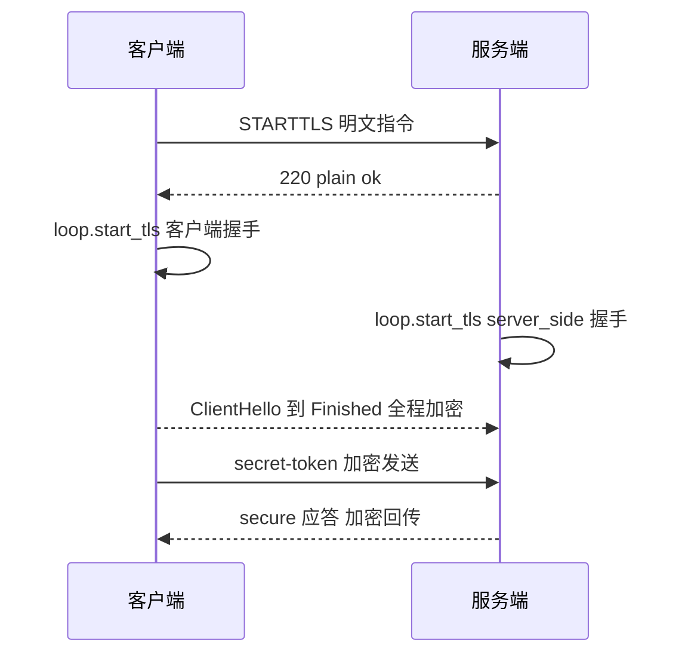

### Q2139 · Unix 域 socket:本机 IPC 的高速通道

> 难度:★★★ | 标签:AF_UNIX, IPC, asyncio

**问**:同一台机器上两个进程通信,为什么有时该选 Unix 域 socket 而不是 TCP?

**答**:AF_UNIX 不走 IP 栈,地址是文件系统路径,少了协议头与路由,权限直接用文件权限表达,本机通信的天然首选。

- asyncio 下 start_unix_server 与 TCP 版 API 完全同构,迁移零成本;

- 实测回显往返正常,退出前主动 unlink 清理套接字文件;

- 不占端口,天然避免端口冲突与端口扫描面;

- 局限:只能本机,跨容器要挂共享的 socket 文件卷。

```python
# file: code/02_并发与网络工程/q2139_unix_socket.py
# -*- coding: utf-8 -*-
"""Unix 域 socket: 本机 IPC 的高速通道。

- AF_UNIX 不走 IP 栈, 地址是文件系统路径, 无端口冲突与路由开销;
- asyncio.start_unix_server 与 TCP 版 API 完全同构, 迁移成本低;
- 退出前要主动 unlink, 否则残留路径会让下次 bind 报 EADDRINUSE。
"""
import asyncio
import os
import tempfile

SOCK_PATH = tempfile.mktemp(prefix="q2139_unix_")


async def handle(reader, writer):
    while True:
        line = await reader.readline()
        if not line:
            break
        writer.write(b"unix-echo: " + line)
        await writer.drain()
    writer.close()


async def main():
    server = await asyncio.start_unix_server(handle, path=SOCK_PATH)
    print("监听地址是文件系统路径:", SOCK_PATH)
    asyncio.ensure_future(server.serve_forever())
    await asyncio.sleep(0.15)

    reader, writer = await asyncio.open_unix_connection(SOCK_PATH)
    for msg in (b"hello", b"ipc"):
        writer.write(msg + b"\n")
        await writer.drain()
        print("发出 %s -> %s" % (msg.decode(), await reader.readline()))
    writer.close()
    await writer.wait_closed()
    server.close()
    await server.wait_closed()
    os.unlink(SOCK_PATH)      # 清理套接字文件, 防止残留
    print("文件已清理, 存在性:", os.path.exists(SOCK_PATH))
    print("同机通信选 AF_UNIX: 少一层 IP 头, 权限可直接用文件权限表达")


if __name__ == "__main__":
    asyncio.run(main())
```

**追问**:1) 残留的 socket 文件会怎样?——下次 bind 报 EADDRINUSE,服务启动前要检测并确认无人使用后再 unlink。2) 它和 socketpair 差在哪?——socketpair 是匿名的、必须由共同祖先进程创建分给双方;unix socket 有名字,无亲缘进程也能连。3) Unix socket 的权限模型怎么用?——socket 文件走文件系统权限(目录+文件 mode):chmod/socket 文件属主控制谁能 connect;与 TCP 的 IP 白名单相比是「文件权限即访问控制」;多容器共享 socket 文件卷时的权限对齐是运维点。4) 残留文件与启动清理的正确姿势?——启动时检测存在→确认无活跃使用者(连接尝试或锁文件)→unlink→bind;退出时主动 unlink(atexit/finally);EADDRINUSE 的 Unix socket 版本就是「残留文件」——比 TCP 简单(没有 TIME_WAIT)。5) 生产陷阱?——残留 socket 文件没清理(bind 失败);绝对路径过长( sockaddr 长度限制,~108 字节);跨容器忘挂载共享卷;把 Unix socket 当网络服务暴露(只能本机);unlink 竞态(两个实例同时清理/绑定,要 O_EXCL 锁文件配合)。



---
