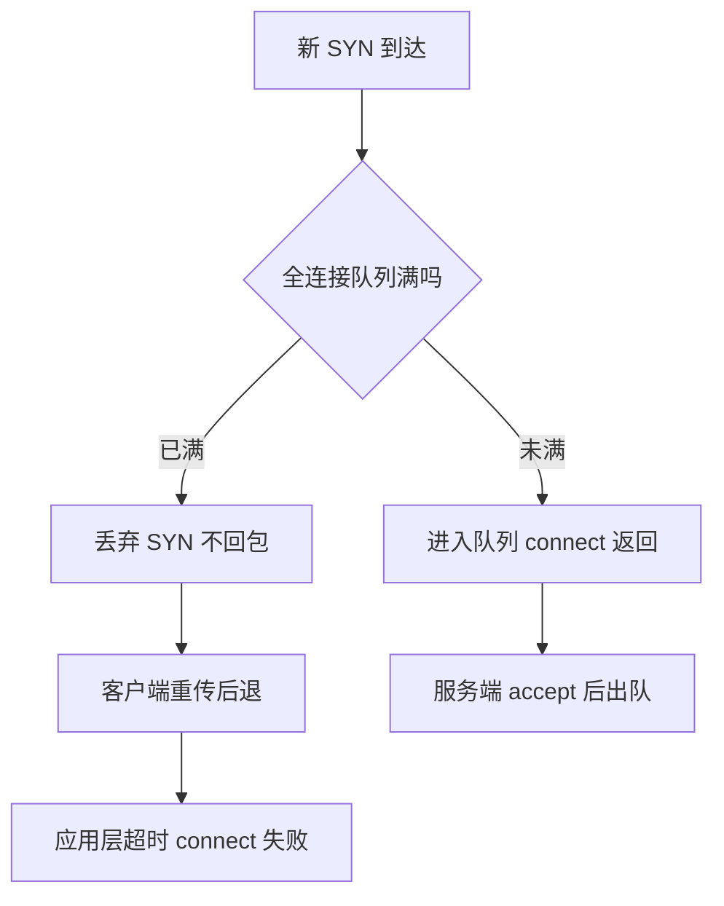

### Q2145 · backlog 实测:队列满时 connect 的行为

> 难度:★★★★ | 标签:backlog, listen, 全连接队列

**问**:listen(1) 之后不 accept,第 2、3、4 个客户端 connect 会怎样?

**答**:macOS 实测:只有 1 个 connect 立即成功,其余全部应用层超时——队列满时内核选择丢弃 SYN 而不是回 RST,客户端在重传后退中耗到超时。

- 全连接队列容量为 backlog+1(BSD/macOS),Linux 为 backlog;

- 丢弃而非拒绝,让服务端有自愈机会,但客户端感知是"很慢"而非"失败";

- 服务端开始 accept 后,积压连接才逐个转正;

- 排障含义: connect 超时可能不是网络不通,而是服务端不收货。

```python
# file: code/02_并发与网络工程/q2145_backlog_overflow.py
# -*- coding: utf-8 -*-
"""backlog 实测: 连接上限时 connect 的真实行为。

- listen(backlog) 给的是全连接队列长度, 队列满时内核丢弃新 SYN;
- macOS 实测: 多出来的客户端 connect 一直重试, 直到应用层超时;
- 服务端开始 accept 后, 排队者才逐个转为 ESTABLISHED。
"""
import socket
import threading
import time

HOST = "127.0.0.1"


def try_connect(i, port, results):
    c = socket.socket()
    c.settimeout(1.5)
    t0 = time.monotonic()
    try:
        c.connect((HOST, port))
        results[i] = ("connected", time.monotonic() - t0, c)
    except OSError as e:
        results[i] = ("%s: %s" % (type(e).__name__, e),
                      time.monotonic() - t0, None)


def main():
    srv = socket.socket()
    srv.setsockopt(socket.SOL_SOCKET, socket.SO_REUSEADDR, 1)
    srv.bind((HOST, 0))
    srv.listen(1)                       # backlog=1: 队列容量极小
    port = srv.getsockname()[1]

    results = [None] * 6
    ts = []
    for i in range(6):
        t = threading.Thread(target=try_connect, args=(i, port, results))
        t.start()
        ts.append(t)
        time.sleep(0.05)                # 依次到达, 制造排队
    for t in ts:
        t.join(3)

    ok = 0
    for i, (res, dur, conn) in enumerate(results):
        print("client %d -> %-28s %.2fs" % (i, res, dur))
        if conn:
            ok += 1
    print("backlog=1 时仅 %d 个立即成功, 其余 connect 超时(SYN 被丢)" % ok)

    # 服务端现在开始 accept: 存活连接被取走, 新连接可以进来了
    accepted = 0
    srv.settimeout(0.1)
    try:
        while True:
            conn, _ = srv.accept()
            conn.close()
            accepted += 1
            if accepted >= ok:
                break
    except socket.timeout:
        pass
    print("服务端 accept 了 %d 个积压连接" % accepted)
    print("容量公式: BSD/macOS 的全连接队列 = backlog + 1, Linux 为 backlog")
    srv.close()


if __name__ == "__main__":
    main()
```

**追问**:1) SYN 队列和 accept 队列分别在哪一步?——半连接队列收 SYN 未确认,三次握手完成进入全连接队列等 accept,溢出行为由内核参数决定。2) 怎么确认线上是这种情况?——netstat 看 Recv-Q 贴着 backlog 上限,配 ss -lnt 的 Send-Q/Recv-Q,应用侧看 connect 超时率。3) 丢弃 SYN 而非回 RST 的设计意图?——让客户端 TCP 自动重传(1s/2s/4s...),给服务端自愈窗口;代价是客户端感知「慢」而不是「失败」——这正是「connect 超时」难归因的根源(Q665/Q618):队列满、网络断、防火墙丢全是同一症状。4) backlog+1 与平台差异怎么写可移植代码?——BSD/macOS 实际容量 backlog+1,Linux 为 backlog(且受 somaxconn 钳制,Q618);容量估算按 min(backlog, somaxconn),测试别依赖精确值;观测用 ss -lnt 的 Recv-Q/Send-Q。5) 生产陷阱?——listen(1) 上生产;connect 超时误判网络不通(其实是服务不收货);调大 backlog 不调 somaxconn(白调);SYN 重传的超时(127s 级)远大于应用层超时,「超时重试」在队列满时变成雪崩放大器(要限流重试)。



---
