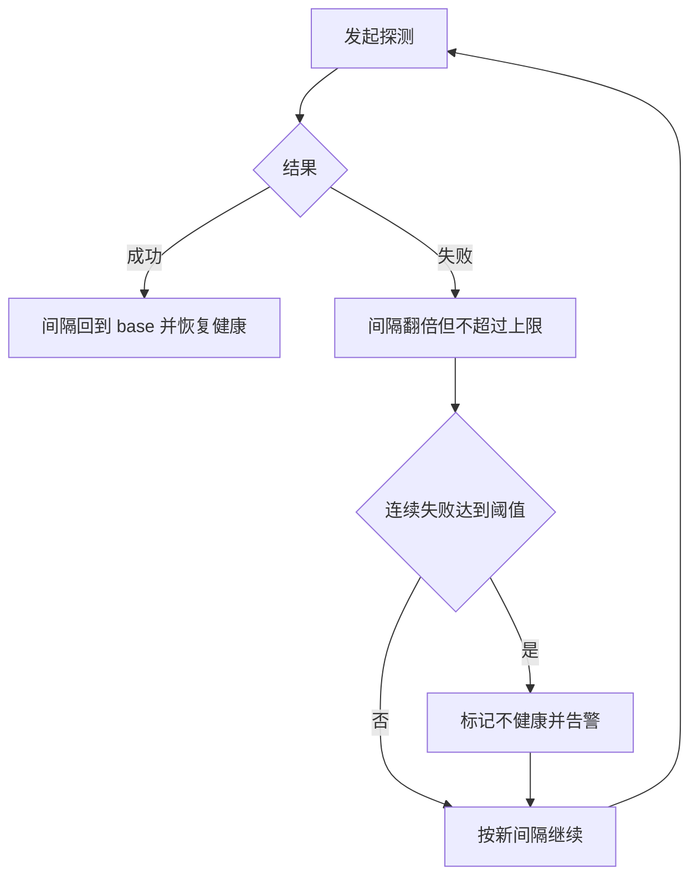

### Q2150 · 健康探测的指数回退:从快到慢,恢复即回正常

> 难度:★★★ | 标签:健康检查, 指数回退, 探测

**问**:健康探测失败要不要立刻再试?间隔怎么定才不把病重的依赖打死?

**答**:失败就退:间隔从 base 起翻倍,设上限封顶;一旦成功立即回到 base——病时少打扰,好时第一时间发现。

- 实测间隔序列 0.05、0.10、0.20、0.40 封顶,第 5 次成功后回 base;

- 与重试退避的区别:探测是持续行为,没有"放弃",只有节奏变化;

- 恢复检测延迟由 base 决定,故障发现速度由 cap 决定,两端都要按业务定;

- 多实例要加 jitter,防止同相位探测形成周期性齐射。

```python
# file: code/02_并发与网络工程/q2150_probe_backoff.py
# -*- coding: utf-8 -*-
"""健康探测的指数回退: 从快到慢, 恢复即回正常。

- 探测失败按倍数拉长间隔并设上限, 避免打死已经病了的依赖;
- 一旦成功立即回到最快档, 保证恢复能被第一时间发现;
- 实测间隔序列: 0.05, 0.10, 0.20, 0.40, 0.40... 成功后回到 0.05。
"""
import time


def probe(calls, state):
    """假依赖: 前 4 次失败, 之后恢复; 记录真实健康变化。"""
    state["n"] += 1
    calls.append(state["n"])
    return state["n"] > 4


def main():
    state = {"n": 0}
    calls = []
    base, cap, factor = 0.05, 0.4, 2.0
    interval = base
    seq = []
    ok_at = None
    deadline = time.monotonic() + 3.0
    t0 = time.monotonic()
    while time.monotonic() < deadline:
        begin = time.monotonic()
        healthy = probe(calls, state)
        if healthy:
            ok_at = time.monotonic() - t0
            seq.append(("成功", interval))
            break
        seq.append(("失败", interval))
        interval = min(cap, interval * factor)   # 回退, 封顶
        sleep_left = interval - (time.monotonic() - begin)
        if sleep_left > 0:
            time.sleep(sleep_left)

    for i, (res, gap) in enumerate(seq):
        print("第 %d 次探测: %-2s 间隔 %.2fs" % (i + 1, res, gap))
    print("恢复时刻: %.2fs" % ok_at)
    print("失败段间隔翻倍直到封顶; 成功后下一轮从 base 重新开始")
    print("工程补充: 抖动 jitter 防止多实例同相位探测; "
          "连续 N 次失败才标记不健康, 单次失败不摘除")


if __name__ == "__main__":
    main()
```

**追问**:1) 探测成功要连续几次才算恢复?——单次成功可能是瞬态,连续 N 次再翻转状态,避免健康/不健康的振荡。2) cap 定 0.4s 还是 30s?——取决于探测成本与恢复敏感度:本机进程 0.4s,远端云服务几秒到几十秒都很常见。3) 「连续 N 次成功才翻转」的防振荡设计?——单次成功可能是瞬态(抖动);N 次连续成功才标记恢复,恢复检测延迟=N×base——N 与 base 的权衡;这与健康检查的 failureThreshold 对称(Q691 readiness 的连续失败阈值)。4) 探测节奏与重试退避的区别?——探测是持续行为(没有放弃,只有节奏);重试有总预算(会放弃);恢复即回 base(第一时间发现恢复);多实例 jitter 防齐射(Q1335 抖动思想)——两个机制共享「指数退避」但语义不同,别共用参数。5) 生产陷阱?——失败立即重试(打死病重依赖);无 cap(间隔指数爆炸);恢复判定单次(振荡);探测与业务超时同一参数(探测超时应更短);状态翻转无指标(健康/不健康切换次数可观)。



---
