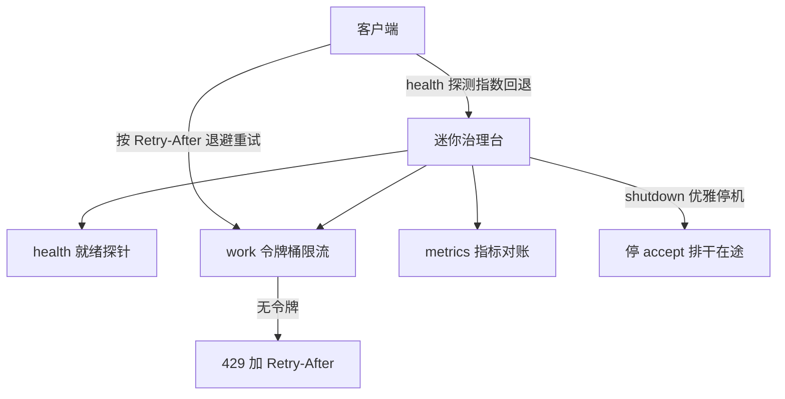

### Q2154 · 守护进程化:setsid 与双重 fork

> 难度:★★★★ | 标签:daemonize, setsid, 双重 fork

**问**:把一个脚本变成真正的 daemon,为什么标准动作是 fork 两次加 setsid?

**答**:fork 一加 setsid 让进程自成会话、脱离控制终端;fork 二让孙进程不再担任会话首——会话首才可能重新拿回终端,双重 fork 从结构上断绝这条路。

- 实测孙进程 ppid=1 由 launchd 收养,sid 等于中间进程 pid 而非自身 pid;

- 0/1/2 三个 fd 全部断开重定向,stdin/stdout/stderr 与终端脱钩;

- 中间进程把孙 pid 写入 pidfile 交给父进程,作为管理锚点;

- SIGTERM 后孙进程被收养者收尸,无僵尸残留。

```python
# file: code/02_并发与网络工程/q2154_daemonize.py
# -*- coding: utf-8 -*-
"""守护进程化: setsid 与双重 fork。

- 一次 fork + setsid 摆脱终端; 第二次 fork 让 daemon 永远不是会话首进程;
- 会话首进程才可能意外拿回控制终端, 二次 fork 是历史上防这一手的;
- 实测: 孙进程 ppid 变 1 由 launchd 收养, 自己是自己的会话首。
"""
import os
import subprocess
import tempfile
import time

pidfile = tempfile.mktemp(prefix="q2154_pid_")
beatfile = tempfile.mktemp(prefix="q2154_beat_")


def ps_field(pid, field):
    r = subprocess.run(["ps", "-o", field + "=", "-p", str(pid)],
                       capture_output=True, text=True)
    return r.stdout.strip()


def main():
    pid = os.fork()
    if pid == 0:
        os.setsid()                       # 第一次: 自成会话, 脱离终端
        pid2 = os.fork()                  # 第二次: 甩掉会话首身份
        if pid2 == 0:
            devnull = os.open(os.devnull, os.O_RDWR)
            os.dup2(devnull, 0)           # 三件套: 断开 stdio 与终端
            os.dup2(devnull, 1)
            os.dup2(devnull, 2)
            for i in range(8):
                with open(beatfile, "a") as bf:
                    bf.write("beat-%d\n" % i)
                time.sleep(0.15)
            os._exit(0)
        with open(pidfile, "w") as pf:    # 中间进程把孙 pid 交给父进程
            pf.write(str(pid2))
        os._exit(0)

    os.waitpid(pid, 0)                    # 原始子进程立刻退出
    time.sleep(0.2)
    gpid = int(open(pidfile).read())
    print("孙进程 pid:", gpid)
    print("收养检查: ppid =", ps_field(gpid, "ppid"),
          "(1 表示由 launchd 收养)")
    sid = os.getsid(gpid)
    print("会话检查: sid =", sid, "| 自身 pid =", gpid,
          "(sid 是中间进程, 孙进程不是会话首, 永远拿不回终端)")
    time.sleep(0.4)                       # daemon 还在心跳
    try:
        os.kill(gpid, 0)
        alive = True
    except OSError:
        alive = False
    print("运行中探活:", alive, "| 心跳:",
          open(beatfile).read().split()[-1])
    os.kill(gpid, 15)                     # 收工
    time.sleep(0.3)
    print("SIGTERM 后 stat:", ps_field(gpid, "stat") or "<gone>",
          "-> 已由收养者收尸, 无僵尸残留")
    for p in (pidfile, beatfile):
        try:
            os.remove(p)
        except OSError:
            pass


if __name__ == "__main__":
    main()
```

**追问**:1) 现代系统还用双重 fork 吗?——有 systemd/launchd 托管后大多不用,但无 init 帮忙的环境(容器内嵌脚本、crontab 长任务)仍是标准手艺。2) daemon 里为什么常调 os.umask?——fork 继承的 umask 来自调用者,重设为 022 之类的确定值,避免新建文件权限受环境摆布。3) 双重 fork 的每一步各解决什么?——fork1+setsid:新会话、脱离控制终端(SIGHUP 不再来自终端断开);fork2:daemon 不再是会话首(会话首可能重新拿终端);之后 chdir('/')、umask 重设、0/1/2 重定向——每步都有明确目的,不是仪式。4) 现代替代方案与适用场景?——systemd/launchd 托管(无需自 daemon 化,Type=forking 兼容旧式);容器里用 tini/编排;双重 fork 仍适用:无 init 环境、crontab 长任务、自研管理器——「有 init 交 init,没 init 自己来」。5) 生产陷阱?——fork1 后忘记 setsid(SIGHUP 杀进程);stdin/stdout 没重定向(写 tty 阻塞);pidfile 没写(管理锚点丢失,Q1612);umask 没重设(文件权限随环境);双重 fork 后孤儿误判(孙进程 ppid=1 是正常状态)。



---
