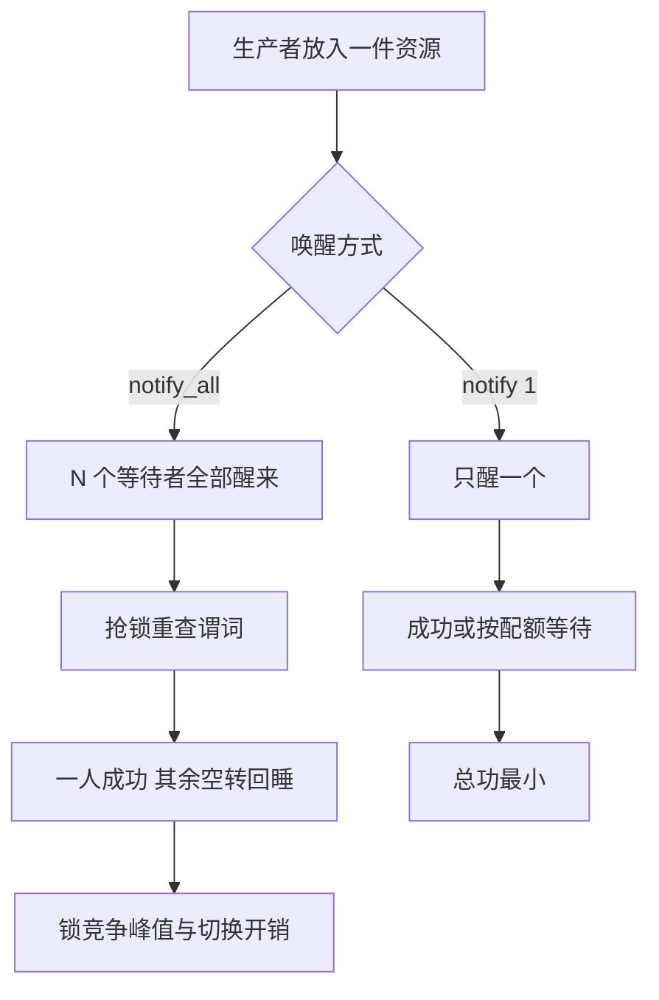

### Q2381 · 条件变量的广播唤醒风暴

> 难度:★★☆ | 标签:Condition, notify_all, 惊群

**问**:五个消费者都挂在 Condition 上,生产者放了一件资源然后 notify_all,会发生什么?代价是什么?

**答**:notify_all 无差别唤醒所有等待者,但资源只有一份,于是四个人醒来、抢锁、检查谓词、再睡回去,全是空转,这就是惊群 herd effect。

- 实测 5 个等待者广播唤醒 5 次,成功只有 1 次,空转 4 次;

- notify(1) 只唤醒一人,唤醒次数等于成功次数,总功最小;

- 广播的正确用途是"状态发生了质变"(关门、配置切换),不是"来了一件货";

- 惊群的真实代价是锁竞争峰值与上下文切换,等待者越多越痛。

```python
# file: code/02_并发与网络工程/q2381_notify_all_storm.py
# -*- coding: utf-8 -*-
"""条件变量的广播唤醒风暴: notify_all 唤醒 N 人, 只有 1 人干成活。

- notify_all 无差别唤醒全部等待者, 每个醒来都要抢锁重查谓词;
- 一份资源被一个人拿走, 其余唤醒全是空转, 这就是惊群 herd effect;
- notify(1) 只唤醒一个, 唤醒次数等于成功次数, 系统总功最小。
"""
import threading
import time


class Slot:
    """最小可竞争资源槽: items 非空即谓词成立。"""

    def __init__(self):
        self.cond = threading.Condition()
        self.items = []
        self.wakeups = 0    # wait() 返回次数, 即被唤醒的次数
        self.success = 0    # 醒来后真的拿到资源的次数
        self.stop = False

    def consumer(self, name):
        while True:
            with self.cond:
                while not self.items and not self.stop:
                    self.cond.wait()
                    self.wakeups += 1        # 每次 wait 返回都是一次唤醒
                if self.items:
                    self.items.pop()
                    self.success += 1
                if self.stop:
                    return

    def produce_one(self, broadcast):
        with self.cond:
            self.items.append("job")
            if broadcast:
                self.cond.notify_all()
            else:
                self.cond.notify(1)

    def shutdown(self):
        with self.cond:
            self.stop = True
            self.cond.notify_all()


def run_round(n_consumers, broadcast):
    slot = Slot()
    threads = [threading.Thread(target=slot.consumer, args=(i,), daemon=True)
               for i in range(n_consumers)]
    for t in threads:
        t.start()
    time.sleep(0.2)          # 确保全部消费者已挂到 wait 上
    with slot.cond:
        assert len(slot.cond._waiters) == n_consumers, "消费者未全部挂起"
    slot.produce_one(broadcast)
    deadline = time.monotonic() + 2.0
    while slot.success < 1 and time.monotonic() < deadline:
        time.sleep(0.01)
    time.sleep(0.25)                  # 等这一轮被唤醒的消费者全部数完
    storm_wakeups = slot.wakeups      # 在 shutdown 唤醒之前快照, 只统计资源那轮
    slot.shutdown()
    for t in threads:
        t.join(timeout=1.0)
    return storm_wakeups, slot.success


def main():
    w1, s1 = run_round(5, broadcast=True)
    print("notify_all: 资源轮唤醒 %d 次, 成功 %d 次, 空转 %d 次" % (w1, s1, w1 - s1))
    w2, s2 = run_round(5, broadcast=False)
    print("notify(1) : 资源轮唤醒 %d 次, 成功 %d 次, 空转 %d 次" % (w2, s2, w2 - s2))
    assert s1 == 1 and s2 == 1, "两种方式最终都只应成功消费一份"
    assert w1 >= 5 and w2 == 1, "广播应唤醒全员, 精准通知只醒一人"


if __name__ == "__main__":
    main()
```

**追问**:1) 什么场景必须用 notify_all 而不能 notify(1)?——谓词对全体等待者同时成立或失效时,比如 shutdown 标志,notify(1) 会让其余人永久沉睡。2) 惊群在 accept 场景有标准解法吗?——多进程 accept 用 SO_REUSEPORT 让内核分流,应用层等价物是每线程独立事件队列。3) 惊群的代价在 CPython 里具体是什么?——等待者全部醒来抢 GIL+锁、检查谓词、再 wait,锁竞争峰值与上下文切换都是空转功;等待者越多代价越线性;notify(1) 的「唤醒数=成功数」是最小功原则——与内核 accept 惊群( thundering herd)同型。4) notify(1) 的语义陷阱?——唤醒哪一个由调度决定(不保证 FIFO),公平性要靠队列票号(Q1851);配额与资源数要匹配(放 n 件 notify(n),Q2382);「状态质变」(shutdown/配置切换)必须广播,notify(1) 会让其余等待者永久沉睡(见原问)。5) 生产陷阱?——事事 notify_all(惊群常态化);谓词用 if 不用 while(空唤醒后拿错状态);notify 在锁外调用;把 SO_REUSEPORT 与应用层惊群混为一谈(内核分流 vs 唤醒风暴,层次不同)。



---
