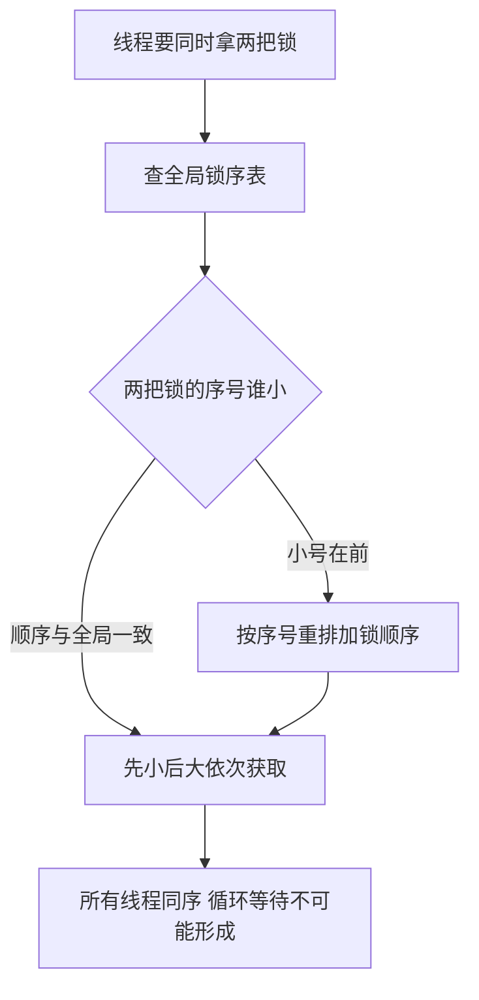

### Q2383 · 锁顺序图与死锁预防:全局定序

> 难度:★★★ | 标签:锁顺序, 死锁预防, 转账

**问**:两个账户互相转账,每笔转账要同时拿两把锁,怎么保证永不死锁?

**答**:死锁四条件里唯一能被业务代码破坏的是循环等待,手段是给所有锁一个全局全序,任何线程加锁都按序号从小到大。

- 实测按参数顺序加锁的两个方向相反的转账,在交叉持锁窗口下至少一方撞上循环等待,靠超时才逃出来;

- 修复版按 acc_id 排序后加锁,与传参方向无关,五轮对照全部成功且账目守恒;

- 定序的工程形态是锁顺序图:锁编号集中登记,评审时对着图检查调用链;

- 代价是某些调用必须先拿"不想要"的锁,以及锁的分层设计要在文档里活着维护。

```python
# file: code/02_并发与网络工程/q2383_lock_order_graph.py
# -*- coding: utf-8 -*-
"""锁顺序图与死锁预防: 全局定序, 按序加锁。

- 死锁四条件的破坏点选"循环等待": 给所有锁一个全序编号;
- 加锁永远从小号到大号, 两把锁的获取顺序在任何线程里都一致;
- 演示按参数顺序加锁的两个转账互锁, 与按 id 排序的正确版对照。
"""
import threading
import time


class Account:
    def __init__(self, acc_id, balance):
        self.acc_id = acc_id
        self.balance = balance
        self.lock = threading.Lock()


def transfer_naive(src, dst, amount, timeout=0.2):
    """按参数顺序加锁, 调用方传参顺序不同就可能互锁。"""
    if not src.lock.acquire(timeout=timeout):
        return False, "拿不到源账户"
    try:
        time.sleep(0.05)                     # 扩大交叉窗口, 模拟真实记账耗时
        if not dst.lock.acquire(timeout=timeout):
            return False, "拿不到目标账户, 疑似循环等待"
        try:
            src.balance -= amount
            dst.balance += amount
            return True, "ok"
        finally:
            dst.lock.release()
    finally:
        src.lock.release()


def transfer_ordered(src, dst, amount):
    """按 acc_id 全序加锁: 小号在前, 与传参方向无关。"""
    first, second = (src, dst) if src.acc_id < dst.acc_id else (dst, src)
    with first.lock:
        with second.lock:
            if first is src:
                src.balance -= amount
                dst.balance += amount
            else:                # 先拿到的是 dst, 锁的语义不变, 记账方向不变
                src.balance -= amount
                dst.balance += amount
            return True, "ok"


def main():
    a, b = Account(1, 100), Account(2, 100)
    results = {}

    def t_ab():
        results["ab"] = transfer_naive(a, b, 10)     # 先拿 a 再拿 b
    def t_ba():
        results["ba"] = transfer_naive(b, a, 10)     # 先拿 b 再拿 a

    t1, t2 = threading.Thread(target=t_ab), threading.Thread(target=t_ba)
    t1.start(); t2.start()
    t1.join(); t2.join()
    print("naive 双向转账:", results["ab"][1], "/", results["ba"][1])
    assert (not results["ab"][0]) or (not results["ba"][0]), \
        "交叉持锁窗口下, naive 版至少一方要撞上循环等待"
    print("  账目守恒 a+b =", a.balance + b.balance, "失败方未动账, 无脏数据")

    for _ in range(5):
        a2, b2 = Account(1, 100), Account(2, 100)
        r = {}

        def t2_ab():
            r["ab"] = transfer_ordered(a2, b2, 10)
        def t2_ba():
            r["ba"] = transfer_ordered(b2, a2, 10)

        ta, tb = threading.Thread(target=t2_ab), threading.Thread(target=t2_ba)
        ta.start(); tb.start()
        ta.join(); tb.join()
        assert r["ab"] == (True, "ok") and r["ba"] == (True, "ok"), "按序加锁必须双双成功"
        assert a2.balance == 100 and b2.balance == 100, "两笔对转账应互相抵消"
    print("ordered 双向转账 x5: 全部成功, 余额守恒")


if __name__ == "__main__":
    main()
```

**追问**:1) 锁序号怎么定才不返工?——按模块层级分层编号,高层先于低层,新增锁必须声明自己在哪层。2) 已上线的代码拿不到全序怎么办?——用 acquire 的 timeout 加失败回退近似模拟 tryLock,再用等待图检测兜底。3) 全局定序的分层设计怎么维护不腐化?——锁编号按模块层级集中登记(锁顺序图),新增锁必须声明层级;评审检查「调用链上的加锁顺序」;文档「活着维护」意味着:CI 检查(静态扫描 acquire 调用图)优于人工记忆——定序是防死锁四条件里唯一业务可破坏的(循环等待),其余三条(互斥/持有等待/不可剥夺)只能缓解。4) 已上线代码没有全序怎么办?——acquire(timeout)+失败回退近似 tryLock(拿到两把或全都不拿);等待图检测兜底(Q2384);这两层是「检测+恢复」,定序是「预防」——三层互补,别只用一层。5) 生产陷阱?——按参数顺序拿锁(方向相反就互锁,见原问);锁序破坏点藏在回调/依赖注入里(拿锁时调外部代码,Q2116 同源);超时回退后重试无退避(活锁);定序只覆盖业务锁,logging/分配器等隐式锁没进图(Q2124)。



---
