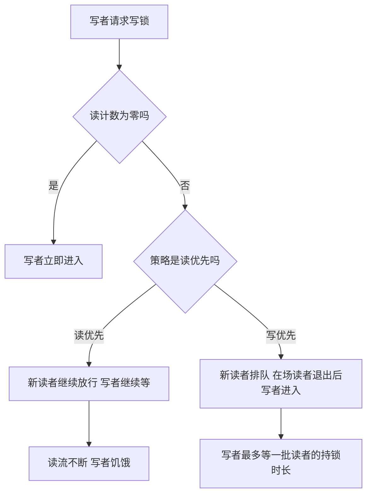

### Q2386 · 读写锁的写饥饿实测

> 难度:★★★★ | 标签:读写锁, 写饥饿, 公平策略

**问**:读多写少的场景给读写锁配了读优先策略,写者会怎么样?

**答**:读优先策略下,只要读计数不落回零,写者就一直等;读流不断,写者就饿死。实测用互相重叠的读流验证:读优先时写者等到读流结束,写优先时写者只等在场的最后一批读者退出。

- 读优先的实现:read_acquire 无条件放行,write_acquire 等 readers==0;

- 写优先的实现:writer_waiters 计数,后来的读者排在等待的写者身后;

- 实测数字:重叠读流下读优先写者等约 0.9s,写优先只等约 0.09s,差一个量级;

- 没有绝对正确的策略,读极多写极少选读优先吞吐高,写延迟敏感必须写优先,策略要写进测试。

```python
# file: code/02_并发与网络工程/q2386_rwlock_writer_starve.py
# -*- coding: utf-8 -*-
"""读写锁的写饥饿实测: 读优先策略下, 写者等到天荒地老。

- 读优先: 只要读计数不落回零, 写者就一直等, 读流不断则写者永远进不来;
- 写优先: 后来读者排在等待的写者身后, 写者最多等在场的这批读者退出;
- 没有绝对正确的策略, 要按读写比显式选择并写明测试。
"""
import threading
import time


class RWLock:
    def __init__(self, writer_pref=False):
        self.cond = threading.Condition()
        self.readers = 0
        self.writer = False
        self.writer_waiters = 0
        self.writer_pref = writer_pref

    def read_acquire(self):
        with self.cond:
            while self.writer or (self.writer_pref and self.writer_waiters):
                self.cond.wait()
            self.readers += 1

    def read_release(self):
        with self.cond:
            self.readers -= 1
            self.cond.notify_all()

    def write_acquire(self):
        with self.cond:
            self.writer_waiters += 1
            try:
                while self.writer or self.readers:
                    self.cond.wait()
            finally:
                self.writer_waiters -= 1
            self.writer = True

    def write_release(self):
        with self.cond:
            self.writer = False
            self.cond.notify_all()


def reader_one(rwl, hold_s, counter):
    """单个读者: 持锁 hold_s 后退出。"""
    rwl.read_acquire()
    try:
        counter["entered"] += 1
        time.sleep(hold_s)
    finally:
        rwl.read_release()


def reader_stream(rwl, stop_at, counter, hold_s=0.1, period=0.02):
    """重叠读流: 每 period 秒来一个持锁 hold_s 的读者, 区间互相覆盖。

    hold_s 远大于 period, 相邻读者有 80ms 的重叠余量, 读计数从构造上
    不落回零, 排除调度抖动导致的假成功。
    """
    spawner = threading.current_thread()
    while time.monotonic() < stop_at:
        t = threading.Thread(target=reader_one, args=(rwl, hold_s, counter))
        t.start()
        time.sleep(period)
    return spawner


def measure_writer_wait(writer_pref):
    rwl = RWLock(writer_pref=writer_pref)
    counter = {"entered": 0}
    stop_at = time.monotonic() + 1.0
    st = threading.Thread(target=reader_stream, args=(rwl, stop_at, counter))
    st.start()
    time.sleep(0.25)                     # 读流已经滚动并互相覆盖
    t0 = time.monotonic()
    rwl.write_acquire()
    waited = time.monotonic() - t0
    time.sleep(0.02)
    rwl.write_release()
    st.join(timeout=3)
    return waited, counter["entered"]


def main():
    w_read_pref, n1 = measure_writer_wait(writer_pref=False)
    print("读优先: 写者等了 %.2fs, 期间读进入 %d 次" % (w_read_pref, n1))
    w_write_pref, n2 = measure_writer_wait(writer_pref=True)
    print("写优先: 写者等了 %.2fs, 期间读进入 %d 次" % (w_write_pref, n2))
    assert w_read_pref > 0.5, "重叠读流下读优先应让写者等到读流结束"
    assert w_write_pref < 0.4, "写优先下写者只应等在场的这批读者退出"
    assert w_write_pref * 2 < w_read_pref, "两种策略的等待必须拉开量级"


if __name__ == "__main__":
    main()
```

**追问**:1) 想要两者之外的公平锁方案?——读写都排队,队头轮转,吞吐略降但谁也不饿死。2) 为什么演示要保证读计数永不落零?——这是饥饿的构造条件,读流一旦有缝隙写者就乘虚而入,实验就测不出饥饿了。3) 读写锁策略与实际负载怎么匹配?——读写比+写延迟敏感度决定:读极多写极少→读优先(吞吐),写延迟敏感→写优先(谁也不饿死但要付公平代价),两者都要→公平排队(队头轮转,吞吐略降)——「没有绝对正确,只有匹配负载」,策略要写进测试(Q2386 原问)。4) 写优先的实现细节?——writer_waiters 计数:有写者等待时新读者排队;写者拿锁仍要等 readers==0(在场读者自然退出)——「拦新读者、等在场读者」是写优先的最小实现;升级场景(读→写)是另一个死锁坑(Q1301 的预留名额)。5) 生产陷阱?——读优先+读流不断(写者饿死,见原问);策略换掉没改测试(回归测不出);读计数不落零的构造性测试缺失(测不出饥饿);读写锁用于单写场景(白付状态机开销);跨片聚合拿锁顺序不定(死锁,Q572)。



---
