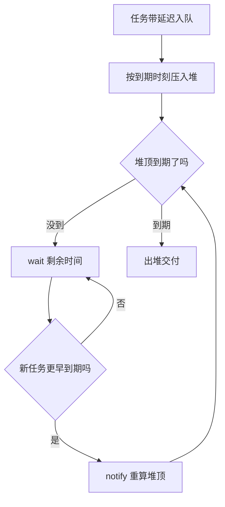

### Q2392 · 延迟队列的堆实现

> 难度:★★★★ | 标签:延迟队列, heapq, 定时器

**问**:要实现“10 秒后重试”“30 分钟后关单”这类延迟任务,标准库怎么做?

**答**:延迟队列就是一个按"到期时刻"排序的堆加一个会看表的消费者:堆顶永远是最近要醒的任务,没到点就 wait(剩余时间),到点出堆交付。

- 堆元素用 (到期绝对时刻, 序号, 负载),序号打破同刻并列,也让堆比较不碰负载类型;

- 消费者 peek 堆顶:未到期则 cond.wait(remain),睡到最近的到期点而不是轮询;

- 关键细节:put 一个更早到期的任务要 notify_all 重算,实测后投的 0.05s 任务顶掉了先投的 0.5s 任务,执行顺序按到期时刻而非投递顺序;

- 这是 DelayQueue 的标准库实现,也是时间轮之外的通用选择。

```python
# file: code/02_并发与网络工程/q2392_delay_queue_heap.py
# -*- coding: utf-8 -*-
"""延迟队列的堆实现: 到期时间在堆顶, 没到期就按最近到期点小睡。

- 堆按 (到期时刻, 序号) 排序, 堆顶永远是最近要醒的任务;
- 消费者 peek 堆顶: 没到期就 wait(剩余时间), 有新任务且更早则被推醒重算;
- 序号用来打破同刻并列, 保证同刻任务按入队顺序执行, 堆比较也不碰负载。
"""
import heapq
import threading
import time


class DelayQueue:
    def __init__(self):
        self._heap = []
        self._seq = 0
        self._cond = threading.Condition()
        self._closed = False

    def put(self, item, delay_s):
        with self._cond:
            heapq.heappush(self._heap,
                           (time.monotonic() + delay_s, self._seq, item))
            self._seq += 1
            self._cond.notify_all()          # 新任务可能比堆顶更早

    def take(self):
        """取一个到期任务, 关闭后返回 None。"""
        with self._cond:
            while True:
                if self._closed and not self._heap:
                    return None
                if self._heap:
                    remain = self._heap[0][0] - time.monotonic()
                    if remain <= 0:
                        return heapq.heappop(self._heap)[2]
                    self._cond.wait(timeout=remain)   # 睡到最近的到期点
                else:
                    self._cond.wait(timeout=0.1)

    def close(self):
        with self._cond:
            self._closed = True
            self._cond.notify_all()


def main():
    dq = DelayQueue()
    fired = []

    def consumer():
        while True:
            item = dq.take()
            if item is None:
                return
            fired.append((item, time.monotonic()))

    ct = threading.Thread(target=consumer, daemon=True)
    ct.start()
    t0 = time.monotonic()
    dq.put("慢件-0.5s", 0.5)
    dq.put("快件-0.1s", 0.1)
    dq.put("中件-0.3s", 0.3)
    dq.put("追件-0.05s", 0.05)               # 后发的最早到期, 要能顶到堆顶
    deadline = time.monotonic() + 1.5
    while len(fired) < 4 and time.monotonic() < deadline:
        time.sleep(0.01)
    dq.close()
    ct.join(timeout=1.0)

    order = [name for name, _ in fired]
    print("执行顺序:", order)
    for name, at in fired:
        print("  %s 在投递后 %.2fs 触发" % (name, at - t0))
    assert order == ["追件-0.05s", "快件-0.1s", "中件-0.3s", "慢件-0.5s"], \
        "执行顺序应按到期时刻, 而非投递顺序"


if __name__ == "__main__":
    main()
```

**追问**:1) wait(remain) 期间有新任务插入更早到期怎么办?——put 侧 notify_all 拉起消费者,重读堆顶剩余时间,实时性由通知保证。2) 大量同刻任务会惊群吗?——不会,到期后逐个出堆受同一把锁串行化,交付是平稳的。3) 「wait(remain) 睡到最近到期点」为什么优于轮询?——堆顶是最近到期任务,wait(remain) 精确睡到那个时刻,无轮询空转;更早任务插入时 put 侧 notify_all 拉起重算——「事件驱动+睡眠到点」是延迟队列的心脏,与 call_at 绝对时刻调度(Q2134)同思想。4) 堆元素 (到期时刻, 序号, 负载) 的设计细节?——序号打破同刻并列(先投先出)且让堆比较不碰负载(负载不可比也不炸);绝对时刻(单调度钟)锚定;取消延迟任务靠惰性标记(出堆时校验)或索引堆——「序列号+绝对时刻」是延迟队列的通用骨架。5) 生产陷阱?——轮询实现(空转);相对时刻锚定(入堆后任务耗时影响下一拍,Q1579 漂移);堆序依赖负载(负载不可比较时 TypeError);更早任务插入没 notify(消费者睡过头);大量同刻任务惊群(不会,出堆串行,见原问);取消未实现(延迟任务堆积)。



---
