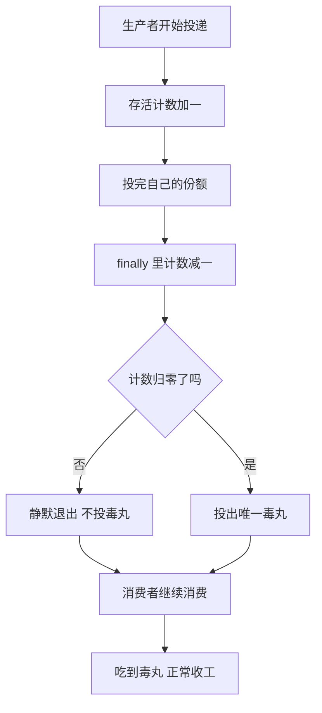

### Q2396 · 多生产者的关队协议:减计数到零

> 难度:★★★☆ | 标签:毒丸, 多生产者, 关队

**问**:三个生产者往同一个队列投毒丸,消费者怎么知道该吃几颗?

**答**:单生产者一颗毒丸即可,多生产者时毒丸数量成了隐式协议,数错就出事:消费者提前关门丢数据,或者多等几颗悬死。

- 标准解法:存活生产者计数,每个生产者退出时在锁内减一,减到零的那位投出唯一毒丸;

- 实测三生产者各五件:十五件数据全部到达,毒丸恰好一颗,消费者干净收工;

- 对照组实测每生产者各投一颗:消费者吃第一颗就关门,实测丢十件数据,教训直观;

- 减计数要放在 finally 里,生产者中途抛异常也要算退出,否则计数永远到不了零,又回到悬死。

```python
# file: code/02_并发与网络工程/q2396_multi_producer_close.py
# -*- coding: utf-8 -*-
"""多生产者的关队协议: 减计数到零, 最后一个人投毒丸。

- 单生产者投一个毒丸即可, 多生产者时消费者不知道要吃几颗;
- 数错颗数要么提前关门丢数据, 要么永远等下一颗;
- 标准解法: 每个生产者退出时给计数减一, 减到零的那位投唯一毒丸。
"""
import queue
import threading
import time

PILL = object()


def producer(q, pid, n_items, remaining, item_s=0.01):
    try:
        for i in range(n_items):
            q.put("p%d-%d" % (pid, i))
            time.sleep(item_s)
    finally:
        with remaining["lock"]:
            remaining["count"] -= 1
            last = remaining["count"] == 0
        if last:
            q.put(PILL)                      # 最后退场的生产者投唯一毒丸


def consumer(q, out):
    while True:
        item = q.get()
        if item is PILL:
            out.append("PILL")
            return
        out.append(item)


def main():
    q = queue.Queue(maxsize=8)
    out = []
    remaining = {"count": 3, "lock": threading.Lock()}
    ct = threading.Thread(target=consumer, args=(q, out))
    ct.start()
    producers = [threading.Thread(target=producer,
                                  args=(q, pid, 5, remaining))
                 for pid in range(3)]
    for t in producers:
        t.start()
    for t in producers:
        t.join()
    ct.join(timeout=3)
    assert not ct.is_alive(), "毒丸必须恰好一颗, 消费者要能收工"
    items = [x for x in out if x != "PILL"]
    print("共收到 %d 件数据 + %d 颗毒丸" %
          (len(items), out.count("PILL")))
    assert len(items) == 15, "三个生产者各 5 件, 一件不丢"
    assert out.count("PILL") == 1, "毒丸只能有一颗, 多了就是协议错误"

    # 对照: 每人各投一颗毒丸, 消费者吃第一颗就关门, 后面的数据全丢
    q2 = queue.Queue()
    out2 = []

    def bad_producer(pid, n_items):
        for i in range(n_items):
            q2.put("p%d-%d" % (pid, i))      # 一口气全倒进去
        q2.put(PILL)                         # 人手一颗, 谁先到谁引爆

    def bad_consumer():
        while True:
            item = q2.get()
            if item is PILL:
                out2.append("PILL")
                return
            out2.append(item)
            time.sleep(0.01)                 # 慢消费, 队列必然积压

    ct2 = threading.Thread(target=bad_consumer, daemon=True)
    ct2.start()
    bads = [threading.Thread(target=bad_producer, args=(pid, 5))
            for pid in range(3)]
    for t in bads:
        t.start()
    for t in bads:
        t.join()
    ct2.join(timeout=2)
    lost = 15 - len([x for x in out2 if x != "PILL"])
    print("对照组: 每人一颗毒丸, 收到 %d 件就提前关门, 丢失 %d 件" %
          (len([x for x in out2 if x != "PILL"]), lost))
    assert lost > 0, "每生产者各投一颗毒丸的协议必然提前关门丢数据"


if __name__ == "__main__":
    main()
```

**追问**:1) 不用毒丸能行吗?——可以,消费者轮询计数与队列双空判定,但轮询有延迟,毒丸版是事件驱动更干净。2) 生产者数量动态变化怎么办?——计数改为注册表,新生产者注册加一,退出减一,协议不变。3) 减计数协议的失败路径为什么必须 finally?——生产者中途抛异常也要算退出,否则计数永远不到零,消费者悬死——与 task_done 账目事故(Q1856)同构:「计数要在一切退出路径上准确」;finally 减计数+减到零者投毒丸(锁内)。4) 动态生产者数量的注册表变体?——计数升级为注册表(注册加一、退出减一),消费者只看计数归零——协议不变,容量弹性;注册表本身要锁;新生产者加入时机(消费者已收到毒丸后注册=空等,要拒绝注册)——「关队后的注册」是协议边角。5) 生产陷阱?——每生产者各投一颗毒丸(消费者吃第一颗就关门,实测丢十件);减计数不在 finally(异常路径悬死);消费者固定等 N 颗(数量写死,动态场景崩);毒丸不唯一(业务数据混入);注册表无锁(计数竞态)。



---
