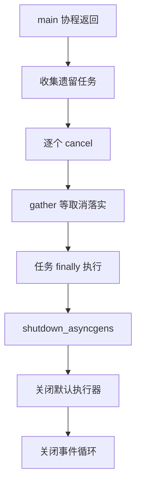

### Q2402 · asyncio.run 的收尾纪律

> 难度:★★★★ | 标签:asyncio.run, 任务清理, 取消

**问**:main 返回时还有没 await 的后台任务,asyncio.run 会怎么处理?

**答**:asyncio.run 不静默丢弃遗留任务:它逐个 cancel,用 gather(return_exceptions=True) 等取消落实,再走 shutdown_asyncgens 与执行器收尾,最后关循环。

- 实测:main 故意不等一个睡 5 秒的任务,run 返回后事件记录显示任务被取消、finally 执行;

- 任务里 finally 有机会跑,这是"收尾资源能释放"的关键约定,别在 finally 里写不可取消的阻塞;

- 想让后台任务活过 main,得显式交出去:返回 Future、注册表保存或 run_forever 常驻循环;

- 这个收尾序列值得背下来:cancel 遗留任务、等落实、关异步生成器、关执行器、关循环。

```python
# file: code/02_并发与网络工程/q2402_asyncio_run_cleanup.py
# -*- coding: utf-8 -*-
"""asyncio.run 的收尾纪律: 你忘了 await 的任务, 它替你取消。

- main 返回时还有没跑完的任务, asyncio.run 不静默丢弃;
- 它逐个 cancel, gather(return_exceptions=True) 等取消落实, 再关循环;
- 任务里的 finally 有机会执行, 这是收尾资源能释放的关键约定。
"""
import asyncio

events = []


async def orphan_worker():
    """被遗忘的后台任务: 睡 5 秒, 但 finally 必须有机会说话。"""
    try:
        events.append("worker 开跑")
        await asyncio.sleep(5.0)
        events.append("worker 自然完成")          # 永远到不了
    except asyncio.CancelledError:
        events.append("worker 被取消")
        raise
    finally:
        events.append("worker finally 清理")


async def main():
    task = asyncio.create_task(orphan_worker())
    events.append("main 故意不等它, 直接返回")
    await asyncio.sleep(0.05)
    assert not task.done()
    return "main-done"


def main_entry():
    result = asyncio.run(main())
    print("asyncio.run 返回:", result)
    for e in events:
        print("  事件:", e)
    assert "worker 被取消" in events, "遗留任务必须被 run 的收尾取消"
    assert "worker finally 清理" in events, "finally 必须被执行"
    assert "worker 自然完成" not in events, "取消的任务不应走到自然完成"
    print("结论: run 的收尾 = cancel 遗留任务 + 等落实 + 关循环")


if __name__ == "__main__":
    main_entry()
```

**追问**:1) 取消落实会不会等很久?——取决于任务对取消的响应,拒不退出的任务会拖住整个收尾,所以任务要在 await 点保持可取消。2) run 之外自己管理循环时要照抄这套吗?——要,或者直接换 asyncio.run,自己管理循环时收尾清单全靠自觉。3) asyncio.run 收尾序列的完整步骤与含义?——cancel 遗留任务→gather(return_exceptions=True) 等落实→shutdown_asyncgens(Q2404)→shutdown_default_executor(Q1859)→关循环——「五步收尾」每步对应一类资源;自管循环要照抄,漏一步就漏一类泄漏。4) 「任务在 await 点保持可取消」为什么是收尾的前提?——取消落实时长=任务对取消的响应速度;拒不退出的任务拖住整个收尾;任务在 finally 里做不可取消的阻塞(同步 IO/sleep)是收尾卡死的常见源——「可取消性」是协程的公共责任。5) 生产陷阱?——以为 run 会等后台任务跑完(是 cancel 不是等待);想让任务活过 main 却没显式交接(返回 Future/注册表/run_forever);finally 里同步阻塞(收尾卡死);取消的异常没人消费(never retrieved);自管循环漏 shutdown 步骤(资源悬到进程退出)。



---
